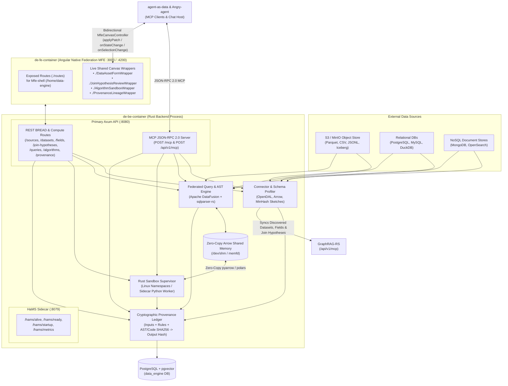

# Data-Engine (`data-engine`)

[](https://www.rust-lang.org)
[](https://angular.dev)
[](https://opensource.org/licenses/MIT)
[](https://github.com/PolecatWorks/data-engine/actions/workflows/de-be-docker-publish.yml)
[](https://github.com/PolecatWorks/data-engine/actions/workflows/de-fe-docker-publish.yml)

**Data-Engine** is the universal data ingestion, schema & statistical profiling, federated calculation (`Apache DataFusion` + `Apache Arrow`), Rust-supervised Python code sandbox, and cryptographic provenance platform for the PolecatWorks AI ecosystem. It pairs a high-performance Rust backend (`de-be-container`) with an interactive Native Federation Angular Micro-Frontend (`de-fe-container`) designed to run both standalone, inside [`Mfe-shell`](https://github.com/PolecatWorks/Mfe-shell), and as a live bidirectional co-editing canvas inside [`Angry-agent`](https://github.com/PolecatWorks/Angry-agent).

---

## Table of Contents

- [Architecture Overview](#architecture-overview)
- [Repository Structure](#repository-structure)
- [Ecosystem Integration](#ecosystem-integration)
- [API & MCP Reference](#api--mcp-reference)
  - [Primary Data-Engine REST & MCP API (`:8080`)](#primary-data-engine-rest--mcp-api-8080)
  - [Health Monitoring Sidecar (HaMS) API (`:8079`)](#health-monitoring-sidecar-hams-api-8079)
  - [Federated MFE Remotes (`:3003` / `:4200`)](#federated-mfe-remotes-3003--4200)
- [Quickstart & Local Setup](#quickstart--local-setup)
- [Make Command Reference](#make-command-reference)
- [Configuration](#configuration)
- [Testing](#testing)
- [Documentation & Guidelines](#documentation--guidelines)

---

## Architecture Overview

`data-engine` consists of two primary containers that bridge physical data sources (S3/Parquet, Relational DBs, NoSQL), semantic knowledge graphs (`Graphrag`), declarative agent orchestration (`agent-as-data`), and human-in-the-loop visual workspaces (`Mfe-shell` & `Angry-agent`):

1. **Rust Data & Compute Backend (`de-be-container`)**:
   - **Primary Axum API & MCP Server (`:8080`)**: Connects to S3/MinIO (Parquet, CSV, JSONL, Arrow, Iceberg), relational databases (PostgreSQL, MySQL, DuckDB), and NoSQL document stores (MongoDB, OpenSearch); profiles schemas and value distributions; probes join hypotheses; executes federated SQL/DataFrame queries via **Apache DataFusion**; supervises isolated **Python sandbox executions** over zero-copy Apache Arrow shared memory (`/dev/shm`); and records W3C PROV / OpenLineage provenance DAGs.
   - **Health Monitoring Sidecar (`:8079`)**: Powered by [`hams`](https://github.com/PolecatWorks/hams), serving Kubernetes liveness/readiness/startup probes, Prometheus metrics (`tokio-metrics` + `axum-prometheus`), and graceful shutdown coordination.
2. **Interactive Data & Steward MFE (`de-fe-container`)**:
   - Built with **Angular** and **`@angular-architects/native-federation`** sharing `@polecatworks/mfe-shared`.
   - Exposes both full application routes (`./routes`) for `Mfe-shell` and individual **Live Shared Canvas MFE Wrappers** (`./DataAssetFormWrapper`, `./JoinHypothesisReviewWrapper`, `./AlgorithmSandboxWrapper`, `./ProvenanceLineageWrapper`) that mount on the right-hand side of `Angry-agent`'s chat interface for real-time human + AI co-editing.



---

## Repository Structure

```text
├── de-be-container/            # Rust backend microservice (Axum, DataFusion, Arrow, SQLx, HaMS, rmcp)
│   ├── src/                    # Modular domain sources (cli, config, db, connectors, profiler, compute, sandbox, provenance, mcp)
│   ├── migrations/             # Paired reversible SQLx migrations (*.up.sql & *.down.sql)
│   ├── config.yaml             # Default local backend configuration
│   ├── Cargo.toml              # Rust dependencies and workspace metadata
│   └── Dockerfile              # Multi-stage cargo-chef + sandbox Python venv build
├── de-fe-container/            # Angular Native Federation MFE & Shared Canvas forms
│   ├── src/                    # Standalone components, MfeCanvasController wrappers, services
│   ├── federation.config.js    # Exposes ./routes and live RHS canvas wrappers
│   ├── nginx.conf              # Production container Nginx config with CORS for remoteEntry.json
│   └── Dockerfile              # Multi-stage Node build + Nginx runtime image
├── spec/                       # Governance, PRDs, TDD Specs, and Research notes
│   ├── prds/                   # Product Requirements Documents (Source of Truth)
│   ├── specs/                  # Test-Driven Development (TDD) implementation specs
│   └── research/               # Exploratory research and architectural trade-off notes
├── integration-tests/          # Robot Framework + Ragas/Provenance E2E test suites
├── docker-compose/             # Local PostgreSQL (pgvector) & MinIO test stack
├── charts/data-engine/         # Kubernetes Helm deployment chart (Backend + MFE Frontend)
├── fluxcd-dev/                 # FluxCD HelmRelease & Istio VirtualService manifests
├── garden.yml                  # Garden configuration for local & ephemeral PR Kubernetes testing
├── .github/workflows/          # Path-filtered CI, multi-arch GHCR publish, Helm OCI & K8s integration tests
├── Makefile                    # Standardized developer workflow targets
└── AGENTS.md                   # Mandatory workflow, configuration, and TDD rules
```

---

## Ecosystem Integration

| Partner Repository | How `data-engine` Integrates |
| :--- | :--- |
| **[`Graphrag`](https://github.com/PolecatWorks/Graphrag)** | `data-engine` introspects physical datasets (S3 Parquet, SQL, NoSQL), computes column profiles and MinHash value-overlap sketches, empirically tests candidate joins in DataFusion, and pushes discovered `Dataset` (Layer 1) and `Field` (Layer 0) nodes plus `JOINABLE_WITH` edges into `Graphrag` for human-in-the-loop verification. |
| **[`agent-as-data`](https://github.com/PolecatWorks/agent-as-data)** | Registers `data-engine`'s MCP endpoint (`POST /api/v1/mcp`) in its Tools Registry so declarative Agents and Skills can profile data, validate SQL plans, execute sandboxed Python algorithms, and promote verified algorithms into reusable governed Skills. |
| **[`Angry-agent`](https://github.com/PolecatWorks/Angry-agent)** | Mounts `de-fe-container`'s MFE form wrappers (`./DataAssetFormWrapper`, `./JoinHypothesisReviewWrapper`, `./AlgorithmSandboxWrapper`, `./ProvenanceLineageWrapper`) on the RHS of the chat interface using the bidirectional `MfeCanvasController` (`applyPatch`, `onStateChange`, `onSelectionChange`). |
| **[`Mfe-shell`](https://github.com/PolecatWorks/Mfe-shell)** | Loads `de-fe-container` (`http://localhost:3003/remoteEntry.json` or `/mfe/data-engine`) as a federated portal module at `/home/data-engine` and shares singleton state via `@polecatworks/mfe-shared`. |

---

## API & MCP Reference

### Primary Data-Engine REST & MCP API (`:8080`)

| Resource / Endpoint | Methods | Description |
| :--- | :--- | :--- |
| `/hello` | `GET` | Basic connectivity sanity check returning `200 OK` (`"Hello, World!"`). |
| `/api/v1/sources` | `GET`, `POST`, `PUT`, `DELETE` | BREAD management for external data source connections (S3/MinIO, PostgreSQL, DuckDB, MongoDB, Local files). |
| `/api/v1/datasets` | `GET`, `POST`, `PUT`, `DELETE` | BREAD management & automated schema introspection (`POST /api/v1/datasets/:id/profile`) for tables, files, and collections. |
| `/api/v1/fields` | `GET`, `PUT` | Inspect and curate field-level metadata, statistical profiles, units, sensitivity tags, and human stewardship status. |
| `/api/v1/join-hypotheses` | `GET`, `POST`, `PUT`, `DELETE` | Discover, empirically probe (`POST /api/v1/join-hypotheses/probe`), and human-verify (`verified` / `rejected`) join relationships and grain rules. |
| `/api/v1/queries/validate` & `/execute` | `POST` | Validate SQL AST & join grain via `sqlparser-rs` + `DataFusion` (`LogicalPlan`) and execute federated queries with automatic provenance capture. |
| `/api/v1/algorithms` | `GET`, `POST`, `PUT`, `DELETE` | BREAD management, dry-run validation (`/validate`), and sandboxed Python execution (`/execute`) over zero-copy Arrow buffers. |
| `/api/v1/provenance` | `GET` | Retrieve immutable W3C PROV / OpenLineage execution records, column-level lineage, and renderable Mermaid DAGs (`/api/v1/provenance/:id/mermaid`). |
| `/mcp` & `/api/v1/mcp` | `POST` | Stateless HTTP JSON-RPC 2.0 Model Context Protocol (MCP) server exposing 25+ tools for AI agents. |

### Health Monitoring Sidecar (HaMS) API (`:8079`)

| Method | Path | Description |
| :--- | :--- | :--- |
| `GET` | `/hams/alive` | Liveness probe (`200 OK` when process is healthy). |
| `GET` | `/hams/ready` | Readiness probe (`200 OK` after PostgreSQL + `pgvector`, DataFusion context, and Sandbox supervisor initialization). |
| `GET` | `/hams/startup` | Startup probe endpoint. |
| `GET` | `/hams/version` | Returns service and HaMS version metadata in JSON. |
| `GET` | `/hams/metrics` | Exposes Prometheus metrics (`app_info`, `tokio-metrics`, HTTP latency, sandbox execution counters). |
| `GET` | `/hams/shutdown` | Triggers graceful shutdown via `CancellationToken`. |

### Federated MFE Remotes (`:3003` / `:4200`)

Exposed in `de-fe-container/federation.config.js`:
- `./routes`: Standalone Angular routes for mounting inside `Mfe-shell` (`/home/data-engine`).
- `./DataAssetFormWrapper`: Bidirectional form MFE for curating dataset grain, field descriptions, units, and business glossary links alongside the chat assistant.
- `./JoinHypothesisReviewWrapper`: Interactive human-in-the-loop review card displaying statistical overlap proofs, cardinality (`1:1`, `1:N`), sample matched/orphan rows, and `[Verify]` / `[Edit]` / `[Reject]` controls.
- `./AlgorithmSandboxWrapper`: Interactive SQL & Python code editor with dry-run schema preview and resource telemetry.
- `./ProvenanceLineageWrapper`: Interactive DAG & audit trail viewer showing exact datasets, semantic rules, and code hashes behind any calculation.

---

## Quickstart & Local Setup

### 1. Start Local Backing Services & Run Migrations
```bash
make db-up
make migrate
```

### 2. Run the Rust Backend (`:8080` API/MCP & `:8079` HaMS)
```bash
make dev
# Or with hot-reloading watch mode:
make de-be-watch
```

### 3. Run the Angular MFE Frontend (`:3003` / `:4200`)
```bash
make de-fe-dev
```

### 4. Run Tests
```bash
# Rust Backend Unit Tests
make test

# Angular Frontend Unit Tests (Vitest)
make test-fe

# End-to-End Robot Framework Integration Tests
make test-robot
```

---

## Make Command Reference

| Target | Description |
| :--- | :--- |
| `make help` | Display all available Make targets |
| `make dev` / `make de-be-dev` | Run Rust backend dev server with port cleanup (`8080` / `8079`) |
| `make de-be-watch` | Run Rust backend with `cargo watch` hot-reloading and `DEBUG` logging |
| `make de-fe-dev` | Run Angular MFE frontend dev server with HMR |
| `make migrate` | Create `data_engine` database and apply pending `.up.sql` migrations |
| `make db-up` / `make db-down` | Start or stop local PostgreSQL (`pgvector`) container |
| `make test` | Run Rust backend unit tests (`cargo test -- --test-threads=1`) |
| `make test-fe` | Run Angular frontend unit tests (`ng test --watch=false`) |
| `make test-robot` | Run Robot Framework E2E integration tests (`./integration-tests/run-tests-local.sh`) |
| `make build-be` / `make build-fe` | Build production Docker images for backend and MFE frontend |
| `make helm-lint` | Lint the `charts/data-engine` Kubernetes Helm chart |
| `make garden-up` | Deploy full stack to local Kubernetes namespace via Garden |
| `make garden-test` | Execute ephemeral in-cluster Robot Framework integration suite via Garden |

---

## Configuration

Backend configuration is managed centrally in `de-be-container/src/config.rs` via `figment` and validated fail-fast at startup:
- **CLI Flag (`clap` Derive)**: Pass `-c <PATH>` or `--config <PATH>` (`src/cli.rs`).
- **YAML Configuration**: Defaults for local development live in `de-be-container/config.yaml`.
- **Environment Variable Overrides**: Any property in `AppConfig` can be overridden with the `DE_BE__` prefix and `__` nesting (e.g., `DE_BE__DATABASE__URL`, `DE_BE__SERVER_PORT`, `DE_BE__SANDBOX__TIMEOUT_SECONDS`, `DE_BE__GRAPHRAG__MCP_URL`).

---

## Documentation & Guidelines

- **Product Requirements (PRDs)**: See [spec/prds/README.md](./spec/prds/README.md) for the complete architectural and product specifications.
- **Technical Specifications (Specs)**: See [spec/specs/README.md](./spec/specs/README.md) for TDD build specifications.
- **Research Notes**: See [spec/research/README.md](./spec/research/README.md) for background evaluations and architecture explorations.
- **Agent & Developer Rules**: See [AGENTS.md](./AGENTS.md) for mandatory TDD workflow, configuration, and typed error handling standards.
