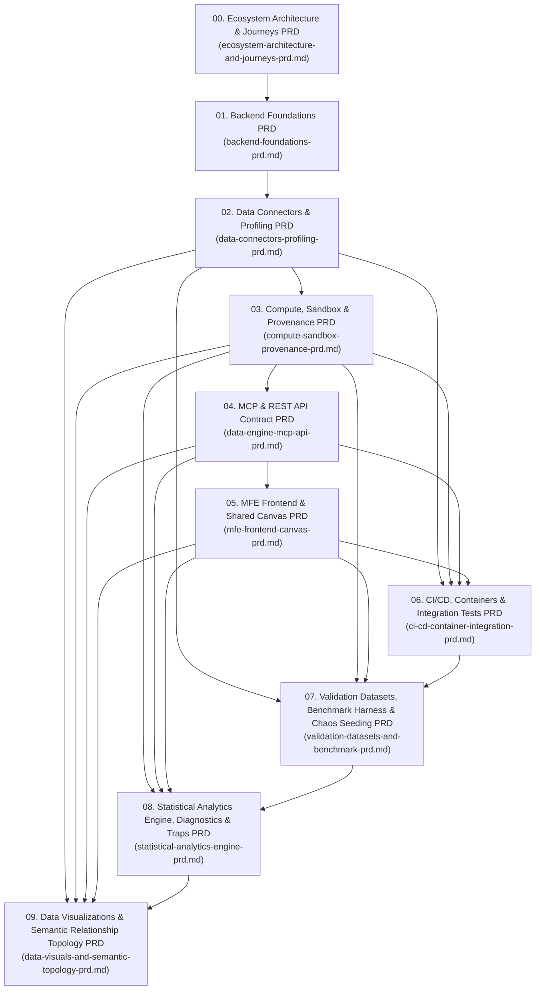

# Data Engine PRDs Index

This directory contains the modular Product Requirements Documents (PRDs) defining the **Data Engine (`data-engine`)** architecture, capabilities, and cross-repository integration contracts.

---

## Architecture & Module Map

---

## Modular PRDs

| PRD Document | Scope & Responsibilities |
| :--- | :--- |
| **[00. Ecosystem Architecture & End-to-End Journeys](./ecosystem-architecture-and-journeys-prd.md)** | Master cross-repository architecture connecting `data-engine`, `Graphrag`, `agent-as-data`, `Angry-agent`, and `Mfe-shell` across Autonomous Semantic Discovery, HITL Stewardship, Provenance Analytics, and Interactive Visual Exploration. |
| **[01. Backend Foundations & Configuration](./backend-foundations-prd.md)** | Rust workspace structure (`de-be-container`), `clap` derive CLI (`serve`, `migrate`, `profile`, `seed-validation-suite`), fail-fast `AppConfig` (`DE_BE__` prefix, configurable `service.api_prefix`), `thiserror` domain error enums, HAMS health/metrics (`:8079`), and PostgreSQL reversible migrations. |
| **[02. Data Connectors, Ingestion & Statistical Profiling](./data-connectors-profiling-prd.md)** | Pluggable `DataSourceConnector` traits for S3/MinIO (Parquet, CSV, JSONL, Iceberg), PostgreSQL, and NoSQL; Apache Arrow schema extraction; statistical profiling (nulls, cardinality, quantiles); and MinHash / HyperLogLog sketches for automated join-key discovery. |
| **[03. Federated Compute, Code Sandbox & Provenance Engine](./compute-sandbox-provenance-prd.md)** | `Apache DataFusion` federated SQL execution, `sqlparser-rs` AST validation & pre-execution join cardinality/fan-out checks, isolated Python code sandbox (`bwrap`/nsjail + zero-copy Arrow IPC over `/dev/shm`), and W3C PROV / OpenLineage cryptographic provenance (`ProvenanceRun`). |
| **[04. MCP Server & REST API Contract](./data-engine-mcp-api-prd.md)** | REST API (`/api/data-engine/v1/...` & `/api/v1/...`), SSE streaming endpoints, and Model Context Protocol (`/mcp/sse`) tools consumed by `agent-as-data`, `Graphrag`, and `Angry-agent`. |
| **[05. MFE Frontend & Live Shared Canvas](./mfe-frontend-canvas-prd.md)** | Angular 21 + `@angular-architects/native-federation` remote (`de-fe-container` served under `/mfe/data-engine`), standalone workbench views, and embeddable RHS Shared Canvas wrappers implementing `MfeCanvasController` (`applyPatch`, `getState`, `getSchema`, `onStateChange`, `onSelectionChange`). |
| **[06. CI/CD, Containerization & Integration Testing](./ci-cd-container-integration-prd.md)** | Multi-stage Dockerfiles (`de-be-container` with in-build unit tests, `de-fe-container`), per-component multi-arch GHCR workflows (`de-be-docker-publish.yml`, `de-fe-docker-publish.yml`), SemVer release workflows (`*-release.yml`), Helm OCI pipelines (`helm-ci-*.yaml`) with zero-rewrite Istio `VirtualService`, Garden ephemeral K8s Robot Framework integration tests (`integration-test.yaml`), and `gh-pages` sparse-checkout report/docs publishing modeled after `sward-warden`. |
| **[07. Validation Datasets, Benchmark Harness & Chaos Seeding](./validation-datasets-and-benchmark-prd.md)** | Curated external datasets (**BIRD-SQL**, **Valentine**, **Olist E-Commerce**, **NYC TLC**, **TPC-H via `tpchgen-rs`**), the built-in 3-wave **Enterprise Chaos & Drift Seeder (`de-be seed-validation-suite`)**, 5 canonical semantic traps (`TRAP-01`..`TRAP-05`), and the quantitative ablation evaluation matrix. |
| **[08. Statistical Analytics Engine, Diagnostics & Statistical Traps](./statistical-analytics-engine-prd.md)** | Pinned scientific Python venv (`numpy`, `scipy`, `statsmodels`, `pyarrow`) behind `SandboxExecutor`, zero-copy Arrow IPC `/dev/shm` staging with fail-fast row limits & opt-in seeded sampling, typed `stat_*` MCP tools & REST analytics endpoints, universal `StatisticalResultEnvelope` with assumption checks & diagnostic plot specs, `./StatisticalDiagnosticsWrapper` canvas view, persistent field statistical traits, and `STAT-TRAP-01`..`STAT-TRAP-04` benchmarks. |
| **[09. Data Visualizations & Semantic Relationship Topology](./data-visuals-and-semantic-topology-prd.md)** | Declarative **Vega-Lite / Apache ECharts** interactive data visuals (`./DataVisualExplorerWrapper`, schema-driven chart recommendations, bounded DataFusion aggregation, cross-filtering, saved visuals BREAD) and **Cytoscape.js + ELK** 3-layer semantic/structural relationship visuals (`./SemanticTopologyWrapper`: Business Concepts/Metrics $\rightarrow$ Datasets $\rightarrow$ Fields, ER/join cardinalities, `FORBIDDEN_JOIN` red edges, drift & confounder overlays, and zoomed-in Field-to-Field Join & Structural Anatomy). |

---

## Research Index
- [spec/research/README.md](../research/README.md)
  - [Autonomous Semantic Layer, Sandboxed Compute & Shared Canvas MFE Research](../research/autonomous-semantic-layer-and-sandbox-research.md)
  - [Validation Datasets, Benchmarks & Chaos Testing Research](../research/validation-datasets-and-benchmark-strategy.md)
  - [Statistical Analytics Thinking, Compute Toolbelt & Diagnostic Visualization Research](../research/statistical-analytics-skills-and-compute-research.md)

## Build Specifications Index
- [spec/specs/README.md](../specs/README.md)
