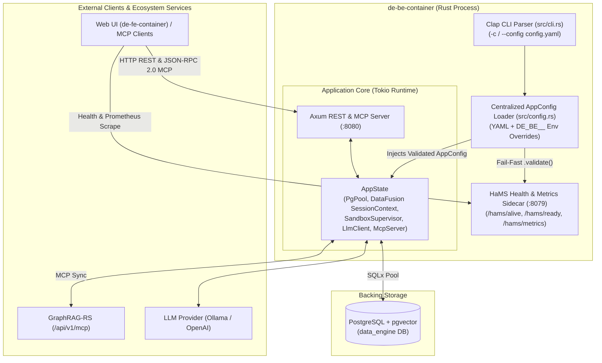
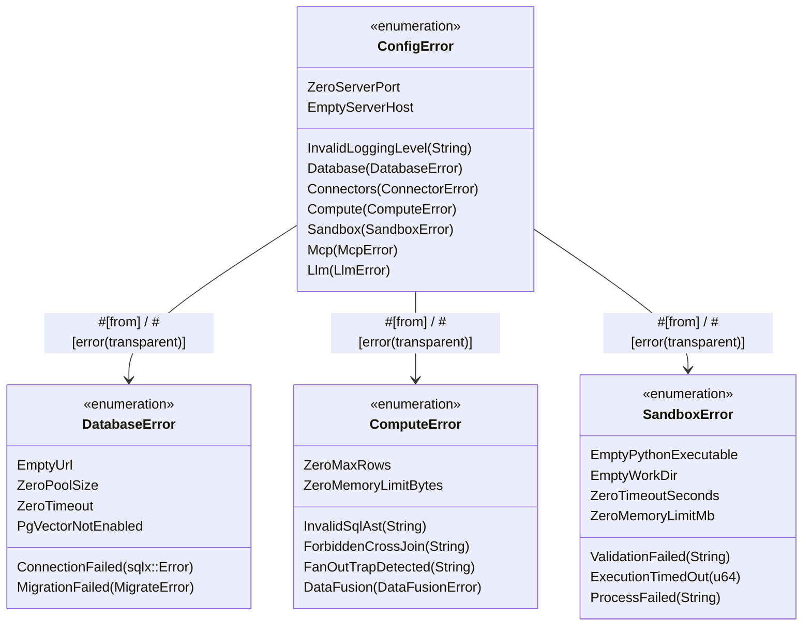
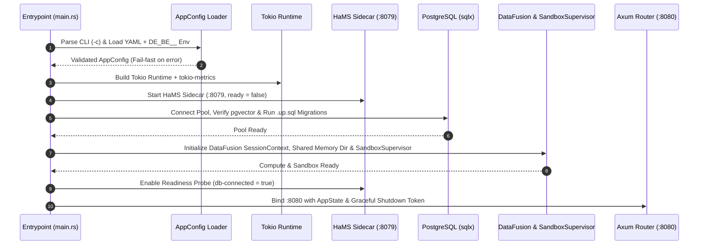

# Backend Foundations Product Requirements Document (PRD)

## Overview
This PRD defines the foundational Rust microservice architecture, configuration loading, typed error hierarchy, async runtime management, database migration standards, and Health Monitoring Sidecar (HaMS) integration for the **Data-Engine Backend (`de-be-container`)**, maintaining full architectural parity with `Graphrag` and `agent-as-data`.

---

## System Architecture

---

## Core Components & Requirements

### 0. Developer Tooling (`Makefile`)
**Objective:** Provide uniform developer ergonomics across local, container, and Kubernetes workflows.
- Root-level `Makefile` targets:
  - `make dev` / `make de-be-dev`: Frees ports `8080` and `8079` and runs `cargo run --manifest-path de-be-container/Cargo.toml -- -c de-be-container/config.yaml`.
  - `make watch` / `make de-be-watch`: Runs `cargo watch` with `DE_BE__LOGGING__LEVEL=debug` for live backend hot-reloading.
  - `make de-fe-dev`: Runs the Angular MFE frontend (`de-fe-container`) with Native Federation HMR on port `3003` / `4200`.
  - `make migrate`: Creates the `data_engine` database and applies pending `.up.sql` migrations.
  - `make test`: Runs Rust backend unit tests (`cargo test --manifest-path de-be-container/Cargo.toml -- --test-threads=1`).
  - `make test-fe`: Runs Angular MFE frontend unit tests (`npm --prefix de-fe-container test -- --watch=false`).
  - `make test-robot`: Executes Robot Framework E2E integration tests via `./integration-tests/run-tests-local.sh`.

---

### 1. Configuration Loading & Typed Error Hierarchy (`thiserror`)
**Objective:** Guarantee that `de-be-container` starts only with valid, complete configuration and uses strongly typed, inspectable error enums across all modules.
- **CLI Argument Parsing (`clap` Derive)**: Defined in `de-be-container/src/cli.rs` using `#[derive(clap::Parser)]` supporting `-c` / `--config <FILE>`.
- **Centralized Loader (`figment`)**: `AppConfig` (`de-be-container/src/config.rs`) loads configuration from the YAML file passed via `-c` and merges environment variable overrides prefixed with `DE_BE__` (using `__` for nested structs).
- **Configurable Service API Prefix (`service.api_prefix`)**:
  - `ServiceConfig` defines `api_prefix: String` (defaulting in configuration files to `"/api/data-engine/v1"`, overridable via `DE_BE__SERVICE__API_PREFIX`).
  - `ServiceConfig::validate()` enforces that `api_prefix` is non-empty, starts with `'/'`, has length `> 1`, and does not end with `'/'`, returning `ServiceConfigError::InvalidApiPrefix` on violation so Kubernetes Istio `VirtualService` path routing works cleanly with zero URI path rewrites.
- **Modular Config Ownership & Delegated Validation**:
  - `service` (`src/config.rs`): `ServiceConfig` (`name`, `version`, `host`, `port`, `log_level`, `api_prefix`) + `ServiceConfigError` (`EmptyName`, `EmptyVersion`, `EmptyHost`, `InvalidPort`, `EmptyLogLevel`, `InvalidApiPrefix`)
  - `db` (`src/db.rs`): `DatabaseConfig` + `DatabaseError`
  - `connectors` (`src/connectors/mod.rs`): `ConnectorsConfig` + `ConnectorError`
  - `profiler` (`src/profiler/mod.rs`): `ProfilerConfig` + `ProfilerError`
  - `compute` (`src/compute/mod.rs`): `ComputeConfig` + `ComputeError`
  - `sandbox` (`src/sandbox/mod.rs`): `SandboxConfig` + `SandboxError`
  - `provenance` (`src/provenance/mod.rs`): `ProvenanceConfig` + `ProvenanceError`
  - `mcp` (`src/mcp/mod.rs`): `McpConfig` + `McpError`
  - `llm_tools` (`src/llm_tools.rs`): `LlmConfig` + `LlmError`
  - `hams_tools` (`src/hams_tools.rs`): `HamsConfig` + `HamsError`
  - `logging` (`src/config.rs`): `LoggingConfig` (`level`, `filter`)
- **Zero `Result<_, String>` & Zero Runtime `std::env::var`**: Strictly enforced per [AGENTS.md](../../AGENTS.md).
- **CrashLoop Fail Debug Delay (`debugging.fail_debug_delay`)**: Configurable duration (default `"0s"`) to pause before exiting on startup validation or initialization failures so operators can inspect pods in Kubernetes before restart.

---

### 2. Configurable Tokio Runtime & Telemetry (`tokio-metrics`)
- **Configurable Runtime (`RuntimeConfig`)**:
  - `threads`: `0` selects `new_current_thread()`; `> 0` selects `new_multi_thread()` with `worker_threads(threads)`.
  - `stack_size`: Worker thread stack size in bytes.
  - `name`: Worker thread name prefix (e.g., `"de-be-worker"`).
  - `metrics_interval`: Sampling interval for `tokio-metrics`.
- **Baseline Startup Prometheus Telemetry**:
  - Registers `app_info{name="data-engine", version="..."} = 1.0`, HTTP counters, DataFusion query counters, and sandbox execution histograms immediately upon startup so `/hams/metrics` returns valid, non-empty Prometheus exposition data before any traffic arrives.

---

### 3. Database & Storage Layer (`sqlx` + `pgvector`)
- **Connection Pool**: Managed via `sqlx::postgres::PgPoolOptions` using `DatabaseConfig` (`url`, `pool_size`, `timeout_seconds`).
- **Extension Verification**: Verifies `SELECT extname FROM pg_extension WHERE extname = 'vector'` on startup, failing fast with `DatabaseError::PgVectorNotEnabled` if absent.
- **Paired Reversible Migrations**: All schema migrations in `de-be-container/migrations/` MUST include paired `.up.sql` and `.down.sql` scripts, executed automatically on startup via `sqlx::migrate!("./migrations")`.

---

### 4. Health Monitoring Sidecar (`HaMS` on `:8079`) & Pod-Direct Telemetry
- **Out-of-Band Listener (`:8079`)**: Starts immediately after `AppConfig::validate()` with readiness disabled (`ready_signal` false).
- **Readiness Gate**: Enabled only after PostgreSQL (`pgvector`), migrations, the Apache DataFusion `SessionContext`, the `SandboxSupervisor`, and `LlmClient` are initialized.
- **Graceful Shutdown**: Hooks HaMS `/hams/shutdown` and OS signals (`SIGINT`, `SIGTERM`) to a `tokio_util::sync::CancellationToken` that drains the primary Axum server (`:8080`) before stopping HaMS and closing database pools.
- **Pod-Direct Telemetry Resolution**: In Kubernetes integration tests (`./integration-tests/run-tests.sh`), the test runner resolves the `data-engine-be` Pod IP directly (`kubectl get pods -l app=data-engine-be`) to query `http://<pod_ip>:8079/hams/metrics` and `/hams/ready` without Service VIP round-robin ambiguity.

---

## Application Startup Lifecycle

