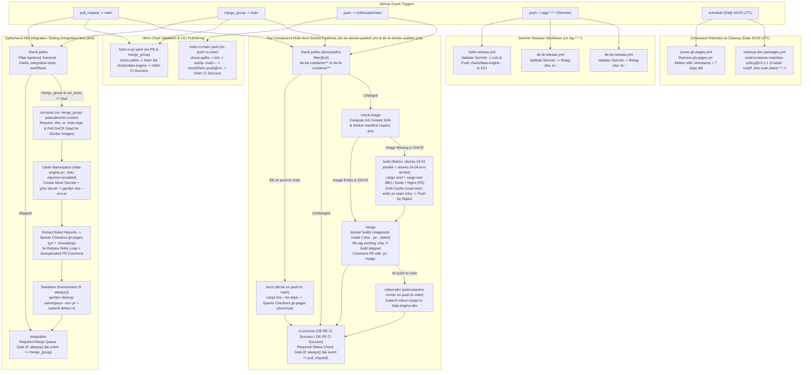
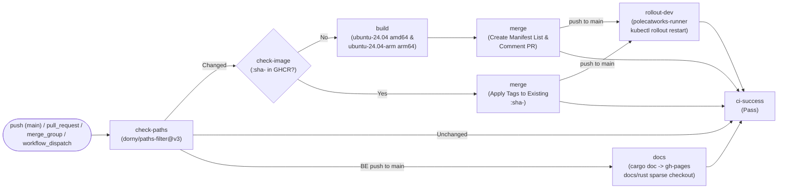
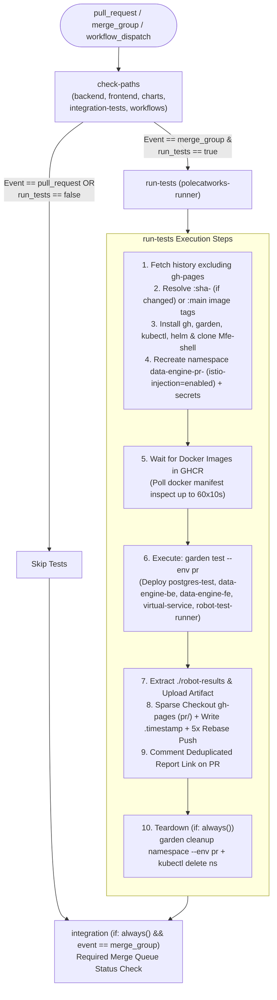

# GitHub CI, Multi-Arch Docker Publish, Release & Ephemeral Integration Testing PRD

## Overview
This PRD defines the requirements and architecture for **Continuous Integration (CI)**, **Per-Component Multi-Architecture Container Publishing (`de-be-docker-publish.yml` & `de-fe-docker-publish.yml`)**, **SemVer Release Tagging (`de-be-release.yml`, `de-fe-release.yml`, `helm-release.yml`)**, **Helm Chart OCI Packaging (`helm-ci-pr.yaml` & `helm-ci-main.yaml`)**, **Istio Service Mesh Routing (`fluxcd-dev` & `garden.yml`)**, **Ephemeral Kubernetes Integration Testing (`integration-test.yaml`)**, and **Automated Artifact & Report Retention (`cleanup-dev-packages.yml` & `prune-gh-pages.yml`)** in **Data-Engine (`data-engine`)**, modeled directly after [`PolecatWorks/sward-warden`](https://github.com/PolecatWorks/sward-warden).

---

## End-to-End CI/CD, Release & Integration Pipeline Architecture

---

## Core Components & Workflow Specifications

### 1. Container Builds (`de-be-container/Dockerfile` & `de-fe-container/Dockerfile`)

#### A. Backend Container (`de-be-container/Dockerfile`)
- **Multi-Stage `cargo-chef` Builder (`lukemathwalker/cargo-chef:latest-rust-1-bookworm`)**:
  - `chef`: Installs build dependencies (`pkg-config`, `cmake`, `clang`, `libssl-dev`) and sets `WORKDIR /app`.
  - `planner`: Copies sources and runs `cargo chef prepare --recipe-path recipe.json`.
  - `buildcache`: Copies `recipe.json` from `planner`.
  - `dev`: Installs `cargo-watch`, runs `cargo chef cook --recipe-path recipe.json`, exposes `VOLUME /app/target`, and holds container open (`CMD ["sleep", "infinity"]`).
  - `buildcacherelease`: Runs `cargo chef cook --release --recipe-path recipe.json` to cache compiled release dependencies.
  - `build`: Copies source tree, executes **`RUN cargo test -- --test-threads=1`** to enforce unit test verification inside the container build, and compiles the release binary via `RUN cargo build --release`.
- **Runtime Image (`debian:bookworm-slim`)**:
  - Installs minimal runtime libraries (`libssl3`, `ca-certificates`, `bubblewrap`) plus an isolated Python 3 virtualenv (`/opt/sandbox-venv` with `pyarrow` and `polars`) for zero-copy Arrow sandbox execution.
  - Copies the compiled binary (`/usr/local/bin/de-be-container`) and default configuration/migrations.
  - Executes **`RUN /usr/local/bin/de-be-container --help`** at build time to verify dynamic library linkage and binary execution on the target architecture (`amd64` / `arm64`).
  - Exposes ports `8080` (Axum REST & MCP) and `8079` (HaMS health & Prometheus metrics), with `ENTRYPOINT ["/usr/local/bin/de-be-container"]` and `CMD ["serve"]`.

#### B. Frontend MFE Container (`de-fe-container/Dockerfile`)
- **Builder Stage (`node:22-alpine`)**:
  - Installs native build tools (`apk add --no-cache python3 make g++`).
  - Mounts `NODE_AUTH_TOKEN` via BuildKit secret (`--mount=type=secret,id=NODE_AUTH_TOKEN,env=NODE_AUTH_TOKEN`) to run `npm install --no-audit --no-fund`.
  - Installs architecture-specific Rollup musl bindings (`@rollup/rollup-linux-x64-musl` on `x86_64` or `@rollup/rollup-linux-arm64-musl` on `aarch64`) to avoid npm optional dependency bugs across multi-arch builds.
  - Copies source files and runs `npm run build` to compile the Angular Native Federation bundle (`remoteEntry.json`, ES module chunks, and shared mappings).
- **Runtime Stage (`nginx:alpine`)**:
  - Sets OCI image labels (`org.opencontainers.image.title`, `description`, `source`).
  - Copies `/app/dist/de-fe-container/browser` to `/usr/share/nginx/html` and `nginx.conf` to `/etc/nginx/conf.d/default.conf`.
  - Serves compiled static assets on port `8080` with health endpoints (`/alive`, `/ready`), SPA fallback routing (`try_files $uri $uri/ /index.html`), and CORS headers on federated assets.

---

### 2. Per-Component Multi-Arch Docker & Docs Workflows (`de-be-docker-publish.yml` & `de-fe-docker-publish.yml`)

Following the [`PolecatWorks/sward-warden`](https://github.com/PolecatWorks/sward-warden) pattern, container builds, unit tests, documentation publishing, and dev rollouts are managed by two dedicated component workflows (`de-be-docker-publish.yml` and `de-fe-docker-publish.yml`) rather than a separate `ci.yml` or `skip-merge-queue.yml`:

1. **Triggers & Concurrency**:
   - Triggered on `push` (`branches: ["main"]`), `pull_request` (`branches: ["main"]`), `merge_group` (`branches: ["main"]`), and `workflow_dispatch`.
   - Concurrency group `${{ github.workflow }}-${{ github.ref }}` with `cancel-in-progress: true`.
2. **`check-paths`**:
   - Uses `dorny/paths-filter@v3` with `ref: ${{ github.event.merge_group.base_ref || github.ref }}` to detect changes in `de-be-container/**` + `.github/workflows/de-be-docker-publish.yml` (or `de-fe-container/**` + `.github/workflows/de-fe-docker-publish.yml`).
3. **`check-image`**:
   - Computes the deterministic Git content SHA of the component directory and workflow file:
     - `BACKEND_SHA=$(git log -1 --format=%H -- de-be-container/ .github/workflows/de-be-docker-publish.yml)`
     - `FE_SHA=$(git log -1 --format=%H -- de-fe-container/ .github/workflows/de-fe-docker-publish.yml)`
   - Inspects GHCR via `docker manifest inspect ghcr.io/polecatworks/data-engine-(be|fe):sha-${CONTENT_SHA}` and outputs `exists=true|false`.
4. **`build` (Multi-Arch Native Matrix)**:
   - Runs when `check-paths` is `true` and `check-image.outputs.exists != 'true'`.
   - Uses native GitHub runners (`ubuntu-24.04` for `linux/amd64` and `ubuntu-24.04-arm` for `linux/arm64`) with `fail-fast: false`.
   - Uses `docker/build-push-action@v7` pushing per-platform images by digest (`outputs: type=image,name=...,push-by-digest=true,name-canonical=true,push=true,oci-mediatypes=true`).
   - **Cache Policy**: Always reads BuildKit cache from `main` (`cache-from: type=gha,scope=${{ github.repository }}-de-(be|fe)-main-${{ matrix.platform }}`) and **only writes cache on `main`** (`cache-to` enabled only when `github.ref_name == 'main'`), avoiding cache pollution from PR and merge-queue branches.
   - Exports and uploads digest files via `actions/upload-artifact@v6` (`retention-days: 1`).
5. **`merge` (Manifest List Creation, Fast Re-Tagging & PR Comment)**:
   - Runs when `check-paths` is `true` and `(needs.build.result == 'success' || needs.check-image.outputs.exists == 'true')`.
   - Generates tags via `docker/metadata-action@v5`: branch ref, PR ref, `pr-<PR_NUMBER>` (on `pull_request`), `latest` (on `main`), and `sha-<CONTENT_SHA>`.
   - If `needs.build.result == 'success'`, downloads platform digests (`actions/download-artifact@v6`) and runs `docker buildx imagetools create` with OCI index annotations (with an unannotated fallback step if annotation fails).
   - If `needs.build.result != 'success'` (meaning `check-image` found `:sha-<CONTENT_SHA>` already in GHCR from the PR build), immediately re-tags the existing `:sha-<CONTENT_SHA>` manifest with the new branch/main/latest tags without rebuilding.
   - On `pull_request`, comments on the PR via `actions/github-script@v7` with the published `:pr-<PR_NUMBER>` image name.
6. **`docs` (Backend Rust Docs via Sparse Checkout)**:
   - Runs in `de-be-docker-publish.yml` when `backend == 'true'` on `push` to `refs/heads/main`.
   - Runs `cargo doc --no-deps` in `de-be-container` and publishes `./de-be-container/target/doc/*` to the `gh-pages` branch under `docs/rust` using a shallow, blobless Git `sparse-checkout` (`git sparse-checkout init --no-cone`, `git sparse-checkout set "docs/rust"`, `git fetch --filter=blob:none --depth 1 origin gh-pages`) inside a 5-attempt `git pull --rebase -Xtheirs` retry loop.
7. **`rollout-dev` (Automated Dev Cluster Restart)**:
   - Runs on self-hosted `polecatworks-runner` on `push` to `refs/heads/main` when `check-paths` is `true` and `(exists == 'true' || merge.result == 'success')`.
   - Configures in-cluster `kubectl` via `/var/run/secrets/kubernetes.io/serviceaccount` and runs `kubectl rollout restart deployment/data-engine-be -n data-engine-dev` (or `deployment/data-engine-fe-nginx-view -n data-engine-dev`).
8. **`ci-success` (`DE-BE CI Success` / `DE-FE CI Success`)**:
   - Runs with `if: always() && github.event_name != 'pull_request'` as the required branch/merge-queue status check gate. Passes immediately if component paths were unchanged, or verifies that `exists == 'true' || merge.result == 'success'` (plus `rollout-dev.result == 'success'` on `main`).

---

### 3. Helm Chart CI (`helm-ci-pr.yaml` & `helm-ci-main.yaml`) & SemVer Releases (`*-release.yml`)

- **`.github/workflows/helm-ci-pr.yaml` (`on: pull_request`, `merge_group` targeting `main`)**:
  - `check-paths`: Filters `charts/**` and `.github/workflows/helm-ci-*.yaml`.
  - `lint`: Runs `helm lint charts/data-engine` when `charts == 'true'`.
  - `ci-success` (`Helm CI Success`): Runs `if: always()` to provide a consistent required status check whether `charts/**` was modified or skipped.
- **Zero-Rewrite Istio `VirtualService` Template (`charts/data-engine/templates/virtualservice.yaml`)**:
  - Controlled via `.Values.virtualService.enabled` (default `false` in `values.yaml` with `hosts: ["ai.k8s"]`, `gateways: ["istio-ingress/k8s-gateway", "mesh"]`, `apiPrefix: "/api/data-engine/v1"`, and `mfePrefix: "/mfe/data-engine"`).
  - Routes `prefix: {{ .Values.virtualService.apiPrefix }}` directly to `{{ include "data-engine.fullname" . }}-be` on `{{ .Values.service.port }}` **without URI path rewrites**, matching `service.api_prefix: "/api/data-engine/v1"` in `charts/data-engine/configs/config.yaml`.
  - Frontend MFE (`de-fe-container`) is served via `nginx-view` under `SERVE_ROOT=/mfe/data-engine` so all applications coexist in the shared Kubernetes namespace without path collisions.
- **`.github/workflows/helm-ci-main.yaml` (`on: push` to `main`)**:
  - `check-paths` $\rightarrow$ `lint` $\rightarrow$ `publish` (computes `TIMESTAMP-SHA_SHORT` from `git log -1 --format=%h -- charts/data-engine`, appends `-main-${TIMESTAMP}-${SHA_SHORT}` to `version:` in `charts/data-engine/Chart.yaml`, and pushes to `oci://ghcr.io/polecatworks/data-engine/helm` via `bsord/helm-push@v4`) $\rightarrow$ `ci-success` (`Helm CI Success`).
- **SemVer Release Workflows (`de-be-release.yml`, `de-fe-release.yml`, `helm-release.yml`)**:
  - Triggered on `push` of tags matching `*.*.*` (with component path filters on the container release workflows).
  - Strictly validates SemVer format (`^[0-9]+\.[0-9]+\.[0-9]+$`).
  - `de-be-release.yml` & `de-fe-release.yml`: Compute the component content SHA at `${{ github.ref_name }}`, verify that `ghcr.io/polecatworks/data-engine-(be|fe):sha-${CONTENT_SHA}` already exists in GHCR via `docker buildx imagetools inspect`, and re-tag it to `:${{ github.ref_name }}` using `docker buildx imagetools create`.
  - `helm-release.yml`: Lints `charts/data-engine`, sets `version: ${{ github.ref_name }}` in `Chart.yaml`, and pushes the release chart to `oci://ghcr.io/polecatworks/data-engine/helm`.

---

### 4. Ephemeral Kubernetes Integration Testing (`integration-test.yaml`, `garden.yml` & `integration-tests/`)

- **Path Filtering (`check-paths`)**:
  - Evaluates `backend`, `frontend`, `spec`, and `run_tests` (`de-be-container/**`, `de-fe-container/**`, `charts/**`, `integration-tests/**`, `.github/workflows/de-be-docker-publish.yml`, `.github/workflows/de-fe-docker-publish.yml`, `.github/workflows/helm-ci-pr.yaml`, `.github/workflows/helm-ci-main.yaml`, `.github/workflows/integration-test.yaml`).
- **Merge-Group Execution (`run-tests`)**:
  - Runs on `polecatworks-runner` when `needs.check-paths.outputs.run_tests == 'true' && github.event_name == 'merge_group'`.
  - **Dynamic Image Tag Resolution**: If `backend == 'true'`, uses `DE_BE_TAG=sha-${BACKEND_SHA}`; otherwise falls back to `DE_BE_TAG=main` (and likewise `DE_FE_TAG=sha-${FRONTEND_SHA}` or `main`).
  - **Wait for Docker Images**: Polls `docker manifest inspect` for both `DE_BE_IMAGE:DE_BE_TAG` and `DE_FE_IMAGE:DE_FE_TAG` (up to 60 attempts x 10s = 10 minutes) before invoking Garden so Kubernetes pods never hit `ImagePullBackOff` while a build finishes.
  - **Garden Stack (`garden.yml` & `integration-tests/garden.yml`)**:
    - Deploys ephemeral `postgres-test`, `data-engine` backend Helm chart (`charts/data-engine`), `data-engine-fe` via `oci://ghcr.io/polecatworks/mfe-shell/helm/nginx-view`, Istio `virtual-service`, `telemetry`, and `robot-test-runner` pod (`marketsquare/robotframework-browser:latest`), then executes `integration-all` (`./run-tests.sh`).
  - **Sparse Checkout `gh-pages` Report Publishing**:
    - Initializes an empty repo, enables `git sparse-checkout init --no-cone`, sets `git sparse-checkout set "$TARGET_DIR"`, fetches `gh-pages` with `--filter=blob:none --depth 1`, writes a Unix epoch `.timestamp` file alongside the Robot HTML logs (`pr/<PR>/log.html`), and pushes within a 5-attempt `git pull --rebase -Xtheirs` retry loop.
    - Posts a deduplicated PR comment linking to `https://polecatworks.github.io/data-engine/pr/<PR>/log.html`.
  - **Coordinating Gate Job (`integration`)**:
    - Runs on `ubuntu-latest` with `if: always() && github.event_name == 'merge_group'`, ensuring the required `integration` status check passes when `run_tests` is skipped and fails if `run_tests` was required and failed.

---

### 5. Automated Package & Report Retention (`cleanup-dev-packages.yml`, `prune-gh-pages.yml` & `Makefile`)

- **`.github/workflows/cleanup-dev-packages.yml`**:
  - Runs daily (`cron: '0 0 * * *'`) and on `workflow_dispatch`.
  - Uses `snok/container-retention-policy@v2.2.1` to prune `data-engine-be`, `data-engine-fe`, and `data-engine/helm/data-engine` packages older than `2 weeks ago UTC` (`timestamp-to-use: updated_at`, `keep-at-least: 1`), while preserving `skip-tags: main,latest,*.*.*`.
- **`.github/workflows/prune-gh-pages.yml` & `make squash-gh-pages`**:
  - Runs daily (`cron: '0 0 * * *'`) and on `workflow_dispatch` to check out `gh-pages`, inspect `pr/*/.timestamp`, delete any PR report directory older than 7 days (`7 * 24 * 3600` seconds), and commit/push the cleanup.
  - `Makefile` also provides `make squash-gh-pages` (guarded by `CONFIRM_SQUASH=true`) to squash `gh-pages` commit history older than 8 days and prune stale `pr/` and `merge-group/` folders.
- **`.github/workflows/readme.md`**:
  - Documents the repository's Docker Image workflows and Integration Tests workflow with architecture flowcharts for contributors and operators.
