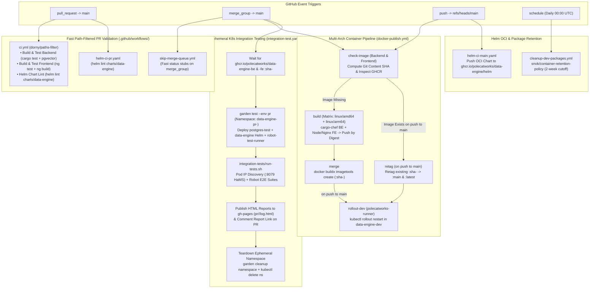

# GitHub CI, Multi-Arch Docker Publish & Ephemeral Integration Testing PRD

## Overview
This PRD defines the requirements and architecture for **Continuous Integration (CI)**, **Multi-Architecture Container Publishing (`docker-publish`)**, **Helm Chart OCI Packaging**, **Istio Service Mesh Routing (`fluxcd-dev`)**, and **Ephemeral Kubernetes Integration Testing (`integration-test`)** in **Data-Engine (`data-engine`)**, modeled directly after [`PolecatWorks/Graphrag`](https://github.com/PolecatWorks/Graphrag) and [`PolecatWorks/agent-as-data`](https://github.com/PolecatWorks/agent-as-data).

---

## End-to-End CI/CD & Integration Pipeline Architecture

---

## Core Components & Requirements

### 1. Container Builds (`de-be-container/Dockerfile` & `de-fe-container/Dockerfile`)

#### A. Backend Container (`de-be-container/Dockerfile`)
- **Multi-Stage `cargo-chef` Builder (`lukemathwalker/cargo-chef:latest-rust-1-bookworm`)**:
  - `chef` / `planner` / `buildcacherelease` / `build` stages with BuildKit cache mounts (`/usr/local/cargo/registry`, `/usr/local/cargo/git`).
- **Runtime Image (`debian:bookworm-slim`)**:
  - Installs minimal runtime libraries (`libssl3`, `ca-certificates`, `bubblewrap`) plus an isolated, pre-built Python 3 virtualenv (`/opt/sandbox-venv` with `pyarrow` and `polars`) for zero-copy Arrow sandbox execution.
  - Copies the compiled binary (`/usr/local/bin/data-engine`), `/app/migrations`, and `/app/config.yaml`.
  - Exposes ports `8080` (Axum REST & MCP) and `8079` (HaMS health & Prometheus metrics).

#### B. Frontend MFE Container (`de-fe-container/Dockerfile`)
- **Builder Stage (`node:22-alpine`)**:
  - Runs `npm ci` and `npm run build` to compile the Native Federation bundle (`remoteEntry.json`, ES module chunks, and shared mappings).
- **Runtime Stage (`nginx:stable-alpine`)**:
  - Serves compiled static assets on container port `8080` with `nginx.conf` configured for SPA fallback routing (`try_files $uri $uri/ /index.html`) and permissive CORS headers (`Access-Control-Allow-Origin: *`) on `remoteEntry.json` and federated `.js` bundles so `Mfe-shell` and `Angry-agent` can load remote modules across origins.

---

### 2. Kubernetes Helm Chart (`charts/data-engine`) & Istio Routing (`fluxcd-dev/`)

- **Helm Chart (`charts/data-engine/`)**:
  - Deploys both `data-engine-be` (ports `80 -> 8080` and `hamsPort 8079` with `/hams/alive` and `/hams/ready` probes) and `data-engine-fe` (Nginx MFE view on port `80 -> 8080`).
  - Mounts `configs/config.yaml` via a checksum-annotated `ConfigMap`.
- **Istio `VirtualService` (`fluxcd-dev/virtualservice.yaml`)**:
  - Integrates with `ai.k8s` and `data-engine.k8s` on `istio-ingress/k8s-gateway`:
    - `/mfe/data-engine` $\rightarrow$ `data-engine-fe-nginx-view` (for `Mfe-shell` and `Angry-agent` federation)
    - `/data-engine/api` $\rightarrow$ `data-engine-be`
    - `/data-engine/mcp` $\rightarrow$ `data-engine-be`

---

### 3. Path-Filtered Pull Request CI (`ci.yml`) & Merge Queue Stubs (`skip-merge-queue.yml`)

- **`.github/workflows/ci.yml` (`on: pull_request`)**:
  - Uses `dorny/paths-filter@v3` to conditionally execute:
    1. **`Build & Test Backend`**: Triggered when `de-be-container/**` changes. Boots `pgvector/pgvector:pg16`, runs `cargo check` and `cargo test -- --test-threads=1`.
    2. **`Build & Test Frontend`**: Triggered when `de-fe-container/**` changes. Runs `npm ci`, `npm test -- --watch=false`, and `npm run build`.
    3. **`Helm Chart Lint`**: Triggered when `charts/**` changes. Runs `helm lint charts/data-engine`.
- **`.github/workflows/skip-merge-queue.yml` (`on: merge_group`)**:
  - Emits immediate passing status checks on `merge_group` so the merge queue focuses on multi-arch image verification and ephemeral Kubernetes integration tests.

---

### 4. Ephemeral Kubernetes Integration Testing (`integration-test.yaml` & `integration-tests/`)

- **Local Execution (`make test-robot` / `./integration-tests/run-tests-local.sh`)**:
  - Verifies readiness on `http://localhost:8079/hams/ready` and executes Robot Framework suites against `http://localhost:8080` and `http://localhost:3003`:
    1. `01_health_and_foundation.robot`: HaMS probes (`/hams/alive`, `/hams/ready`, `/hams/metrics` non-empty check) and `GET /hello`.
    2. `02_connectors_and_profiling.robot`: Ingests baseline CSV/Parquet/JSONL datasets from `integration-tests/data/`, runs statistical profiling and MinHash sketching, and verifies empirical join probing (`JOINABLE_WITH` cardinality & inclusion ratio).
    3. `03_compute_sandbox_and_provenance.robot`: Validates SQL ASTs (confirming rejection of `FORBIDDEN_JOIN` and fan-out traps), executes federated DataFusion queries, runs a sandboxed Python algorithm over zero-copy Arrow buffers, and verifies the resulting `ProvenanceRun` signature and Mermaid lineage DAG.
    4. `04_data_engine_mcp.robot`: Exercises the full MCP lifecycle (`initialize`, `notifications/initialized`, `ping`, `tools/list`, `tools/call`) across `hello`, `dataset_*`, `join_*`, `query_*`, `algorithm_*`, and `provenance_*`.
    5. `05_mfe_canvas_federation.robot`: Verifies `remoteEntry.json` availability and tests the exposed MFE wrappers (`./DataAssetFormWrapper`, `./JoinHypothesisReviewWrapper`, `./AlgorithmSandboxWrapper`, `./ProvenanceLineageWrapper`).
- **In-Cluster Garden Execution (`./integration-tests/run-tests.sh`)**:
  - Provisions isolated namespace `data-engine-pr-<PR>`, resolves `data-engine-be` Pod IP for direct `:8079` HaMS telemetry checks, executes all Robot suites, publishes HTML logs to `gh-pages` (`pr/<PR>/log.html`), comments the report URL on the PR, and tears down the namespace in an `if: always()` cleanup block.
