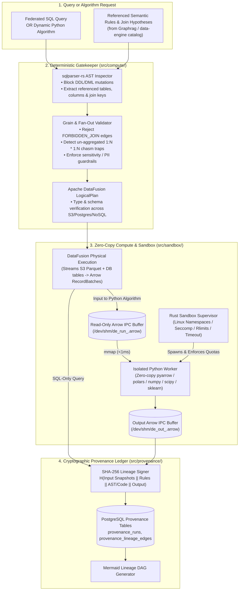
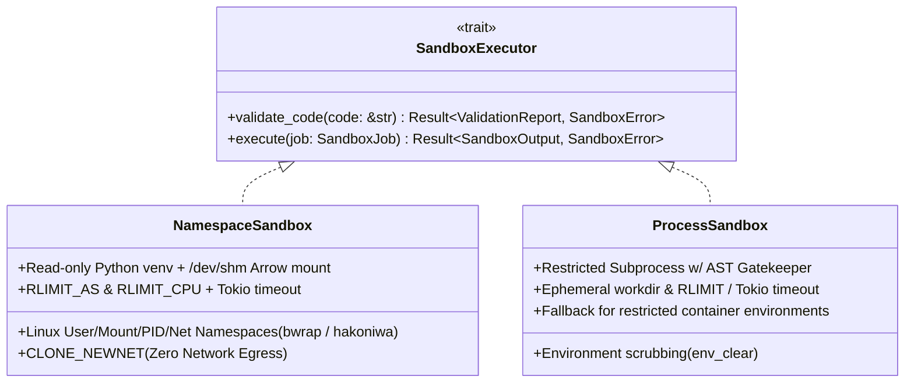
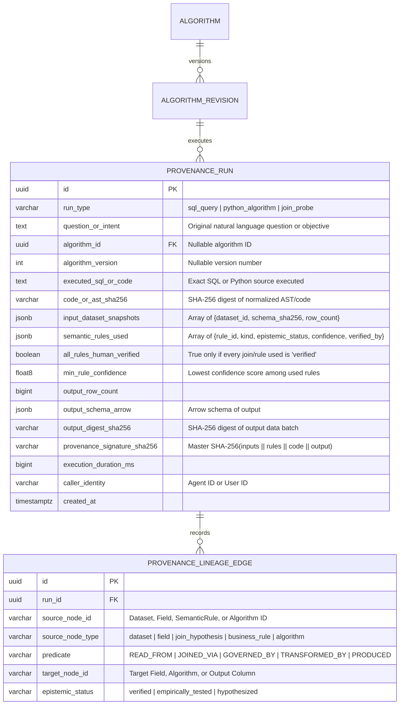

# Federated Compute, Sandboxed Python Execution & Cryptographic Provenance PRD

## Overview
This PRD defines the requirements and architecture for **Data-Engine's** analytical calculation and dynamic code execution subsystem:
1. **Federated SQL & DataFrame Calculation Engine (`src/compute/`)**: Powered by **Apache DataFusion**, `sqlparser-rs`, and **Apache Arrow**, enabling cross-source joins and aggregations with deterministic AST validation, fan-out/chasm trap detection, and column-level lineage extraction.
2. **Rust-Supervised Dynamic Python Sandbox (`src/sandbox/`)**: A lightweight, isolated code execution environment managed by Rust that stages DataFusion outputs into **zero-copy Apache Arrow shared memory (`/dev/shm` / `memfd`)** and executes dynamic Python algorithms inside a namespace/seccomp jail (`NamespaceSandbox`) or isolated worker (`SidecarSandbox`).
3. **Immutable Provenance & Decision Lineage Ledger (`src/provenance/`)**: A W3C PROV and OpenLineage-compatible audit trail that records the complete chain of reasoning, dataset versions, verified vs. hypothesized business rules, SQL AST / Python SHA-256 digests, and output hashes for every run.

---

## End-to-End Execution & Provenance Architecture

---

## Core Functional Requirements

### 1. Deterministic SQL AST & Grain Validation (`src/compute/`)
Before any SQL query or data staging query is executed against underlying data sources:
1. **Read-Only AST Enforcement (`sqlparser-rs`)**:
   - Only `SELECT` (including CTEs `WITH ... AS`, window functions, and set operations) is permitted. Any `INSERT`, `UPDATE`, `DELETE`, `DROP`, `ALTER`, `COPY`, or administrative statement is rejected immediately with `ComputeError::ForbiddenStatementType`.
2. **Catalog & Join-Hypothesis Verification**:
   - Extracts all `(left_table.left_col = right_table.right_col)` join predicates from the AST.
   - Verifies that none of the join pairs match a `FORBIDDEN_JOIN` (`epistemic_status = "rejected"`) in `join_hypotheses` (returning `ComputeError::ForbiddenJoinPath` with the human steward's rejection notes).
   - **Chasm / Fan-Out Trap Detection**: If a query joins table $A$ to two independent $1:N$ child tables ($A \rightarrow B$ with `1:N` and $A \rightarrow C$ with `1:N`) in the same query block without pre-aggregating $B$ and $C$ in CTEs/subqueries, the validator flags `ComputeError::FanOutTrapDetected` and suggests the pre-aggregated CTE structure.
3. **Bounded Resource Quotas (`ComputeConfig`)**:
   - Enforces `max_output_rows` (e.g., `10_000`), `memory_limit_bytes` via DataFusion's `FairSpillPool`, and `query_timeout_seconds`.

---

### 2. Rust-Managed Dynamic Python Sandbox (`src/sandbox/`)

#### A. Versioned Algorithm Registry (`algorithms` & `algorithm_revisions`)
Dynamic code is never executed as an anonymous, untracked string. Every algorithm is persisted as a versioned data artifact:
- `id` (UUID), `canonical_id` (`snake_case`), `name`, `description`
- `language`: `"python"` or `"sql"`
- `code`: Source code string
- `code_sha256`: Deterministic SHA-256 hash of normalized source code
- `input_ bindings`: Named map of input dataset queries or dataset IDs (mounted as read-only Arrow tables `inputs["orders"]`, `inputs["customers"]`)
- `expected_output_schema`: Optional JSON Arrow schema contract
- `validation_status`: `"draft" | "validated" | "failed"`
- `current_version`: Monotonically incrementing revision number persisted in `algorithm_revisions`

#### B. Zero-Copy Apache Arrow Data Bridge
1. For each entry in `input_bindings`, Rust executes the validated DataFusion plan and writes the resulting `RecordBatch` stream into an ephemeral, read-only Apache Arrow IPC file in shared memory (`/dev/shm/de_run_<run_id>/in_<name>.arrow`).
2. Inside the sandbox, a lightweight Python bootstrap harness memory-maps each input via `pyarrow.ipc.open_file` (or `polars.read_ipc(..., memory_map=True)`) in under `1ms` with zero heap copy.
3. The user/agent's Python function `def run(inputs: dict[str, pl.DataFrame | pa.Table], params: dict) -> pl.DataFrame | pa.Table | dict:` executes and writes its output Arrow table to `/dev/shm/de_run_<run_id>/out_result.arrow` plus structured summary metrics to `out_metrics.json`.
4. Rust validates the output Arrow schema, reads the result, and immediately unlinks the `/dev/shm/de_run_<run_id>` directory in a `Drop` guard.

#### C. Pluggable Sandbox Isolation Backends (`SandboxBackend` Trait)
`SandboxConfig` (`src/sandbox/mod.rs`) supports configurable isolation backends behind a unified `SandboxExecutor` trait:

1. **Static AST Pre-Flight Gatekeeper**: Before spawning any process, the sandbox validates the Python AST to reject forbidden imports/builtins (`socket`, `subprocess`, `os.system`, `pty`, `urllib`, `requests`, `http`, `ctypes`, `open` outside the sandbox output path).
2. **`namespace` Mode (Default on Linux hosts)**: Uses Linux namespaces (`CLONE_NEWNET` for zero network access, `CLONE_NEWNS` for read-only rootfs and Python virtualenv bind-mount, `CLONE_NEWPID`) and memory/CPU resource limits.
3. **`process` Mode (Container-safe fallback)**: Uses scrubbed environment (`Command::env_clear()`), read-only input permissions, AST restriction, and strict wall-clock/memory limits when running inside locked-down Kubernetes pods without nested `CLONE_NEWUSER` privileges.

---

### 3. Cryptographic Provenance & Decision Lineage Ledger (`src/provenance/`)

Every query execution (`POST /api/v1/queries/execute`) and algorithm execution (`POST /api/v1/algorithms/:id/execute`) creates an immutable **`ProvenanceRun`** record in PostgreSQL:

#### Key Provenance Capabilities:
1. **Epistemic Trust Rollup (`all_rules_human_verified` & `min_rule_confidence`)**:
   - Every execution response includes a top-level trust summary telling the user and calling agent whether the result relied exclusively on **Human-Verified (`verified`)** semantic rules or included **AI-Inferred (`empirically_tested` / `hypothesized`)** rules that still need human sign-off.
2. **Deterministic Mermaid Lineage DAG (`GET /api/v1/provenance/:id/mermaid`)**:
   - Automatically renders a complete Mermaid flowchart showing source datasets $\rightarrow$ fields $\rightarrow$ join hypotheses (color-coded by `verified` vs. `hypothesized`) $\rightarrow$ SQL/Python transformation $\rightarrow$ output columns, ready to mount directly in `Angry-agent` via `MermaidShowWrapper` or `./ProvenanceLineageWrapper`.
