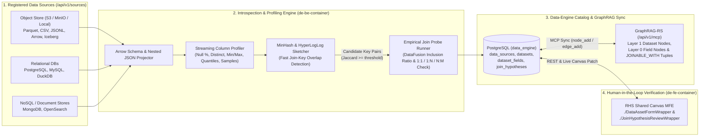
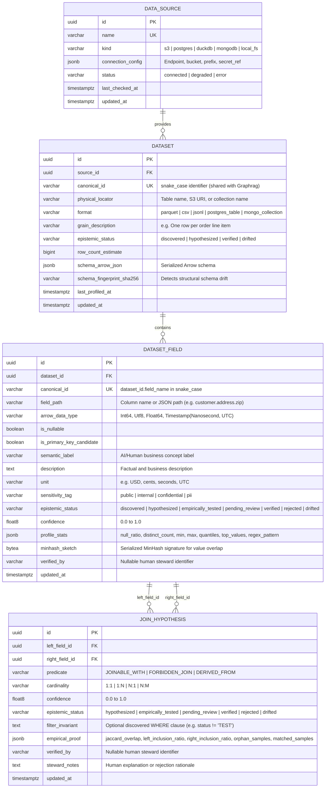
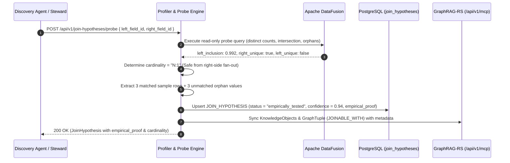

# Universal Data Connectors, Schema Profiling & Autonomous Semantic Discovery PRD

## Overview
This PRD defines the requirements for connecting **Data-Engine** to heterogeneous data sources (S3/MinIO object storage, relational databases, and NoSQL document stores), inferring flat and nested schemas into **Apache Arrow**, computing statistical field profiles and **MinHash** value-overlap sketches, empirically probing candidate joins in a sandbox, and synchronizing discovered semantic metadata with **[`Graphrag`](https://github.com/PolecatWorks/Graphrag)** for human-in-the-loop verification.

---

## Core Objectives

1. **Universal Data Access (`connectors`)**: Read structured, semi-structured, and columnar datasets across S3/MinIO (Parquet, CSV, JSONL, Arrow IPC, Iceberg), relational databases (PostgreSQL, MySQL, SQLite, DuckDB), and NoSQL document collections (MongoDB, OpenSearch) through a unified Apache Arrow table abstraction.
2. **Automated Structure & Statistical Profiling (`profiler`)**: Automatically inspect schemas (including flattening nested NoSQL/JSON structures) and compute column-level statistical profiles (null rates, cardinality, quantiles, regex patterns, temporal grains, unit hints, and top-$k$ categorical values).
3. **Autonomous Semantic Layer Discovery**: Overcome human "Catalog Rot" by combining statistical MinHash value overlap, LLM semantic inference, and **Empirical Sandbox Probing** to automatically propose dataset grains, field meanings, and `JOINABLE_WITH` relationships.
4. **Epistemic Lifecycle & Human Stewardship**: Track every discovered field meaning and join relationship through an explicit epistemic state machine (`discovered` $\rightarrow$ `hypothesized` $\rightarrow$ `empirically_tested` $\rightarrow$ `pending_review` $\rightarrow$ `verified` / `rejected` $\rightarrow$ `drifted`) and synchronize verified/candidate knowledge into `Graphrag`.

---

## System Architecture & Discovery Flow

---

## Domain Model & Database Schema

---

## Core Functional Requirements

### 1. Universal Data Source Connectors (`src/connectors/`)
- **Object Storage (`s3` / `local_fs`)**:
  - Uses `object_store` and `datafusion` to read `Parquet`, `CSV`, `JSONL`, and `Arrow IPC` files from S3-compatible buckets (AWS S3, MinIO) or local workspace directories.
  - Supports partitioned directory layouts (Hive-style `year=2026/month=11/*.parquet`) and predicate pushdown.
- **Relational Databases (`postgres` / `duckdb`)**:
  - Introspects `information_schema.columns` and foreign-key constraints, and registers tables as DataFusion `TableProvider`s for federated querying.
- **NoSQL & Semi-Structured Documents (`mongodb` / `jsonl`)**:
  - Samples documents to infer nested schemas, automatically projecting nested objects and scalar fields into flat dot-notation `field_path` descriptors (`customer.id`, `items[].sku`) backed by Arrow `StructArray` / `ListArray` representations so SQL and Python can query them uniformly.

---

### 2. Automated Statistical Profiling & Drift Detection (`src/profiler/`)
When `POST /api/v1/datasets/:id/profile` (or MCP tool `dataset_profile`) is invoked:
1. **Structural Fingerprinting**: Computes a deterministic SHA-256 fingerprint over sorted `(field_path, arrow_data_type, is_nullable)` tuples. If a previously `verified` dataset's fingerprint changes, affected fields and downstream `JOIN_HYPOTHESIS` records automatically transition to `epistemic_status = "drifted"`.
2. **Column Statistics**: Executes a single-pass DataFusion aggregation over the dataset (or a configurable sample window `profiler.max_sample_rows`) to compute:
   - `null_count` and `null_ratio`
   - Approximate/exact `distinct_count` and uniqueness ratio (`is_primary_key_candidate` when `null_ratio == 0.0` and `uniqueness >= 0.999`)
   - Numeric/temporal `min`, `max`, `mean`, and `p25` / `p50` / `p75` quantiles
   - Top-$k$ most frequent categorical values (`top_values`) so AI query planners know exact enum literals (e.g., `'ACTIVE'` vs `'ACT'`).
3. **MinHash Value Sketching**: For candidate identifier, string, and integer key columns, computes a 128-hash MinHash signature (`minhash_sketch`) to estimate Jaccard value-set similarity across columns in $O(1)$ time without full cross-table scans.

---

### 3. Empirical Join Probing & Fan-Out Trap Analysis
To prevent LLMs from hallucinating invalid joins or falling into **fan-out / chasm traps**, `data-engine` empirically validates candidate joins via `POST /api/v1/join-hypotheses/probe`:

- **Negative Constraints (`FORBIDDEN_JOIN`)**: When a human steward rejects a join hypothesis (`PUT /api/v1/join-hypotheses/:id` with `epistemic_status = "rejected"`), the record is preserved with `predicate = "FORBIDDEN_JOIN"` and `steward_notes`. Both `data-engine`'s AST validator and `Graphrag` block future queries from using that rejected join path.

---

### 4. Bidirectional Synchronization with `Graphrag`
When `graphrag.enabled = true` in `AppConfig`:
- Profiling or updating a `Dataset` upserts a Layer 1 `KnowledgeObject` (`label = "Dataset"`) in `Graphrag`.
- Profiling or curating a `DatasetField` upserts a Layer 0 `KnowledgeObject` (`label = "Field"`) and links `(Dataset) -[HAS_FIELD]-> (Field)`.
- Probing or verifying a `JoinHypothesis` upserts a `(LeftField) -[JOINABLE_WITH]-> (RightField)` (or `FORBIDDEN_JOIN`) tuple in `Graphrag` carrying the cardinality, confidence score, and epistemic status in its description/metadata.
