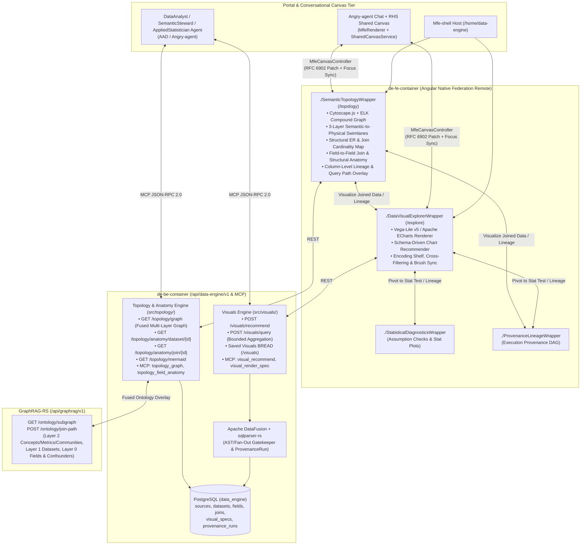
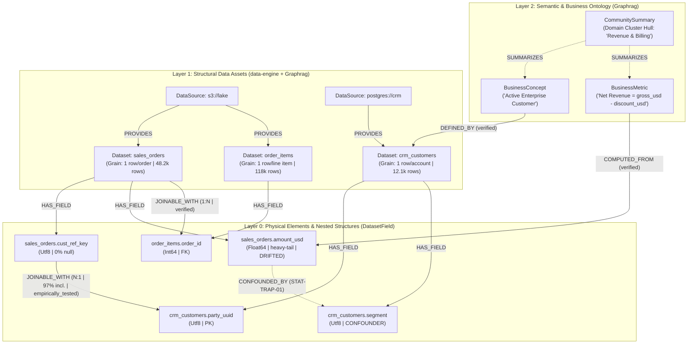
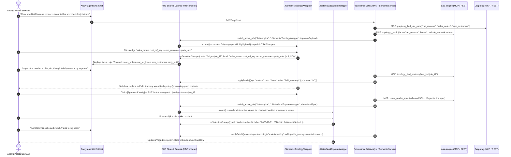
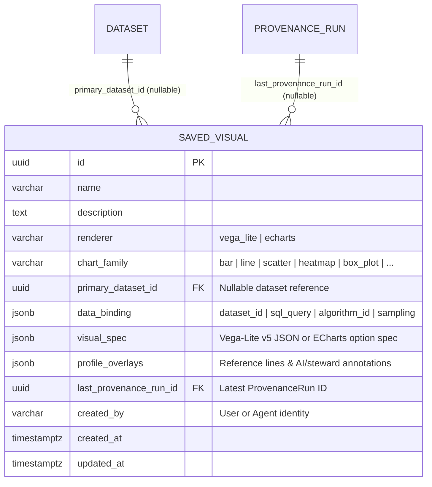

# Data Visualizations & Semantic Relationship Topology PRD

## Overview
This PRD defines **Data-Engine's (`de-be-container` & `de-fe-container`)** two tightly coupled visual intelligence subsystems:
1. **Interactive Data Visuals for Data (`./DataVisualExplorerWrapper` & Studio `/explore`)**: Declarative, interactive data charts and visual explorers over registered datasets, federated SQL query results, column statistical profiles, and sandboxed algorithm outputs — powered by **Vega-Lite** (canonical Grammar-of-Graphics JSON spec) with optional **Apache ECharts** rendering parity for high-density interactive charts.
2. **Semantic, Element & Structural Relationship Visuals (`./SemanticTopologyWrapper` & Studio `/topology`)**: Interactive multi-layer graph and zoomed-in structural anatomy views showing how **Business Concepts, Metrics & Domain Communities (Layer 2 in `Graphrag`)**, **Data Sources & Datasets (Layer 1)**, and **Physical Fields, Nested Elements, Join Keys, Confounders & Provenance Edges (Layer 0)** relate to one another — powered by **Cytoscape.js + ELK (`elkjs`)** layered compound graphs and field-level join/overlap anatomy panels.

Both visual capabilities run identically as:
- **Standalone & `Mfe-shell` Studio Views** (`/home/data-engine/explore` and `/home/data-engine/topology`), and
- **Bidirectional RHS Shared Canvas Wrappers inside `Angry-agent`** implementing `MfeCanvasController` (`applyPatch`, `getState`, `getSchema`, `onStateChange`, `onSelectionChange`), enabling AI agents to emit/patch live visuals via MCP and human users to click or brush visual elements to **"point-and-ask"** in chat.

---

## End-to-End Visual Intelligence Architecture



---

## Pillar 1: Data Visuals for Data (`DataVisualExplorer`)

### 1.1 Universal Declarative Visual Contract (`DataVisualSpec`)
Every data visualization generated by the recommender, saved by a user, or emitted by an AI agent uses a uniform, RFC 6902 patchable JSON envelope (`DataVisualSpec`):

```json
{
  "visual_id": "<uuid>",
  "title": "Daily Net Revenue by Customer Segment",
  "description": "Pre-aggregated net revenue across verified orders -> crm_customers join",
  "renderer": "vega_lite",
  "chart_family": "line",
  "data_binding": {
    "kind": "sql_query",
    "dataset_id": null,
    "sql": "SELECT DATE_TRUNC('day', o.order_ts) AS day, c.segment, SUM(o.amount_usd) AS net_revenue FROM sales_orders o JOIN crm_customers c ON o.cust_ref_key = c.party_uuid GROUP BY 1, 2 ORDER BY 1",
    "provenance_run_id": "<uuid>",
    "algorithm_id": null,
    "sampling": null
  },
  "spec": {
    "$schema": "https://vega.github.io/schema/vega-lite/v5.json",
    "mark": { "type": "line", "point": true },
    "encoding": {
      "x": { "field": "day", "type": "temporal", "title": "Order Date" },
      "y": { "field": "net_revenue", "type": "quantitative", "title": "Net Revenue (USD)" },
      "color": { "field": "segment", "type": "nominal", "title": "Segment" }
    }
  },
  "data_values": [],
  "profile_overlays": {
    "reference_lines": [
      { "axis": "y", "value": 42150.0, "label": "Median Daily Revenue", "style": "dashed" }
    ],
    "annotations": [
      { "x": "2026-10-01", "label": "Wave-3 Schema Drift Detected", "severity": "warning" }
    ]
  },
  "provenance": {
    "provenance_run_id": "<uuid>",
    "trust_summary": { "all_rules_human_verified": true, "min_rule_confidence": 0.96 },
    "sampled": false,
    "population_rows": 48200,
    "rendered_rows": 365,
    "sampling_seed": null
  }
}
```

#### Supported Chart Families
| Category | Chart Families | Primary Use Case |
| :--- | :--- | :--- |
| **Comparison & Ranking** | `bar`, `grouped_bar`, `stacked_bar`, `kpi_sparkline` | Categorical totals, top-K segments, metric comparisons |
| **Temporal & Trends** | `line`, `area` | Time series, cumulative growth, wave/drift change-point inspection |
| **Distribution & Spread** | `histogram`, `box_plot`, `violin` | Column profile distributions, heavy-tail & outlier inspection, group spreads |
| **Correlation & Density** | `scatter`, `bubble`, `heatmap` | Bivariate numeric relationships, 2D density bins, categorical cross-tabs |
| **Multi-Dimensional & Flow** | `pivot_table`, `cohort_matrix`, `sankey` | Tabular drill-downs with inline sparklines, retention matrices, flow/overlap attribution |

#### Renderer Selection (`vega_lite` & `echarts`)
- **`vega_lite` (Default)**: Canonical Grammar-of-Graphics JSON specification (`vega-lite` v5 via `vega-embed`). Compact, declarative, schema-validatable, and natively patchable by LLMs using RFC 6902 JSON Patch (e.g., changing `/spec/encoding/y/scale/type` to `"log"` or adding a facet channel).
- **`echarts` (High-Density / Interactive Parity)**: Supported via `renderer: "echarts"` for high-density scatter/heatmap brushing, multi-axis interactive zoom sliders (`dataZoom`), and Sankey flow diagrams where Canvas/WebGL rendering outperforms SVG.

---

### 1.2 Schema- & Profile-Driven Auto-Recommendation (`POST /api/v1/visuals/recommend`)
Given a `dataset_id` (or validated SQL output schema + column `DatasetField.profile_stats`), `de-be-container` deterministically computes ranked chart candidates without requiring an LLM call:
1. **Temporal + Quantitative** $\rightarrow$ `line` / `area` time series (automatically selecting time granularity from `min`/`max` span and attaching any known `statistical_profile.seasonality_period`).
2. **Low-Cardinality Categorical ($\le 20$ distinct) + Quantitative** $\rightarrow$ sorted `bar` chart; if the numeric column has `statistical_profile.is_heavy_tailed == true` (or high skewness from `profile_stats`), automatically recommends `box_plot` / `violin` with optional log-scale toggle and median reference line.
3. **Two Quantitative Columns** $\rightarrow$ `scatter` (when `row_count <= visuals.max_chart_points`) or 2D binned `heatmap` (when larger).
4. **Two Categoricals + Quantitative** $\rightarrow$ `heatmap` / `pivot_table`.
5. **Single-Column Profile View** $\rightarrow$ `histogram` with quantile markers (`p25`, `p50`, `p75`), null-rate badge, and top-$k$ categorical bar chart.

---

### 1.3 Safe, Bounded Chart Data Materialization (`POST /api/v1/visuals/query`)
1. **Mandatory SQL AST & Grain Guardrails**: Any chart bound to a SQL query passes through `src/compute/` (`sqlparser-rs` + DataFusion `LogicalPlan`), rejecting `FORBIDDEN_JOIN`s and un-aggregated `1:N * 1:N` fan-out traps (`TRAP-03`) before any chart is rendered.
2. **Fail-Fast Point Cap (`visuals.max_chart_points`)**:
   - Charts never silently truncate data or stream raw multi-million-row tables into browser memory or MCP responses.
   - If an un-aggregated query returns more than `visuals.max_chart_points` (configured in `VisualsConfig`, default `5_000`), the endpoint fails fast with `VisualsError::ChartPointLimitExceeded` recommending server-side binning/aggregation or explicit deterministic seeded sampling (`sampling: { strategy, max_rows, seed }`).
   - Whenever sampling or server-side binning is active, `DataVisualSpec.provenance` discloses `sampled: true`, `population_rows`, `rendered_rows`, and `sampling_seed`, and the UI displays an explicit disclosure banner.
3. **Cryptographic Provenance on Every Visual**:
   - Executing a visual query persists an immutable `ProvenanceRun` (`run_type = "visual_query"`) and attaches `provenance_run_id` and `trust_summary` (`Verified` green badge vs. `AI-Inferred` amber badge) directly to the chart header.

---

### 1.4 Interactive Data Explorer UX (`./DataVisualExplorerWrapper` & Studio `/explore`)
- **Interactive Encoding Shelf**: Users can bind or drag `DatasetField`s onto visual channels (`X`, `Y`, `Color`, `Size`, `Facet`, `Aggregation: sum/avg/median/count/p95`), switch chart families in 1 click, toggle linear/log scales, and toggle statistical profile reference lines.
- **Cross-Filtering & Linked Brushing**: Multi-chart dashboard views support brushing a range or clicking a category in one chart to cross-filter sibling charts and the synchronized underlying data table.
- **Data & Profile Table Drawer**: Expandable paginated table beneath the chart showing rendered rows, column Arrow types, inline distribution sparklines, null-rate bars, and sensitivity tags.
- **Seamless Escalation to Statistical Diagnostics**: A **`[Run Statistical Check]`** toolbar button hands the active visual's `data_binding` and encoded columns straight to `stat_describe_and_check` / `stat_hypothesis_test` and opens `./StatisticalDiagnosticsWrapper`.
- **Saved Visual Artifacts (BREAD `/api/v1/visuals`)**: Users and agents can persist named `DataVisualSpec` artifacts in PostgreSQL (`saved_visuals`) for bookmarking, sharing across `Mfe-shell`, and re-running against fresh data snapshots.

---

## Pillar 2: Semantic, Element & Structural Relationship Visuals (`SemanticTopology`)

### 2.1 Unified Multi-Layer Relationship Model (`SemanticTopologyGraph`)
To show how **business semantics**, **logical data structures**, and **physical elements** connect across the enterprise, `de-be-container` exposes `GET /api/v1/topology/graph` (and MCP `topology_graph`), fusing `data-engine`'s physical catalog with `Graphrag`'s semantic ontology (`GET /api/graphrag/v1/ontology/subgraph`):



### 2.2 Four Interactive Visual Lens Modes (`./SemanticTopologyWrapper`)
Powered by **Cytoscape.js + ELK (`elkjs`)** layered compound graph rendering, `./SemanticTopologyWrapper` provides four synchronized visual lenses:

#### Lens 1: 3-Layer Semantic-to-Physical Ontology View (`semantic_3layer`)
- Renders three horizontal swimlanes / compound layers:
  - **Top (Layer 2 — Semantics)**: `CommunitySummary` translucent domain hulls grouping `BusinessConcept` and `BusinessMetric` nodes (displaying metric formulas and verification badges).
  - **Middle (Layer 1 — Structures)**: `DataSource` container frames holding `Dataset` compound cards (format icon, grain subtitle, row count, schema drift indicator).
  - **Bottom / Nested (Layer 0 — Elements)**: Expandable `DatasetField` element rows nested directly inside each `Dataset` card (Arrow type pill, PK/FK glyph, unit tag, sensitivity lock icon, null-rate mini-bar, statistical trait icons for heavy-tail / seasonality / drift).
- Displays cross-layer semantic links (`DEFINED_BY`, `GOVERNED_BY`, `COMPUTED_FROM`, `SUMMARIZES`) and amber dashed **`CONFOUNDED_BY`** statistical confounder links (`known_confounders`).

#### Lens 2: Structural ER & Join Topology Map (`er_join`)
- Focuses on physical and logical data structures (`Dataset` cards with port-to-port `DatasetField` edges):
  - **Cardinality & Crow's-Foot Notation**: Labels every `JOINABLE_WITH` edge with `1:1`, `1:N`, `N:1`, or `N:M`, scaling stroke thickness by `inclusion_ratio` / `confidence`.
  - **Epistemic Status Visual Encoding**:
    | Epistemic / Structural State | Visual Styling | Meaning |
    | :--- | :--- | :--- |
    | `verified` | Solid Emerald Green (`#10b981`) + Check badge | Human-certified rule or join |
    | `empirically_tested` | Solid Sky Blue (`#0ea5e9`) + Flask badge | DataFusion probe confirmed overlap & cardinality |
    | `hypothesized` / `pending_review` | Dashed Slate (`#64748b`) + Review dot | MinHash/AI candidate awaiting steward review |
    | `drifted` | Pulsing Amber (`#f59e0b`) + Drift badge | Schema fingerprint or value distribution shifted (`TRAP-04`) |
    | `FORBIDDEN_JOIN` (`rejected`) | Crossed Dashed Crimson (`#ef4444`) + Stop icon | Negative constraint blocking homonym/invalid joins (`TRAP-01`) |
    | `fan_out_warning` | Orange Hazard Badge (`2.45x`) | Un-aggregated `1:N * 1:N` or `N:M` chasm trap (`TRAP-03`) |

#### Lens 3: Field-to-Field Join & Structural Anatomy View (`field_anatomy`)
- Zoomed-in structural inspection panel (triggered by clicking any join edge, clicking `[Inspect Anatomy]` on a dataset, or via `GET /api/v1/topology/anatomy/join/{id}` and `GET /api/v1/topology/anatomy/dataset/{id}`):
  1. **Dataset Structural Anatomy (Nested & Flat Elements)**:
     - Renders an interactive **Arrow Schema Hierarchy Tree** for semi-structured / nested datasets (NoSQL/JSONL/Parquet structs & lists, e.g., `customer -> address -> zip`, `items[] -> sku`), alongside each element's Arrow type, nullability, PK/FK status, unit, sensitivity tag, top-$k$ value pills, and inline mini-histogram.
  2. **Field-to-Field Join Anatomy**:
     - **Side-by-Side Schema Cards with Port Connectors**: Highlights the exact joined left and right columns, showing type compatibility (or explicit cast warning such as `Int64` $\leftrightarrow$ `Utf8`) and any active `filter_invariant` (`WHERE status != 'TEST'`).
     - **Value-Overlap Venn / Sankey Proportional Strip**: Visualizes `left_inclusion_ratio`, `right_inclusion_ratio`, and `jaccard_overlap`, splitting keys into **Left Orphans**, **Matched Intersection**, and **Right Orphans** with expandable sample matched rows and unmatched orphan key examples.
     - **Fan-Out & Row Multiplication Diagram**: Explicitly illustrates cardinality scaling (e.g., `10,000 orders -> 24,500 rows (2.45x fan-out)` in `TRAP-03`) and previews the safe pre-aggregated CTE join structure.
     - **1-Click Inline Stewardship & Visual Pivot**: `[✓ Approve & Verify]`, `[✕ Reject as FORBIDDEN_JOIN]`, `[⚡ Re-Probe Join]`, and **`[📊 Explore Joined Data]`** (immediately opens `./DataVisualExplorerWrapper` bound to the verified join).

#### Lens 4: Column-Level Lineage & Active Query Path Overlay (`lineage_overlay`)
- Overlays either:
  - A multi-hop join path from `Graphrag`'s `POST /ontology/join-path` (`graphrag_find_join_path`), or
  - A `ProvenanceRun`'s `provenance_lineage_edges` (`READ_FROM`, `JOINED_VIA`, `GOVERNED_BY`, `TRANSFORMED_BY`, `PRODUCED`),
  directly onto the Cytoscape/ELK topology — dimming non-participating nodes, animating active column-to-metric data flow, and surfacing `fan_out_warnings` and `all_rules_human_verified` badges in context.

### 2.3 Scale, Progressive Disclosure & Deterministic Export
- **Server-Side Subgraph Scoping**: `GET /api/v1/topology/graph` supports `?lens=&source_id=&dataset_ids=&epistemic_status=&focus_node_id=&hops=2&include_fields=false&include_forbidden=true&include_semantics=true`.
- **Bounded Payload Protection**: Enforces `VisualsConfig.max_topology_nodes` (default `250`) and `VisualsConfig.max_topology_edges` (default `500`), returning truncation metadata (`truncated: true`, `total_nodes`, `applied_filter_hint`) so the UI never freezes on large catalogs.
- **Semantic Zoom & Progressive Field Expansion**: When more than `15` datasets are in view, Layer 0 fields start collapsed inside dataset cards (displaying field count + key/drift pills) and expand smoothly on click, search match, or zoom-in.
- **Deterministic Mermaid Export (`GET /api/v1/topology/mermaid`)**: Exports any filtered topology view as valid Mermaid (`erDiagram` for `er_join` lens or `flowchart TB` for `semantic_3layer` lens) for markdown reports and chat fallbacks.

---

## Pillar 3: Agent-Driven Declarative Visuals & Bidirectional Shared Canvas

Both `./DataVisualExplorerWrapper` and `./SemanticTopologyWrapper` implement `@polecatworks/mfe-shared`'s **`MfeCanvasController`** contract ([05. MFE Frontend & Shared Canvas PRD](./mfe-frontend-canvas-prd.md)):



### Shared Canvas Controller Contracts
| Exposed Wrapper | `getState()` / `getSchema()` Structure | `applyPatch()` In-Place Capabilities | `onSelectionChange()` Focus Payloads | `onAction()` Dispatched Events |
| :--- | :--- | :--- | :--- | :--- |
| **`./DataVisualExplorerWrapper`** | `{ visual_id, renderer, chart_family, data_binding, spec, active_filters, profile_overlays, provenance }` | Patch Vega-Lite/ECharts encodings, scales, filters, reference lines, or AI callout annotations without destroying chart DOM | Clicked mark datum (`{ field, value, datum }`), brushed interval (`{ x_min, x_max }`), or selected encoding channel | `run_statistical_check`, `open_provenance`, `save_visual`, `drill_down_rows`, `export_spec` |
| **`./SemanticTopologyWrapper`** | `{ lens, visible_layers, epistemic_filters, focus_node_id, expanded_datasets, highlighted_path, graph, active_anatomy }` | Switch lens (`semantic_3layer`, `er_join`, `field_anatomy`, `lineage_overlay`), highlight multi-hop path, pulse drifted/forbidden edges, expand/collapse dataset cards | Selected `BusinessConcept`, `BusinessMetric`, `Dataset`, `DatasetField`, or `JoinHypothesis` edge with canonical ID & epistemic status | `verify_join`, `reject_forbidden_join`, `probe_join`, `inspect_dataset_form`, `explore_data_visual`, `open_provenance` |

---

## Backend Data Model, Configuration & Typed Errors

### 1. Saved Visual Specifications Persistence (`saved_visuals` table)
Reversible migration (`<version>_create_saved_visuals.up.sql` / `.down.sql`):



### 2. Modular Configuration (`VisualsConfig` in `src/visuals/config.rs`)
Compliant with `AGENTS.md` (zero hardcoded runtime defaults, `DE_BE__VISUALS__*` overrides, fail-fast validation):
- `max_chart_points`: `usize` (e.g. `5000`; must be `>= 10` and `<= 100_000`)
- `max_topology_nodes`: `usize` (e.g. `250`; must be `>= 10` and `<= 5_000`)
- `max_topology_edges`: `usize` (e.g. `500`; must be `>= 10` and `<= 20_000`)
- `default_ego_hops`: `u8` (e.g. `2`; must be `>= 1` and `<= 5`)
- `enable_graphrag_overlay`: `bool` (default `true`; falls back cleanly to catalog-only structural topology with `graphrag_overlay_degraded: true` banner if `Graphrag` is temporarily unavailable)

### 3. Typed Domain Errors (`VisualsError` deriving `thiserror::Error`)
- `VisualsError::ChartPointLimitExceeded { actual_rows, max_chart_points }` $\rightarrow$ `400 Bad Request` (with guidance to aggregate or pass explicit seeded sampling)
- `VisualsError::InvalidVisualSpec(String)` $\rightarrow$ `400 Bad Request`
- `VisualsError::UnsupportedRenderer(String)` $\rightarrow$ `400 Bad Request`
- `VisualsError::VisualNotFound(Uuid)` $\rightarrow$ `404 Not Found`
- `VisualsError::TopologyFocusNotFound(String)` $\rightarrow$ `404 Not Found`
- `VisualsError::Compute(#[from] ComputeError)` (surfaces `FORBIDDEN_JOIN` and `FanOutTrapDetected` directly)
- `VisualsError::Database(#[from] DatabaseError)`

---

## REST API & MCP Surface Summary
Full endpoint and MCP tool signatures are indexed in [04. MCP Server & REST API Contract PRD](./data-engine-mcp-api-prd.md):
- **REST (`/api/data-engine/v1/visuals/*` & `/api/v1/visuals/*`)**:
  - `POST /visuals/recommend` — Deterministic chart recommendations from dataset/query schema & profile stats.
  - `POST /visuals/query` — Validates SQL/binding, executes bounded aggregation/sampling, persists `ProvenanceRun`, and returns hydrated `DataVisualSpec` + `data_values`.
  - `GET/POST/PUT/DELETE /visuals` & `/visuals/{id}` — Full BREAD management of `saved_visuals`.
- **REST (`/api/data-engine/v1/topology/*` & `/api/v1/topology/*`)**:
  - `GET /topology/graph` — Fused multi-layer `SemanticTopologyGraph` (Datasets, Fields, Joins, Forbidden Joins, Confounders, and GraphRAG Layer 2 Concepts/Metrics/Communities).
  - `GET /topology/anatomy/dataset/{id}` — Nested Arrow schema tree, column profile mini-distributions, and incident joins/concepts for one dataset.
  - `GET /topology/anatomy/join/{id}` — Side-by-side schema cards, key type compatibility, Venn/Sankey value-overlap breakdown, matched/orphan samples, and fan-out multiplier stats.
  - `GET /topology/mermaid` — Deterministic Mermaid `erDiagram` or `flowchart TB` representation of the scoped topology.
- **MCP Tools (`POST /api/data-engine/v1/mcp`)**:
  - `visual_recommend`
  - `visual_render_spec`
  - `topology_graph`
  - `topology_field_anatomy`

---

## Canonical Validation & Chaos Trap Visual Scenarios
To validate that both visual subsystems accurately communicate data and semantic/structural traps (`TRAP-01`..`TRAP-05` and `STAT-TRAP-01`..`STAT-TRAP-04`):
1. **`TRAP-01` (Homonym Chasm)**: `./SemanticTopologyWrapper` (`er_join` lens) renders a distinct crimson crossed `FORBIDDEN_JOIN` edge between `billing_subscriptions.account_id` and `marketing_leads.account_id` with steward rejection rationale on hover/click.
2. **`TRAP-02` (Cryptic Synonym Join)**: `field_anatomy` lens renders `sales_orders.cust_ref_key` $\leftrightarrow$ `crm_customers.party_uuid` with a `97%` matched intersection Venn/Sankey bar and 1-click `[Approve & Verify]`.
3. **`TRAP-03` (M:N Fan-Out Trap)**: `er_join` and `field_anatomy` lenses display an orange `2.45x fan_out_warning` hazard across `orders -> order_items` and `orders -> order_payments`, and `POST /visuals/query` blocks un-aggregated fan-out SQL with a structured error.
4. **`TRAP-04` (Wave-3 Unit Drift)**: `semantic_3layer` pulses `sales_orders.amount` in amber (`drifted`), and `./DataVisualExplorerWrapper` renders the time-series step-change with a `Wave-3 Schema/Distribution Drift` annotation overlay.
5. **`STAT-TRAP-01` (Simpson's Paradox)**: `semantic_3layer` displays the amber dashed `CONFOUNDED_BY` edge to `segment`, and `./DataVisualExplorerWrapper` facets conversion by `segment` to visually expose the aggregate vs. stratified reversal alongside `./StatisticalDiagnosticsWrapper`.

---

## Cross References
- [00. Ecosystem Architecture & End-to-End Journeys PRD](./ecosystem-architecture-and-journeys-prd.md)
- [02. Data Connectors, Ingestion & Statistical Profiling PRD](./data-connectors-profiling-prd.md)
- [03. Federated Compute, Code Sandbox & Provenance PRD](./compute-sandbox-provenance-prd.md)
- [04. MCP Server & REST API Contract PRD](./data-engine-mcp-api-prd.md)
- [05. MFE Frontend & Shared Canvas PRD](./mfe-frontend-canvas-prd.md)
- [08. Statistical Analytics Engine, Diagnostics & Traps PRD](./statistical-analytics-engine-prd.md)
