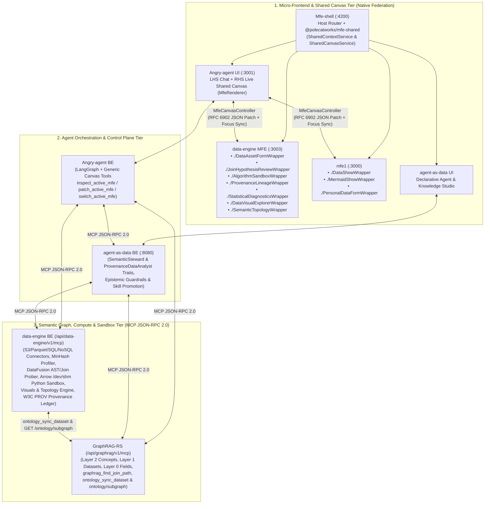
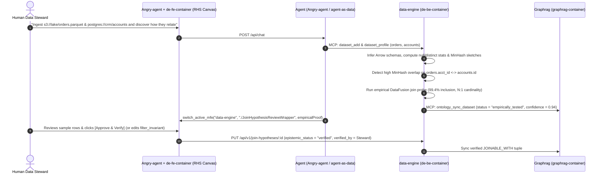
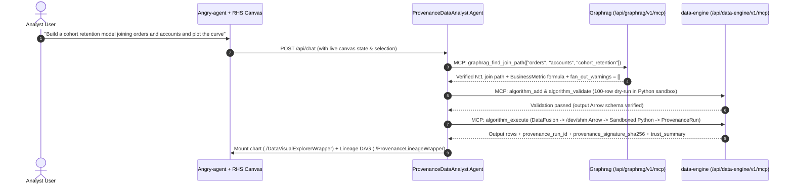
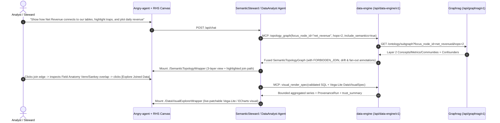

# 5-Repository Ecosystem Architecture & End-to-End Journeys PRD

## Overview
This PRD defines how **Data-Engine (`data-engine`)** integrates with the other four repositories in the PolecatWorks AI ecosystem on the shared feature track (`feat/autonomous-semantic-data-canvas-prds`):
1. **[`Mfe-shell`](https://github.com/PolecatWorks/Mfe-shell)**: Portal Host & `@polecatworks/mfe-shared` (`SharedCanvasService` + `MfeCanvasController`).
2. **[`Angry-agent`](https://github.com/PolecatWorks/Angry-agent)**: Conversational AI & RHS Live Shared Canvas Host (`MfeRenderer` + `MultiServerMCPClient`).
3. **[`agent-as-data`](https://github.com/PolecatWorks/agent-as-data)**: Declarative Agent Control Plane, `SemanticSteward` / `ProvenanceDataAnalyst` Traits, Epistemic Guardrails & Skill Registry.
4. **[`Graphrag`](https://github.com/PolecatWorks/Graphrag)**: Autonomous 3-Layer Semantic Ontology Graph & Multi-Hop Join-Path Planner.
5. **[`data-engine`](https://github.com/PolecatWorks/data-engine)**: Universal Connectors, Statistical Profiler, Empirical Join Prober, Apache DataFusion Query Engine, Zero-Copy Arrow Python Sandbox, Cryptographic Provenance Ledger & Steward MFE Forms.

---

## Cross-Repository Integration Topology

---

## End-to-End Cross-Repo Sequence Flows

### Flow 1: Autonomous Semantic Discovery & Human-in-the-Loop Verification

### Flow 2: Multi-Dataset Reasoning, Sandboxed Algorithm Execution & Provenance Audit

### Flow 3: Semantic & Structural Topology Inspection to Interactive Data Visualization

---

## Related PRDs Across the Ecosystem
- [Backend Foundations PRD](./backend-foundations-prd.md)
- [Universal Connectors, Schema Profiling & Autonomous Semantic Discovery PRD](./data-connectors-profiling-prd.md)
- [Federated Compute, Python Sandbox & Cryptographic Provenance PRD](./compute-sandbox-provenance-prd.md)
- [REST BREAD & MCP Service PRD](./data-engine-mcp-api-prd.md)
- [Angular Native Federation MFE & Bidirectional Shared Canvas PRD](./mfe-frontend-canvas-prd.md)
- [GitHub CI, Multi-Arch Docker Publish & Ephemeral Integration Testing PRD](./ci-cd-container-integration-prd.md)
- [Validation Datasets, Benchmark Harness & Chaos Seeding PRD](./validation-datasets-and-benchmark-prd.md)
- [Statistical Analytics Engine, Diagnostics & Statistical Traps PRD](./statistical-analytics-engine-prd.md)
- [Data Visualizations & Semantic Relationship Topology PRD](./data-visuals-and-semantic-topology-prd.md)
