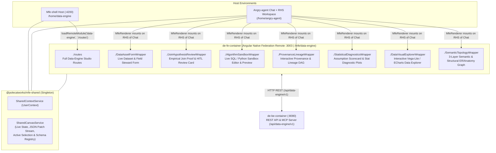
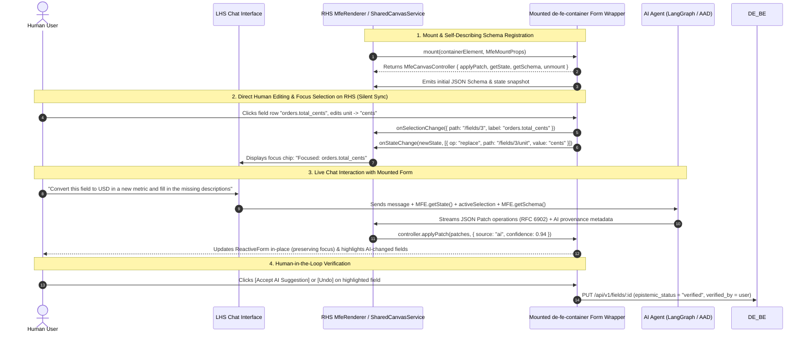

# Angular Native Federation MFE & Bidirectional Shared Canvas PRD

## Overview
This PRD defines the requirements, architecture, and component specifications for the **Data-Engine Frontend Container (`de-fe-container`)**. Built with **Angular**, **Angular Material**, **Tailwind CSS**, and **`@angular-architects/native-federation`**, `de-fe-container` operates in three modes:
1. **Standalone Developer & Steward Application (`:4200`)**: Full two-pane studio for managing data sources, datasets, field profiles, join hypotheses, sandboxed algorithms, and provenance graphs.
2. **Federated Portal Remote inside [`Mfe-shell`](https://github.com/PolecatWorks/Mfe-shell) (`./routes`)**: Mounts seamlessly under `/home/data-engine` via `remoteEntry.json` (`:3003` locally, `/mfe/data-engine/remoteEntry.json` in Kubernetes with `SERVE_ROOT=/mfe/data-engine`) sharing `@polecatworks/mfe-shared`.
3. **Live Bidirectional Shared Canvas MFE on the RHS of [`Angry-agent`](https://github.com/PolecatWorks/Angry-agent)**: Exposes self-describing, live-patchable form, data visualization, and semantic topology wrappers (`./DataAssetFormWrapper`, `./JoinHypothesisReviewWrapper`, `./AlgorithmSandboxWrapper`, `./ProvenanceLineageWrapper`, `./StatisticalDiagnosticsWrapper`, `./DataVisualExplorerWrapper`, `./SemanticTopologyWrapper`) that allow a human user and the chat LLM to simultaneously inspect, click, edit, visualize, and verify the exact same live workspace in real time.

### Zero-Rewrite Kubernetes Hosting & Runtime Configuration Resolution
- **MFE Hosting Prefix (`/mfe/data-engine`)**: In Kubernetes, `de-fe-container` is deployed via the `nginx-view` chart with `SERVE_ROOT=/mfe/data-engine`, exposing its federated assets and `config.json` under `/mfe/data-engine/*` without Istio URI path rewrites.
- **Module-Relative `config.json` Resolution (`import.meta.url`)**: Whether running standalone or federated inside `Mfe-shell` (`/home/data-engine`) or `Angry-agent`, `de-fe-container` resolves its runtime configuration via `new URL('config.json', import.meta.url)` so it always fetches `/mfe/data-engine/config.json` rather than the host application's root `/config.json`.
- **Service-Scoped Backend API Prefix (`/api/data-engine/v1`)**: `config.json` configures `apiUrl: "/api/data-engine/v1"`, matching `de-be-container`'s `service.api_prefix` and the Istio `VirtualService` prefix rule.

---

## System & Federation Architecture



---

## Core Capability 1: Bidirectional Shared Canvas Contract (`MfeCanvasController`)

To enable true simultaneous human + AI co-editing on the right-hand side (RHS) of the chat interface without losing cursor focus, scroll state, or unsaved typing, every wrapper exposed by `de-fe-container` implements the **`MfeCanvasController`** lifecycle contract:



### Required Wrapper Contract Interface
```typescript
export interface JsonPatchOp {
  op: 'add' | 'replace' | 'remove';
  path: string;
  value?: any;
}

export interface AiFieldAttribution {
  path: string;
  source: 'ai' | 'user';
  confidence?: number;
  rationale?: string;
  epistemicStatus?: 'hypothesized' | 'empirically_tested' | 'verified' | 'rejected';
}

export interface MfeMountProps<T = any> {
  initialState: T;
  /** Silent state sync fired whenever the user edits form controls directly */
  onStateChange?: (state: T, patches: JsonPatchOp[]) => void;
  /** Focus/selection tracking so chat knows what item the user clicked ("this field") */
  onSelectionChange?: (selection: { path: string; id?: string; label: string; context?: any } | null) => void;
  /** Explicit action trigger when user clicks an AI workflow button inside the MFE */
  onAction?: (actionName: string, payload: any) => void;
}

export interface MfeCanvasController<T = any> {
  /** Applies RFC 6902 JSON patches or partial state updates in-place without unmounting DOM */
  applyPatch(patches: JsonPatchOp[] | Partial<T>, attributions?: AiFieldAttribution[]): void;
  /** Returns current live state including unsubmitted form edits */
  getState(): T;
  /** Returns Draft-07 JSON Schema describing the form's editable structure and actions */
  getSchema(): Record<string, any>;
  /** Destroys component and cleans up subscriptions */
  unmount(): void;
}
```

### Key UX Safeguards Required in All Canvas Forms:
1. **Active-Focus Lock (No Mid-Typing Overwrites)**:
   - If the user's cursor is actively focused inside a form control (e.g., `/fields/2/description` has `hasFocus == true`), incoming `applyPatch` operations targeting that exact path are queued into a pending suggestion pill rather than overwriting the user's keystrokes mid-word.
2. **AI-Diff Highlighting & 1-Click Stewardship**:
   - Fields populated or modified via `applyPatch(..., source: 'ai')` render an **AI Provenance Badge** displaying the confidence score and rationale tooltip, with inline **`[✓ Verify]`**, **`[✎ Edit]`**, and **`[↺ Undo]`** actions.
3. **Self-Describing JSON Schema (`getSchema()`)**:
   - Enables the chat agent to switch between `./DataAssetFormWrapper`, `./JoinHypothesisReviewWrapper`, and `./AlgorithmSandboxWrapper` dynamically and know every valid field path and enum option without hardcoded per-form backend prompts.

---

## Core Capability 2: Exposed Federated MFE Wrappers (`federation.config.js`)

`de-fe-container/federation.config.js` exposes eight entry points under remote name `data-engine`:

| Exposed Module | Component | Purpose on the RHS of Chat / Studio |
| :--- | :--- | :--- |
| `./routes` | `remoteRoutes` | Full Master-Detail Angular routes (`/sources`, `/datasets/:id`, `/joins/:id`, `/algorithms/:id`, `/provenance/:id`, `/explore`, `/topology`) for standalone or `Mfe-shell` navigation. |
| `./DataAssetFormWrapper` | `DataAssetFormComponent` | Interactive form for inspecting and editing a `Dataset` (grain, format, source) and its table of `DatasetField`s (semantic label, description, unit, sensitivity tag, statistical profile sparklines, and verification state). Users can click any row to focus it in chat, add custom calculated fields, or ask the AI to auto-document fields. |
| `./JoinHypothesisReviewWrapper` | `JoinHypothesisReviewComponent` | Human-in-the-loop stewardship card displaying a candidate `JOINABLE_WITH` relationship, its statistical inclusion ratios, `1:1`/`1:N` cardinality badge, sample matched rows vs. unmatched orphan values, optional `WHERE` filter invariant input, and **`[Approve & Verify]`** / **`[Reject (Forbidden Join)]`** buttons. |
| `./AlgorithmSandboxWrapper` | `AlgorithmSandboxComponent` | Interactive SQL / Python code editor with input dataset bindings, `[Dry-Run Validate (100 rows)]`, `[Execute in Sandbox]`, live execution telemetry, and output data table preview. Both the user and the chat LLM can edit the code and parameters live. |
| `./ProvenanceLineageWrapper` | `ProvenanceLineageComponent` | Interactive lineage explorer rendering the Mermaid DAG (`GET /api/v1/provenance/:id/mermaid`), epistemic trust badge (`Verified` vs. `AI-Inferred`), dataset snapshot hashes, and clickable node inspection. |
| `./StatisticalDiagnosticsWrapper` | `StatisticalDiagnosticsComponent` | Interactive statistical diagnostic canvas rendering the `StatisticalResultEnvelope` ([08. Statistical Analytics Engine PRD](./statistical-analytics-engine-prd.md)): assumption check scorecards (`passed`/`warning`/`failed`), primary vs. non-parametric fallback comparison, diagnostic charts (Q-Q, residual vs. fitted, distributions, CI forest bars, STL/ACF/forecast intervals), and 1-click **`[Verify Statistical Trait]`** stewardship actions. |
| `./DataVisualExplorerWrapper` | `DataVisualExplorerComponent` | Interactive declarative data visualization studio & RHS canvas rendering `DataVisualSpec` payloads via **Vega-Lite v5** or **Apache ECharts** ([09. Data Visualizations & Semantic Relationship Topology PRD](./data-visuals-and-semantic-topology-prd.md)): schema-driven chart recommendations, encoding shelf, cross-filtering/brushing, profile reference overlays, epistemic trust badge, and "point-and-ask" selection sync. |
| `./SemanticTopologyWrapper` | `SemanticTopologyComponent` | Interactive multi-layer relationship & structural anatomy canvas powered by **Cytoscape.js + ELK** ([09. Data Visualizations & Semantic Relationship Topology PRD](./data-visuals-and-semantic-topology-prd.md)): toggles across **3-Layer Semantic-to-Physical Swimlanes** (Business Concepts/Metrics $\rightarrow$ Datasets $\rightarrow$ Fields), **Structural ER & Join Cardinality Map** (including crimson `FORBIDDEN_JOIN`, amber `drifted`, orange `fan_out_warning`, and `CONFOUNDED_BY` overlays), **Zoomed-In Field-to-Field Join & Nested Schema Anatomy**, and **Column-Level Lineage Overlay**. |

---

## Core Capability 3: Standalone & `Mfe-shell` Studio Layout (`/home/data-engine`)

Following the UI standards established in `agent-as-data`:
1. **Viewport Isolation & Independent Scrolling**: The outer layout is locked to `100%` height (`overflow: hidden`) with independently scrolling left-hand entity lists and right-hand detail editors, chart explorers, and interactive graph canvases.
2. **Nested Master-Detail Deep Linking**: Selecting a dataset (`/datasets/:id`), join hypothesis (`/joins/:id`), algorithm (`/algorithms/:id`), provenance run (`/provenance/:id`), saved data visual (`/explore/:id`), or topology focus node (`/topology?focus=:canonical_id`) synchronizes with the Angular Router for bookmarkable deep links.
3. **Embedded RHS Canvas Switcher**: Includes a built-in MFE switcher bar allowing developers to preview and test switching between all seven canvas wrappers in isolation.
