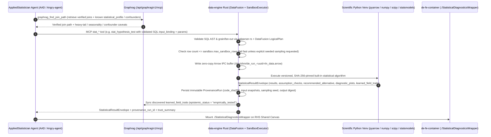
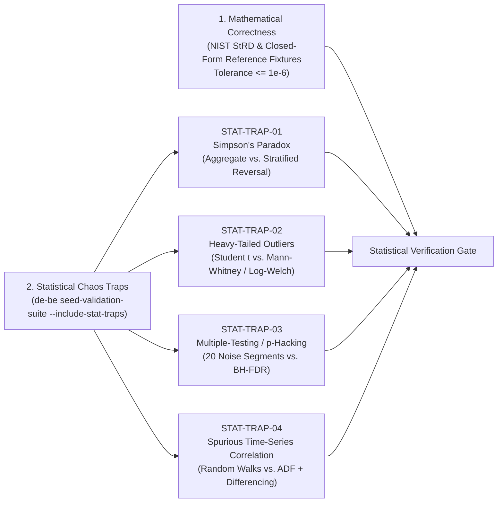

# Statistical Analytics Engine, Diagnostic Visualizations & Statistical Traps PRD

## Overview
This PRD defines **Data-Engine's (`de-be-container` & `de-fe-container`)** deterministic statistical computation toolbelt, scientific Python runtime packaging, self-checking diagnostic envelope, RHS Shared Canvas visualization wrapper, learned field statistical traits, and statistical chaos benchmarks.

It realizes the compute, diagnostic, and verification layers of the **4-Layer Hybrid Statistician Stack** documented in [Statistical Analytics Thinking, Compute Toolbelt & Diagnostic Visualization Research](../research/statistical-analytics-skills-and-compute-research.md), working in concert with `agent-as-data` (methodology skills, `AppliedStatistician` trait, and statistical guardrails) and `Graphrag` (persistent epistemic statistical traits and confounders).

---

## Architecture & Execution Lifecycle



---

## Core Functional Requirements

### 1. Scientific Python Runtime & Zero-Copy Arrow Staging (`src/sandbox/`)
1. **Pinned Scientific Virtual Environment**:
   - `de-be-container` packages a locked, read-only scientific Python virtual environment containing `numpy`, `scipy`, `statsmodels`, and `pyarrow` built from pinned multi-arch wheels (`linux/amd64` and `linux/arm64`).
   - All execution runs behind the `SandboxExecutor` trait (`process` and `namespace` backends today; `SidecarSandbox` supported as a future pluggable backend without changing callers or contracts).
   - `SandboxConfig` (`config/default.yaml`, prefix `DE_BE__SANDBOX__`) governs: `python_binary` (pointing to the pinned venv interpreter), `timeout_ms`, `max_code_bytes`, `max_sandbox_rows`, `shm_dir` (default `/dev/shm`), and `allowed_modules` (extended to allow `math`, `statistics`, `json`, `numpy`, `scipy`, `statsmodels`, `pyarrow`).
2. **Zero-Copy Arrow IPC Data Staging**:
   - Statistical tools accept one or more named `input_bindings` (either a registered `dataset_id` or a read-only DataFusion SQL query validated via `sqlparser-rs` and grain/fan-out checks).
   - Rust executes the DataFusion plan and writes Arrow `RecordBatch` streams to `/dev/shm/de_run_<uuid>/in_<name>.arrow`, memory-mapped read-only inside the sandbox via `pyarrow.ipc.open_file`.
   - Ephemeral `/dev/shm/de_run_<uuid>` directories are unconditionally cleaned up via a Rust `Drop` guard.
3. **Fail-Fast Scale Protection & Explicit Seeded Sampling**:
   - If a staged input exceeds `sandbox.max_sandbox_rows`, execution **fails fast** with `SandboxError::RowLimitExceeded` (returning actual row count and suggesting SQL aggregation or explicit sampling).
   - Silent truncation or implicit sampling is strictly prohibited.
   - Callers may explicitly pass `sampling: { strategy: "random" | "stratified", max_rows: usize, seed: u64, stratify_by?: String }`. When used, DataFusion executes deterministic seeded sampling and `ProvenanceRun` records `sampled: true`, `population_rows`, `sample_rows`, `sampling_strategy`, and `sampling_seed`.

---

### 2. Curated Phase 1 Statistical Toolbelt (Typed MCP Tools & Versioned Algorithms)
Every built-in statistical tool is backed by a **built-in, versioned, SHA-256-pinned algorithm** registered in `data-engine`'s `algorithms` registry (participating in `ProvenanceRun` cryptographic signing and inspectable in `de-fe-container`), while exposing a **strongly typed MCP tool** (`schemars::JsonSchema`) and matching REST endpoint under `${service.api_prefix}/analytics/*` (and `/api/v1/analytics/*`).

#### Phase 1 Tool Families

| MCP Tool Name | REST Endpoint | Statistical Capabilities Included | Automatic Assumption Checks Built In |
| :--- | :--- | :--- | :--- |
| **`stat_describe_and_check`** | `POST /api/v1/analytics/describe` | Moments (mean, std, variance, skewness, excess kurtosis), quantiles (p1/p5/p25/p50/p75/p95/p99, IQR, MAD), ECDF, Shapiro-Wilk / D'Agostino-Pearson / KS normality tests, IQR / MAD / modified $z$-score outlier flags, and missingness breakdown (null counts, conditional missingness hints). | Sample size adequacy, normality test ($p$-value + skewness/kurtosis thresholds), heavy-tail & extreme outlier detection, zero-variance check. |
| **`stat_hypothesis_test`** | `POST /api/v1/analytics/hypothesis-test` | Welch's $t$-test, Student's $t$-test, paired $t$-test, Mann-Whitney $U$, Wilcoxon signed-rank, one-way ANOVA, Kruskal-Wallis, Chi-square test of independence, Fisher's exact test; standardized effect sizes (Cohen's $d$, Hedges' $g$, Cliff's $\delta$, Cramér's $V$, $\eta^2$); analytical & bootstrap confidence intervals; multiple-comparison corrections (Benjamini-Hochberg FDR, Holm-Bonferroni, Bonferroni) for multi-group / stratified runs; optional stratified confounding check (e.g., Mantel-Haenszel / Simpson's paradox reversal detector when `stratify_by` is supplied). | Group sample sizes, per-group normality (Shapiro-Wilk/D'Agostino), equal variance (Levene / Brown-Forsythe), expected cell counts ($\ge 5$ for Chi-square), automatic non-parametric fallback calculation when parametric assumptions fail. |
| **`stat_power_analysis`** | `POST /api/v1/analytics/power` | Prospective & retrospective power analysis, required sample size per arm, and Minimum Detectable Effect (MDE) for two-sample means, proportions, paired tests, and one-way ANOVA at configurable $\alpha$, power ($1 - \beta$), and allocation ratio. | Checks effect size plausibility, two-sided vs. one-sided specification, and flags underpowered retrospective tests ($1 - \beta < 0.80$). |
| **`stat_correlation_vif`** | `POST /api/v1/analytics/correlation` | Pairwise Pearson, Spearman, and Kendall correlation matrices with $p$-values and FDR-adjusted $p$-values; partial correlations controlling for specified covariates; Variance Inflation Factor (VIF) and condition number multicollinearity diagnostics. | Normality & outlier sensitivity (flags divergence between Pearson and Spearman $|r - \rho| > 0.15$), multicollinearity threshold flags ($\text{VIF} > 5$ warning, $> 10$ severe), pairwise sample size check. |
| **`stat_regression_fit`** | `POST /api/v1/analytics/regression` | OLS, GLM (Gaussian, Binomial/Logistic, Poisson, Gamma), and Huber/RANSAC robust regression with coefficient estimates, standard errors (including HC3 heteroscedasticity-robust SEs), $t/z$-stats, $p$-values, 95% CIs, $R^2$/Adj-$R^2$/AIC/BIC/deviance, and standardized coefficients. | VIF multicollinearity, Breusch-Pagan heteroscedasticity test, Durbin-Watson residual autocorrelation, Shapiro-Wilk residual normality, Cook's distance & high-leverage observation counts; auto-computes HC3 robust SEs when heteroscedasticity is detected. |
| **`stat_timeseries_analyze`** | `POST /api/v1/analytics/timeseries` | STL seasonal-trend-remainder decomposition, Augmented Dickey-Fuller (ADF) and KPSS stationarity tests, ACF/PACF lag correlations with Bartlett confidence bands, residual/CUSUM changepoint & anomaly detection, cross-correlation after differencing, and ETS / ARIMA forecasting with 80% & 95% prediction intervals. | Regular spacing & missing timestamp gap check, minimum cycle count for seasonal period, stationarity agreement (ADF vs. KPSS; warns against level correlation when non-stationary), Ljung-Box residual white-noise check. |

#### Phase 2+ Planned Extensions (Out of Scope for Phase 1)
- **Cohort & Survival Analysis**: `stat_cohort_survival` (retention matrices, Kaplan-Meier survival curves, log-rank test, Cox proportional hazards).
- **Causal Inference & Bayesian Methods**: `stat_causal_estimate` (CUPED variance reduction, difference-in-differences, propensity score matching) and `stat_bayesian_ab` (Beta-Binomial & hierarchical credible intervals).

---

### 3. Universal `StatisticalResultEnvelope` Contract
Every `stat_*` tool MUST return a uniform, self-describing envelope so both LLMs and UI renderers inspect results, assumptions, and provenance consistently:

```json
{
  "tool": "stat_hypothesis_test",
  "algorithm_id": "builtin_stat_hypothesis_test",
  "algorithm_version": 1,
  "code_sha256": "<sha256>",
  "sample_context": {
    "population_rows": 12450,
    "analyzed_rows": 12450,
    "sampled": false,
    "sampling_seed": null,
    "group_sizes": { "control": 6200, "treatment": 6250 }
  },
  "primary_result": {
    "method": "welch_t_test",
    "test_statistic": 2.41,
    "p_value": 0.016,
    "adjusted_p_value": null,
    "adjustment_method": null,
    "effect_size": { "metric": "hedges_g", "value": 0.043, "interpretation": "negligible" },
    "confidence_interval": { "level": 0.95, "lower": 0.42, "upper": 4.18, "unit": "USD" }
  },
  "assumption_checks": [
    {
      "check": "normality_shapiro_or_dagostino",
      "status": "failed",
      "statistic": 842.1,
      "p_value": 0.0001,
      "message": "Heavy right skew (skewness=4.82); parametric mean test sensitive to extreme outliers."
    }
  ],
  "recommended_alternative": {
    "method": "mann_whitney_u",
    "reason": "Non-normal heavy-tailed distribution detected; non-parametric rank test computed for verification.",
    "result": { "test_statistic": 18910200.0, "p_value": 0.412, "effect_size": { "metric": "cliffs_delta", "value": -0.011 } }
  },
  "diagnostic_plots": [
    { "plot_type": "qq_plot", "title": "Q-Q Plot (Treatment vs Normal)", "series": [] },
    { "plot_type": "distribution_histogram", "title": "Group Value Distributions", "series": [] },
    { "plot_type": "ci_forest", "title": "Effect Size & 95% Confidence Interval", "series": [] }
  ],
  "learned_field_traits": [
    {
      "field_canonical_id": "sales_orders.order_total_usd",
      "distribution_family": "log_normal_heavy_tailed",
      "is_heavy_tailed": true,
      "skewness": 4.82,
      "recommended_test_family": "non_parametric_or_log_transform",
      "epistemic_status": "empirically_tested",
      "confidence": 0.93
    }
  ],
  "provenance_run_id": "<uuid>",
  "trust_summary": { "all_rules_human_verified": true, "min_rule_confidence": 0.98 }
}
```

---

### 4. Structured Diagnostic Plots & `./StatisticalDiagnosticsWrapper` (Shared Canvas)
1. **Standardized Plot Payload Schema**: `diagnostic_plots` carries typed, bounded visualization payloads (`distribution_histogram`, `qq_plot`, `residual_vs_fitted`, `ci_forest`, `correlation_heatmap`, `stl_decomposition`, `acf_pacf`, `forecast_interval`) with downsampled coordinate arrays (capped via `sandbox.max_plot_points`, default `1000`) so large datasets never bloat MCP responses.
2. **MFE Shared Canvas Wrapper (`de-fe-container`)**:
   - Exposes `./StatisticalDiagnosticsWrapper` implementing `MfeCanvasController` (`applyPatch`, `getState`, `getSchema`, `onStateChange`, `onSelectionChange`).
   - Displays three synchronized panels on the RHS of `Angry-agent`:
     - **Assumption & Rigor Scorecard**: Color-coded `passed` / `warning` / `failed` badges, sample size & sampling disclosure, and side-by-side comparison of primary vs. `recommended_alternative` results.
     - **Interactive Diagnostic Charts**: Renders the `diagnostic_plots` payloads (Q-Q, residual vs. fitted, distributions, CI forest bars, STL/ACF/forecast intervals).
     - **Epistemic Trait & Provenance Drawer**: Allows a human steward to click **[Verify Statistical Trait]** on `learned_field_traits` (syncing `epistemic_status = "verified"` to `data-engine` and `Graphrag`) and inspect the `ProvenanceRun` lineage DAG.

---

### 5. Persistent Learned Statistical Traits (`DatasetField` & `Graphrag` Sync)
When `stat_describe_and_check`, `stat_timeseries_analyze`, or `stat_hypothesis_test` identifies persistent statistical characteristics of a column or dataset:
- `data-engine` merges a `statistical_profile` block into `DatasetField.profile_stats` (recording `distribution_family`, `is_heavy_tailed`, `skewness`, `kurtosis`, `seasonality_period`, `recommended_test_family`, `known_confounders`, and `last_diagnosed_run_id`).
- `data-engine` forwards these traits to `Graphrag` via `POST /ontology/sync-dataset` with `epistemic_status = "empirically_tested"`, preserving any steward-verified annotations (`epistemic_status = "verified"`) unless statistical drift invalidates them (`epistemic_status = "drifted"`).

---

### 6. Mathematical Verification & Statistical Chaos Traps (`STAT-TRAP-01`..`STAT-TRAP-04`)



1. **Golden Mathematical Fixtures**: Every `stat_*` algorithm MUST include deterministic unit tests asserting agreement within `1e-6` against published NIST StRD datasets (e.g., `Norris`, `Longley`, `Pontius`, `SiRstv`) and analytical reference values.
2. **Deterministic Statistical Chaos Traps (`de-be seed-validation-suite`)**:
   - **`STAT-TRAP-01` (Simpson's Paradox / Confounding)**: Seeded A/B experiment where aggregate conversion favors Treatment (`+3.2%`), while both `enterprise` and `smb` strata favor Control (`-2.1%`, `-1.8%`) due to skewed traffic allocation.
   - **`STAT-TRAP-02` (Heavy-Tailed Non-Normality & Outliers)**: Log-normal transaction dataset with 1% extreme outliers where a naïve Student $t$-test fails to reject or points the wrong direction, while `stat_hypothesis_test` flags the normality failure and confirms the true shift via `mann_whitney_u`.
   - **`STAT-TRAP-03` (Multiple-Testing / $p$-Hacking)**: 20 pure-noise cohort segments where 1–2 segments exhibit raw $p < 0.05$ by random chance; Benjamini-Hochberg FDR adjustment yields zero false discoveries (`adjusted_p_value > 0.25`).
   - **`STAT-TRAP-04` (Spurious Non-Stationary Time-Series Correlation)**: Two independent drifting random walks producing Pearson $r > 0.85$ in levels; `stat_timeseries_analyze` detects non-stationarity via ADF/KPSS and yields $|r| < 0.15$ on first differences.

---

### 7. Built-In Registration & Cross-Repo CLI Hydration Interoperability
- `de-be` automatically registers and verifies its built-in SHA-256-pinned statistical algorithms (`builtin_stat_*`) on startup (and via `de-be hydrate-builtins`), ensuring every `stat_*` MCP tool is immediately discoverable over `POST /api/data-engine/v1/mcp`.
- When operators hydrate `agent-as-data` via `aad-be ctl apply -f manifests/ecosystem -R --allow-degraded-tools` (`make hydrate-ecosystem`) and run `aad-be ctl sync-tools data-engine-mcp`, AAD registers `data-engine-mcp`, ingests all `stat_*` tool schemas, and binds the hydrated `AppliedStatistician` trait, 5 statistical methodology skills, and `Applied Statistician Agent` end-to-end without manual UI clicks or hardcoded UUIDs.

---

## Cross References
- [Research: Statistical Analytics Thinking, Compute Toolbelt & Diagnostic Visualization](../research/statistical-analytics-skills-and-compute-research.md)
- [03. Federated Compute, Code Sandbox & Provenance PRD](./compute-sandbox-provenance-prd.md)
- [04. MCP Server & REST API Contract PRD](./data-engine-mcp-api-prd.md)
- [05. MFE Frontend & Shared Canvas PRD](./mfe-frontend-canvas-prd.md)
- [07. Validation Datasets, Benchmark Harness & Chaos Seeding PRD](./validation-datasets-and-benchmark-prd.md)
