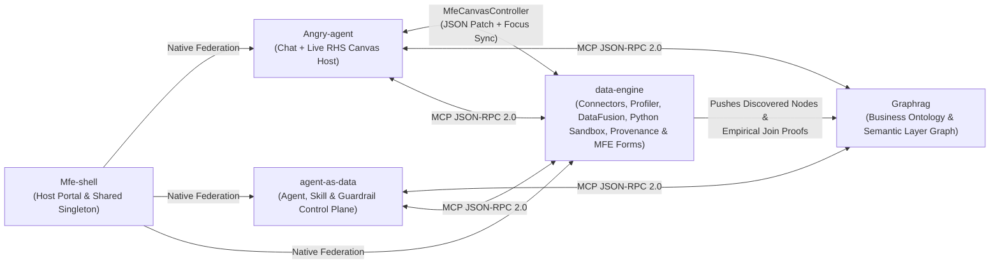

# Autonomous Semantic Layer, Zero-Copy Sandbox & Bidirectional MFE Canvas Research

## 1. Problem Statement
Traditional data catalogs and manual semantic layers suffer from **Catalog Rot (Semantic Drift)**: human teams cannot manually document thousands of evolving dataset columns, foreign keys, units, and aggregation grains. Meanwhile, naive LLM "Text-to-SQL" approaches fail on real-world enterprise schemas due to:
1. **Fan-Out & Chasm Traps**: Joining two $1:N$ tables without pre-aggregation silently corrupts `SUM`/`AVG` metrics.
2. **Opaque Values & Units**: Lack of column value distributions, enum literals, and unit metadata (`cents` vs. `USD`).
3. **Data Gravity in Dynamic Code Execution**: Passing large datasets over HTTP/JSON to external code sandboxes introduces prohibitive serialization overhead.
4. **One-Way UI Interaction**: Standard chat UIs cannot co-edit a live form on the right-hand side without unmounting DOM state or requiring manual form submission before the AI can see user edits.

---

## 2. Architectural Synthesis Across the 5-Repo Ecosystem

### Key Architectural Decisions Captured in PRDs:
1. **Empirical Sandbox Probing for the Semantic Layer** ([data-connectors-profiling-prd.md](../prds/data-connectors-profiling-prd.md)):
   - Combine MinHash value-overlap sketching with read-only DataFusion join probes to measure exact inclusion ratios and cardinality (`1:1`, `1:N`, `N:M`) before consulting a human steward.
   - Persist negative human feedback as explicit `FORBIDDEN_JOIN` constraints so the AI never repeats rejected joins.
2. **Zero-Copy Apache Arrow Bridge to Sandboxed Python** ([compute-sandbox-provenance-prd.md](../prds/compute-sandbox-provenance-prd.md)):
   - Stage filtered/joined DataFusion `RecordBatch` streams into `/dev/shm` as read-only Arrow IPC files and memory-map them inside an isolated Python worker (`pyarrow` / `polars`), achieving `<1ms` hand-off and unified cryptographic provenance (`SHA-256(inputs || rules || code || output)`).
3. **Bidirectional `MfeCanvasController` with RFC 6902 JSON Patch** ([mfe-frontend-canvas-prd.md](../prds/mfe-frontend-canvas-prd.md)):
   - Replace one-shot DOM mounting with a controller returning `{ applyPatch, getState, getSchema, unmount }` and emitting `onStateChange` (silent sync), `onSelectionChange` ("point-and-ask" focus chip), and `onAction`, with active-focus locks and visual AI-attribution badges.
