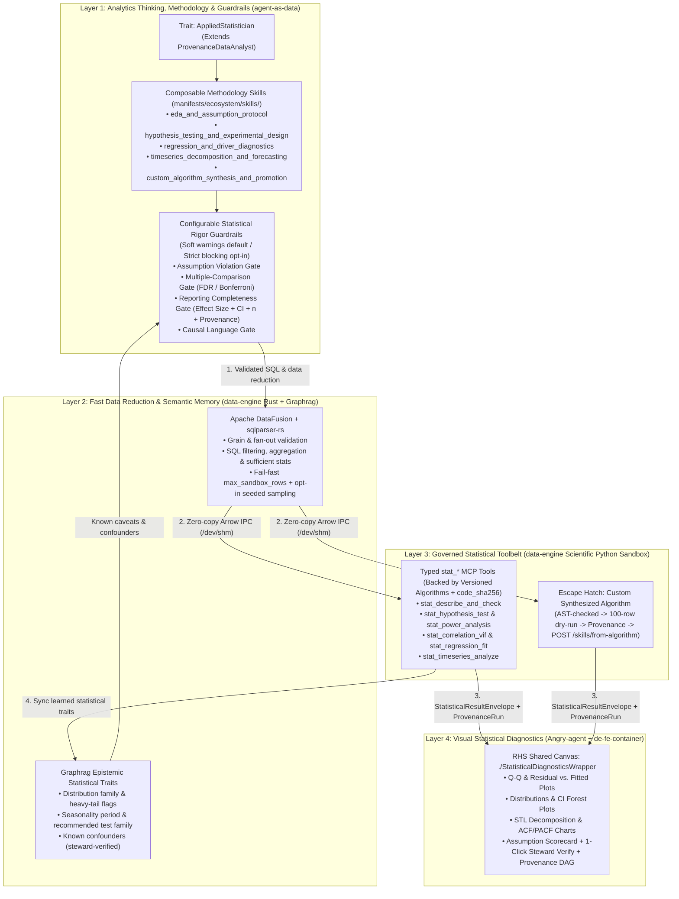

# Statistical Analytics Thinking, Compute Toolbelt & Diagnostic Visualization Research

## 1. Problem Statement & Core Rationale: The Two Halves of Statistician Capabilities

Adding statistician-grade analytics to an AI agent ecosystem is best understood as **two distinct problems that must work together while remaining cleanly decoupled**:

1. **Analytics Thinking (Cognitive, Methodological & Epistemic Rigor)** — *How a statistician reasons before, during, and after calculation*:
   - **Framing the Estimand**: Clarifying whether the user's question is descriptive, inferential, predictive, or causal — and verifying dataset grain and join semantics before touching numbers.
   - **Pre-Flight Assumption Checking**: Testing distributional normality, skewness/heavy tails, variance equality, missingness patterns (MCAR/MAR/MNAR), sample size / statistical power, and time-series stationarity *before* choosing a parametric method.
   - **Method Selection & Trap Avoidance**: Switching cleanly from Student's $t$-test to Welch's $t$-test or Mann-Whitney $U$ when assumptions fail; stratifying to catch Simpson's paradox and confounding; applying Benjamini-Hochberg FDR / Holm-Bonferroni corrections across multiple subgroup comparisons to prevent $p$-hacking; differencing non-stationary time series before checking correlation; and refusing to assert causation from observational associations.
   - **Responsible Uncertainty Communication**: Reporting sample size ($n$), standardized effect sizes (Cohen's $d$, Hedges' $g$, Cliff's $\delta$, Cramér's $V$, $\eta^2$), confidence intervals, sampling caveats, and cryptographic provenance (`provenance_run_id`) — never bare point estimates or naked $p$-values.

2. **Statistical Calculations (Deterministic Numerical Compute)** — *The peer-reviewed mathematical tools a statistician runs on data*:
   - Descriptive moments, quantiles, ECDF, normality/variance tests, and robust outlier diagnostics.
   - Parametric & non-parametric hypothesis tests, bootstrap/analytical CIs, power/MDE calculators, and multiple-testing adjustments.
   - Linear/monotonic/partial correlations, VIF multicollinearity checks, OLS/GLM/logistic/robust regression with HC3 SEs, Breusch-Pagan, Durbin-Watson, and Cook's distance diagnostics.
   - STL seasonal-trend decomposition, ADF/KPSS stationarity tests, ACF/PACF, changepoint detection, and ETS/ARIMA forecasting with prediction intervals.

### Why Separating *Thinking* from *Calculation* Is Non-Negotiable
- **LLMs excel at framing questions, synthesizing domain context, and selecting workflows when guided by explicit trait invariants and composable skills** — yet they are notoriously unreliable at performing arithmetic/statistical distributions in-context and routinely skip assumption checks unless structurally prompted and guarded.
- **Conversely, deterministic numerical libraries (`scipy`, `statsmodels`, Apache DataFusion) excel at exact, auditable math at scale** — yet a bare math library cannot tell whether a user's join introduces a $1:N \times 1:N$ fan-out trap, whether a subgroup comparison is confounded by customer segment, or whether a regression coefficient is being over-interpreted as causal.
- **By decoupling cognitive methodology (`agent-as-data`), semantic memory (`Graphrag`), fast data reduction (`data-engine` DataFusion), and peer-reviewed statistical computation (`data-engine` Scientific Python Sandbox), each layer does what it is objectively best at.**

---

## 2. Architectural Options Evaluated

Four primary options and a layered hybrid were evaluated against five criteria: *Statistical Breadth*, *Mathematical Correctness & Auditability*, *Large-Dataset Performance*, *Operational Complexity*, and *Alignment with Existing Ecosystem PRDs*.

### Detailed Option Analysis

#### Option 1: Prompt-Only Declarative "Thinking" Skills + Ad-Hoc Sandbox Code Generation
Store pure methodological skills in `agent-as-data` (`skills`) and let the LLM author bespoke SQL or Python scripts on each turn inside `data-engine`'s sandbox.
- **Pros**: Zero new infrastructure; maximum ad-hoc flexibility for novel analyses; works immediately with existing skill registries.
- **Cons**: The LLM re-implements statistical formulas from scratch on every run (high risk of subtle numerical bugs such as population vs. sample variance `ddof`, wrong degrees of freedom, one-tailed vs. two-tailed confusion, or missing FDR adjustments); difficult to certify or unit-test against reference datasets; and stdlib-only Python (`math`/`statistics`) cannot practically express GLMs, robust regression, STL decomposition, or exact statistical tests.

#### Option 2: Native Statistical Primitives in Rust (`data-engine` + DataFusion UDFs)
Implement a suite of typed statistical MCP tools directly in `de-be-container` using Rust crates (`statrs`, `nalgebra`, `linfa`) and custom Apache DataFusion aggregate/window UDFs.
- **Pros**: Blazing fast on large Arrow datasets with zero cross-language overhead; single slim Rust container; strong static typing; trivial provenance integration.
- **Cons**: Rust's statistical modeling ecosystem is significantly narrower than Python/R — implementing and certifying GLMs, HC3 robust covariance estimators, Breusch-Pagan, STL decomposition, ADF/KPSS, ARIMA/ETS, survival analysis, and multiple-testing procedures from scratch carries high engineering and numerical-accuracy risk.

#### Option 3: Scientific Python Sandbox + Curated "Standard Library" of Promoted Statistical Skills
Realize the scientific sandbox vision in [03. Compute, Sandbox & Provenance PRD](../prds/compute-sandbox-provenance-prd.md) (`pyarrow`, `numpy`, `scipy`, `statsmodels` over zero-copy Arrow IPC) and ship a pre-validated, versioned library of canonical statistical algorithms in `data-engine` exposed as typed `stat_*` MCP tools and paired with `agent-as-data` skills.
- **Pros**: Full breadth of peer-reviewed statistical libraries (`scipy.stats`, `statsmodels`); deterministic, NIST-verified math pinned to immutable `code_sha256` digests with cryptographic `ProvenanceRun` trails; retains custom algorithm synthesis (`algorithm_add` $\rightarrow$ `algorithm_validate` $\rightarrow$ `POST /skills/from-algorithm`) as an escape hatch for specialized models.
- **Cons**: Larger container image (or optional future sidecar); requires zero-copy Arrow IPC staging so large datasets do not bottleneck on JSON row serialization.

#### Option 4: Dedicated Standalone Statistical MCP Microservice (Python or R)
Deploy an independent statistical MCP microservice alongside `data-engine` and `Graphrag`.
- **Pros**: Keeps `de-be-container` pure Rust; unlocks R (`forecast`, `survival`, `lme4`) if specialized academic/biostatistical tooling is ever needed; allows independent horizontal compute scaling.
- **Cons**: Adds an extra repository/container/Helm chart/CI pipeline to operate; breaks local `/dev/shm` zero-copy Arrow memory-mapping locality with DataFusion (requiring Arrow Flight or object-store network transfers); fragments cryptographic provenance unless bridged back into `data-engine`.

### Side-by-Side Comparison Matrix

| Dimension | Opt 1: Prompt + Ad-Hoc | Opt 2: Native Rust / DataFusion | Opt 3: Curated SciPy Sandbox + AAD Skills | Opt 4: Separate Stats MCP Service | **Selected: 4-Layer Hybrid (1 + 2 + 3)** |
| :--- | :---: | :---: | :---: | :---: | :---: |
| **Statistical Breadth** | Low (stdlib only) | Low–Medium | **High** (`scipy`, `statsmodels`) | **Very High** (Python + R) | **High** (+ custom escape hatch) |
| **Math Correctness & Auditability** | Low (LLM-written each run) | **Very High** | **High** (NIST-tested, `code_sha256`-pinned) | High | **High** (NIST-tested + `ProvenanceRun`) |
| **Large-Dataset Performance** | Low (JSON rows) | **Very High** | High (DataFusion + Arrow IPC) | Medium (network hop) | **High** (DataFusion reduction + `/dev/shm` Arrow) |
| **Methodological Rigor ("Thinking")** | Soft prompt only | None | Medium (tool diagnostics) | Medium | **Very High** (Skills + Trait + Self-checking tools + Guardrails) |
| **Operational Complexity** | **Minimal** | Low | Medium (pinned venv in `de-be`) | High (new service + bridge) | **Low–Medium** (zero new services) |
| **Alignment w/ Existing Ecosystem PRDs** | Partial | Partial | Strong | Divergent | **Exact fit across all 5 repos** |

---

## 3. Selected Architecture: The 4-Layer Hybrid Statistician Stack

### Why This 4-Layer Design Works (Four Core Pillars)

1. **Composable "Thinking" Skills + Hard Invariants (Layer 1 — `agent-as-data`)**:
   - An `AppliedStatistician` trait extends `ProvenanceDataAnalyst` with explicit behavioral invariants (*check assumptions first*, *report effect size + CI + $n$ + provenance*, *check confounders & apply FDR*, *never assert causation from observational correlation*).
   - High-level methodology skills compose lower-level skills via `Skill.attached_skills` (e.g., every inferential, regression, and time-series skill composes `eda_and_assumption_protocol`) and bind to `data-engine-mcp` and `graphrag-mcp`.
   - Configurable **Statistical Rigor Guardrails** (`soft` warning mode by default; `strict` retry/blocking mode opt-in) convert best-practice methodology into deterministic runtime verification without crippling interactive exploration.

2. **DataFusion for Scale, Scientific Python for Statistical Depth (Layers 2 & 3 — `data-engine`)**:
   - Apache DataFusion + `sqlparser-rs` performs the heavy lifting on S3/Postgres/Parquet (joins, chasm/fan-out checks, filtering, pre-aggregation, deterministic seeded sampling), handing compact zero-copy Apache Arrow IPC buffers (`/dev/shm`) to a pinned scientific Python venv (`pyarrow`, `numpy`, `scipy`, `statsmodels`) behind `SandboxExecutor`.
   - **Explicit over Implicit Scale Safety**: Exceeding `max_sandbox_rows` fails fast (`RowLimitExceeded`) unless the caller explicitly requests deterministic seeded sampling (`SamplingSpec`), which is recorded transparently in `ProvenanceRun`.

3. **Self-Checking Statistical Algorithms & Persistent Epistemic Memory (Layers 2 & 3 — `data-engine` + `Graphrag`)**:
   - Rather than relying on the LLM to remember every diagnostic test, every curated `stat_*` tool returns a standardized `StatisticalResultEnvelope` containing both the primary statistic and deterministic `assumption_checks` + `recommended_alternative` (e.g., automatically computing Mann-Whitney $U$ when normality fails, HC3 robust SEs when Breusch-Pagan detects heteroscedasticity, or flagging Simpson's paradox when stratified effects reverse aggregate direction).
   - Discovered persistent field traits (`distribution_family`, `is_heavy_tailed`, `seasonality_period`, `recommended_test_family`, `known_confounders`) sync to `DatasetField.profile_stats` and `Graphrag` (`POST /ontology/sync-dataset`) under the epistemic lifecycle (`empirically_tested` $\rightarrow$ `verified` / `drifted`), so future analyses inherit institutional statistical memory automatically on `graphrag_find_join_path`.

4. **Visual Statistical Diagnostics & Natural Skill Promotion Loop (Layer 4 — `de-fe-container` / `Angry-agent`)**:
   - Applied statisticians never trust a model without inspecting plots; bounded `diagnostic_plots` payloads (Q-Q, residual vs. fitted, distributions, CI forest intervals, STL/ACF/forecast bands) mount directly into `./StatisticalDiagnosticsWrapper` alongside 1-click `[Verify Statistical Trait]` stewardship and provenance lineage inspection.
   - When an analyst needs a domain-specific calculation outside the built-in `stat_*` library, the agent synthesizes a custom Python algorithm via `algorithm_add` + `algorithm_validate` (using the same scientific venv and AST gatekeeper), runs it with full provenance, and promotes validated revisions into governed AAD Skills (`POST /skills/from-algorithm`).

---

## 4. Key Technical Design Decisions

### 4.1 Phased Statistical Scope
- **Phase 1 (Core Statistician Foundation)**:
  1. **Exploratory Diagnostics & Assumption Checking**: Moments, skewness, kurtosis, quantiles, ECDF, Shapiro-Wilk / Kolmogorov-Smirnov / D'Agostino-Pearson normality tests, Levene / Brown-Forsythe equal-variance tests, IQR / MAD / modified $z$-score outlier detection, and missingness profiling.
  2. **Hypothesis Testing & Experimental Design**: Welch's & Student's $t$-test, paired $t$-test, Mann-Whitney $U$, Wilcoxon signed-rank, one-way ANOVA & Kruskal-Wallis, Chi-square & Fisher's exact test, standardized effect sizes (Cohen's $d$, Hedges' $g$, Cliff's $\delta$, Cramér's $V$, $\eta^2$), bootstrap & analytical confidence intervals, statistical power & minimum detectable effect / sample-size calculators, multiple-comparison corrections (Benjamini-Hochberg FDR, Holm-Bonferroni, Bonferroni), and stratified confounding / Simpson's paradox checks.
  3. **Relationships & Regression Modeling**: Pearson, Spearman, Kendall, and partial correlations; Variance Inflation Factor (VIF) multicollinearity diagnostics; OLS, GLM, logistic, and Huber/RANSAC robust regression; Breusch-Pagan heteroscedasticity, Durbin-Watson autocorrelation, residual normality, HC3 robust standard errors, and Cook's distance / leverage influence diagnostics.
  4. **Time-Series & Forecasting**: STL seasonal-trend decomposition, ADF & KPSS stationarity tests, ACF / PACF lag analysis, changepoint & residual anomaly detection, differenced cross-series correlation checks, and ETS / ARIMA forecasting with prediction intervals.
- **Phase 2+ (Advanced & Specialized Extensions)**:
  - Cohort retention & survival analysis (Kaplan-Meier curves, log-rank test, Cox proportional hazards).
  - Causal inference & Bayesian analytics (CUPED variance reduction, difference-in-differences, propensity score matching, Beta-Binomial & hierarchical Bayesian credible intervals).

### 4.2 Scientific Python Runtime & Zero-Copy Arrow Staging
- **Runtime Packaging**: A pinned, read-only Python virtual environment (`numpy`, `scipy`, `statsmodels`, `pyarrow`) baked into `de-be-container` via multi-arch wheels (`linux/amd64`, `linux/arm64`) behind the `SandboxExecutor` trait. This avoids immediate multi-container deployment overhead while keeping `SidecarSandbox` cleanly pluggable if independent pod cgroups are needed later.
- **Data Staging & Scale Safety**:
  - Every `stat_*` invocation binds validated DataFusion SQL query outputs (or registered datasets) into read-only Apache Arrow IPC files under `/dev/shm/de_run_<uuid>/in_<name>.arrow`, memory-mapped by `pyarrow.ipc.open_file` in sub-millisecond time.
  - **Fail-Fast Row Cap with Explicit Seeded Sampling**: If staged rows exceed `sandbox.max_sandbox_rows`, execution fails fast with `SandboxError::RowLimitExceeded` by default rather than silently truncating or approximating. Callers must either pre-aggregate in DataFusion SQL or explicitly opt into deterministic seeded sampling (`sampling: { strategy: "random" | "stratified", max_rows, seed }`), which records `sampled: true`, `population_rows`, `sample_rows`, and `seed` inside `ProvenanceRun`.

### 4.3 Verification & Statistical Chaos Traps (`STAT-TRAP-01`..`STAT-TRAP-04`)
Mathematical correctness and analytical thinking are validated separately:
1. **Golden Reference Fixtures**: Unit and integration tests verify every `stat_*` algorithm against NIST StRD (Statistical Reference Datasets) and analytical closed-form benchmarks within strict numerical tolerances (`1e-6`).
2. **Statistical Chaos Traps** extending `de-be seed-validation-suite`:
   - **`STAT-TRAP-01` (Simpson's Paradox / Confounding)**: Aggregate conversion rate favors Treatment (`+3.2%`), while every stratified segment (Enterprise vs. SMB) favors Control (`-2.1%`, `-1.8%`) due to imbalanced allocation.
   - **`STAT-TRAP-02` (Heavy-Tailed Non-Normality & Outliers)**: Log-normal order values with 1% whale outliers cause a naïve Student $t$-test to miss or invert a real median shift detectable via Mann-Whitney $U$ or log-transformed Welch's $t$-test.
   - **`STAT-TRAP-03` (Multiple-Testing / $p$-Hacking)**: 20 pure-noise feature segments tested simultaneously yield 1–2 spurious $p < 0.05$ hits that disappear under Benjamini-Hochberg FDR correction.
   - **`STAT-TRAP-04` (Spurious Non-Stationary Time-Series Correlation)**: Two independent drifting random walks exhibit Pearson $r > 0.85$ in levels, which drops to $|r| < 0.15$ after ADF/KPSS stationarity checking and first-differencing.

---

## 5. Cross-Repository Mapping & Implementation Roadmap

| Repo | Responsibility in the 4-Layer Stack | PRDs & Derived TDD Specs |
| :--- | :--- | :--- |
| **`data-engine`** | **Layers 2, 3 & 4 (Compute, Sandbox, Diagnostics & Benchmarks)**: DataFusion SQL reduction, `/dev/shm` Arrow IPC staging, pinned scientific Python venv, 6 curated `stat_*` MCP/REST tools, `StatisticalResultEnvelope`, NIST golden math tests, `STAT-TRAP-01..04`, and `./StatisticalDiagnosticsWrapper`. | [PRD 08](../prds/statistical-analytics-engine-prd.md), [Spec 10](../specs/10-scientific-python-sandbox-and-arrow-ipc-spec.md), [Spec 11](../specs/11-curated-statistical-toolbelt-and-mcp-spec.md), [Spec 12](../specs/12-statistical-chaos-traps-and-diagnostics-canvas-spec.md) |
| **`Graphrag`** | **Layer 2 (Semantic & Epistemic Statistical Memory)**: Persists `properties.statistical_profile` & `known_confounders` on `Dataset`/`Field` nodes, protects steward-verified traits from unverified overwrite, and surfaces `statistical_caveats` in `POST /ontology/join-path`. | `Graphrag/spec/prds/autonomous-semantic-ontology-prd.md`, `Graphrag/spec/specs/24-epistemic-statistical-traits-and-confounders-spec.md` |
| **`agent-as-data`** | **Layer 1 (Analytics Thinking, Declarative Hydration & Statistical Guardrails)**: `AppliedStatistician` trait, 5 composable statistical methodology skills & `Applied Statistician Agent` in `manifests/ecosystem/` (hydrated via `aad-be ctl apply -f manifests/ecosystem -R --allow-degraded-tools` & `aad-be ctl sync-tools data-engine-mcp`), and configurable `soft`/`strict` Statistical Rigor Guardrails (4 gates). | `agent-as-data/spec/prds/analytics-thinking-skills-and-guardrails-prd.md`, `agent-as-data/spec/prds/cli-manifest-tool-prd.md`, `agent-as-data/spec/specs/43-statistical-analytics-manifests-pack-spec.md`, `agent-as-data/spec/specs/44-statistical-rigor-guardrails-and-ablation-spec.md` |
