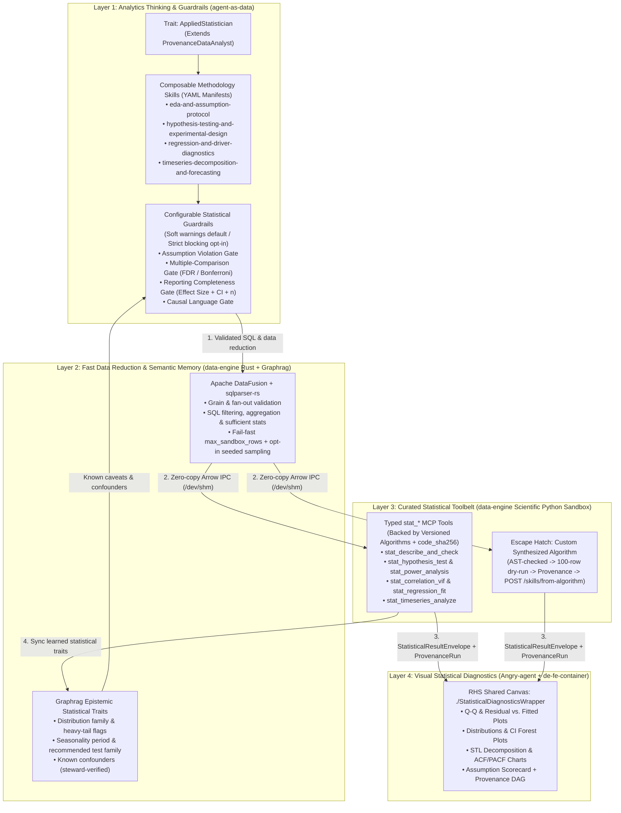

# Statistical Analytics Thinking, Compute Toolbelt & Diagnostic Visualization Research

## 1. Problem Statement & Motivation

Large Language Models can write plausible SQL and narrate trends, yet they routinely fail as **applied statisticians** for two complementary reasons:

1. **Methodological Failure ("Analytics Thinking")**: Without explicit statistical discipline, LLMs jump straight to parametric tests (e.g., Student's $t$-test) on heavy-tailed or skewed data, ignore confounding variables (Simpson's paradox), run dozens of subgroup comparisons without false-discovery-rate (FDR) correction ($p$-hacking), report bare $p$-values without effect sizes or confidence intervals, fit OLS models without checking multicollinearity (VIF) or heteroscedasticity, and treat spurious correlations between non-stationary time series as causal relationships.
2. **Computational & Epistemic Failure ("Statistical Calculations")**: LLMs cannot reliably perform exact numerical statistics in-context, and regenerating ad-hoc Python math scripts per request introduces subtle numerical errors (e.g., biased vs. unbiased variance, incorrect degrees of freedom, wrong tail direction) while making provenance and peer review impossible.

This research evaluates architectural options for adding **statistician-grade analytics thinking and deterministic statistical computation** across the 5-repository PolecatWorks ecosystem (`Mfe-shell`, `Angry-agent`, `agent-as-data`, `Graphrag`, and `data-engine`).

---

## 2. Architectural Options Evaluated

Four primary options and a layered hybrid were evaluated against five criteria: *Statistical Breadth*, *Mathematical Correctness & Auditability*, *Large-Dataset Performance*, *Operational Complexity*, and *Alignment with Existing PRDs*.

| Approach | Summary | Strengths | Limitations |
| :--- | :--- | :--- | :--- |
| **Option 1: Prompt-Only Skills + Ad-Hoc Sandbox Code** | Store methodology prompts in `agent-as-data` (`skills`) and let the LLM author bespoke SQL / stdlib Python scripts on each turn. | Zero new runtime dependencies; maximum ad-hoc flexibility. | Re-invents math every run (high error rate); current sandbox only exposes stdlib `math`/`statistics`; hard to audit or guarantee assumption checks. |
| **Option 2: Native Rust / DataFusion Statistical Primitives** | Implement statistical tests and regressions directly in Rust (`statrs`, `nalgebra`, `linfa`) and custom DataFusion UDFs. | Fastest execution on huge Arrow datasets; single slim Rust binary; strong static typing. | Narrow statistical library ecosystem compared to Python/R; high maintenance cost for GLMs, robust regression, STL/ARIMA, survival, and multiple-testing diagnostics. |
| **Option 3: Curated Scientific Python Sandbox + Promoted AAD Skills** | Bake a pinned scientific Python venv (`numpy`, `scipy`, `statsmodels`, `pyarrow`) behind `SandboxExecutor`, ship versioned/SHA-256-pinned statistical algorithms exposed as typed `stat_*` MCP tools, and pair with `agent-as-data` skills. | Full breadth of peer-reviewed statistical libraries; deterministic & reproducible (`code_sha256` + `ProvenanceRun`); keeps custom algorithm synthesis as an escape hatch. | Larger container image (or optional future sidecar); requires Arrow IPC staging to avoid JSON serialization bottlenecks. |
| **Option 4: Dedicated Standalone Stats MCP Microservice (Python/R)** | Deploy an independent statistical microservice alongside `data-engine` and `Graphrag`. | Keeps `de-be-container` pure Rust; unlocks R (`forecast`, `survival`, `lme4`); scales compute independently. | Adds a new deployment, Helm chart, and CI pipeline; breaks local `/dev/shm` zero-copy Arrow locality with DataFusion; fragments provenance tracking. |
| **Selected: 4-Layer Hybrid Statistician Stack (Options 1 + 2 + 3)** | **Layer 1**: Methodology Skills, `AppliedStatistician` trait & configurable guardrails (`agent-as-data`). **Layer 2**: DataFusion SQL reduction & profiling (`data-engine` Rust). **Layer 3**: Curated versioned `stat_*` MCP tools in a pinned scientific Python venv (`data-engine` sandbox). **Layer 4**: Structured diagnostic plot specs + Shared Canvas (`Angry-agent` / `de-fe-container`) + learned field statistical traits (`Graphrag`). | Combines cognitive rigor, Rust/Arrow scale, `scipy`/`statsmodels` depth, visual diagnostics, and unified cryptographic provenance with minimal operational overhead. | Requires careful container multi-arch wheel pinning (`amd64`/`arm64`) and strict memory/row limits on Arrow IPC staging. |

---

## 3. Selected Architecture: The 4-Layer Statistician Stack

---

## 4. Key Technical Design Decisions

### 4.1 Phased Statistical Scope
- **Phase 1 (Core Statistician Foundation)**:
  1. **Exploratory Diagnostics & Assumption Checking**: Moments, skewness, kurtosis, quantiles, ECDF, Shapiro-Wilk / Kolmogorov-Smirnov / D'Agostino-Pearson normality tests, Levene / Brown-Forsythe equal-variance tests, IQR / MAD / modified $z$-score outlier detection, and missingness profiling.
  2. **Hypothesis Testing & Experimental Design**: Welch's & Student's $t$-test, paired $t$-test, Mann-Whitney $U$, Wilcoxon signed-rank, one-way ANOVA & Kruskal-Wallis, Chi-square & Fisher's exact test, standardized effect sizes (Cohen's $d$, Hedges' $g$, Cliff's $\delta$, Cramér's $V$, $\eta^2$), bootstrap & analytical confidence intervals, statistical power & minimum detectable effect / sample-size calculators, and multiple-comparison corrections (Benjamini-Hochberg FDR, Holm-Bonferroni, Bonferroni).
  3. **Relationships & Regression Modeling**: Pearson, Spearman, Kendall, and partial correlations; Variance Inflation Factor (VIF) multicollinearity diagnostics; OLS, GLM, logistic, and Huber/RANSAC robust regression; Breusch-Pagan heteroscedasticity, Durbin-Watson autocorrelation, residual normality, and Cook's distance / leverage influence diagnostics.
  4. **Time-Series & Forecasting**: STL seasonal-trend decomposition, ADF & KPSS stationarity tests, ACF / PACF lag analysis, changepoint & residual anomaly detection, and ETS / ARIMA forecasting with prediction intervals.
- **Phase 2+ (Advanced & Specialized Extensions)**:
  - Cohort retention & survival analysis (Kaplan-Meier curves, log-rank test, Cox proportional hazards).
  - Causal inference & Bayesian analytics (CUPED variance reduction, difference-in-differences, propensity score matching, Beta-Binomial & hierarchical Bayesian credible intervals).

### 4.2 Scientific Python Runtime & Zero-Copy Arrow Staging
- **Runtime Packaging**: A pinned, read-only Python virtual environment (`numpy`, `scipy`, `statsmodels`, `pyarrow`) baked into `de-be-container` via multi-arch wheels (`linux/amd64`, `linux/arm64`) behind the `SandboxExecutor` trait. This avoids immediate multi-container deployment overhead while keeping `SidecarSandbox` cleanly pluggable if independent pod cgroups are needed later.
- **Data Staging & Scale Safety**:
  - Every `stat_*` invocation binds validated DataFusion SQL query outputs (or registered datasets) into read-only Apache Arrow IPC files under `/dev/shm/de_run_<uuid>/in_<name>.arrow`, memory-mapped by `pyarrow.ipc.open_file` in sub-millisecond time.
  - **Fail-Fast Row Cap with Explicit Seeded Sampling**: If staged rows exceed `sandbox.max_sandbox_rows`, execution fails fast with `SandboxError::RowLimitExceeded` by default rather than silently truncating or approximating. Callers must either pre-aggregate in DataFusion SQL or explicitly opt into deterministic seeded sampling (`sampling: { strategy: "random" | "stratified", max_rows, seed }`), which records `sampled: true`, `population_rows`, `sample_rows`, and `seed` inside `ProvenanceRun`.

### 4.3 Self-Checking Statistical Envelope & Learned Epistemic Traits
- Every curated `stat_*` tool returns a standardized `StatisticalResultEnvelope`:
  - Core estimates (`test_statistic`, `p_value`, `adjusted_p_value`, `effect_size`, `confidence_interval`, `sample_size`)
  - Deterministic `assumption_checks` scorecard (`passed`, `warning`, `failed` with exact diagnostic statistics) and `recommended_alternative` (e.g., automatically computing Mann-Whitney $U$ alongside Welch's $t$-test when normality fails)
  - Structured `diagnostic_plots` payloads (Q-Q points, residual vs. fitted coordinates, histograms, CI intervals, STL/ACF series) for rendering in `de-fe-container`'s `./StatisticalDiagnosticsWrapper`
  - `learned_field_traits` persisted to `DatasetField.profile_stats` in `data-engine` and synchronized to `Graphrag` (`POST /ontology/sync-dataset`) under the standard epistemic lifecycle (`empirically_tested` $\rightarrow$ `pending_review` $\rightarrow$ `verified` / `drifted`).

### 4.4 Verification & Statistical Chaos Traps (`STAT-TRAP-01`..`STAT-TRAP-04`)
Mathematical correctness and analytical thinking are validated separately:
1. **Golden Reference Fixtures**: Unit and integration tests verify every `stat_*` algorithm against NIST StRD (Statistical Reference Datasets) and analytical closed-form benchmarks within strict numerical tolerances (`1e-6`).
2. **Statistical Chaos Traps** extending `de-be seed-validation-suite`:
   - **`STAT-TRAP-01` (Simpson's Paradox / Confounding)**: Aggregate conversion rate favors Treatment (`+3.2%`), while every stratified segment (Enterprise vs. SMB) favors Control (`-2.1%`, `-1.8%`) due to imbalanced allocation.
   - **`STAT-TRAP-02` (Heavy-Tailed Non-Normality & Outliers)**: Log-normal order values with 1% whale outliers cause a naïve Student $t$-test to miss or invert a real median shift detectable via Mann-Whitney $U$ or log-transformed Welch's $t$-test.
   - **`STAT-TRAP-03` (Multiple-Testing / $p$-Hacking)**: 20 pure-noise feature segments tested simultaneously yield 1–2 spurious $p < 0.05$ hits that disappear under Benjamini-Hochberg FDR correction.
   - **`STAT-TRAP-04` (Spurious Non-Stationary Time-Series Correlation)**: Two independent drifting random walks exhibit Pearson $r > 0.85$ in levels, which drops to $r \approx 0$ after ADF/KPSS stationarity checking and first-differencing.

---

## 5. Resulting PRD Plan Across Repositories

1. **`data-engine`**:
   - Author [08. Statistical Analytics Engine, Diagnostics & Statistical Traps PRD](../prds/statistical-analytics-engine-prd.md).
   - Update [MCP & REST API PRD](../prds/data-engine-mcp-api-prd.md), [MFE Frontend & Shared Canvas PRD](../prds/mfe-frontend-canvas-prd.md), [Validation Datasets & Benchmark PRD](../prds/validation-datasets-and-benchmark-prd.md), and [PRDs Index](../prds/README.md).
2. **`agent-as-data`**:
   - Author `spec/prds/analytics-thinking-skills-and-guardrails-prd.md` covering the `AppliedStatistician` trait, composable YAML methodology skills, and soft/strict statistical guardrails.
   - Expand `spec/prds/cli-manifest-tool-prd.md` to add full-stack `aad-be ctl hydrate` / `apply` / `export` support for `Trait`, `McpTool` (with remote MCP sync), `Knowledge`, `Skill`, and `Agent` packs (`core-mcp`, `data-stewardship`, `statistical-analytics`, `general-workbench`) with symbolic name resolution and idempotent upserts.
   - Update `spec/prds/data-semantic-stewardship-and-provenance-prd.md` and `spec/prds/README.md`.
3. **`Graphrag`**:
   - Update `spec/prds/autonomous-semantic-ontology-prd.md` to persist and return epistemic statistical traits and known confounders on `Dataset` and `Field` nodes.
