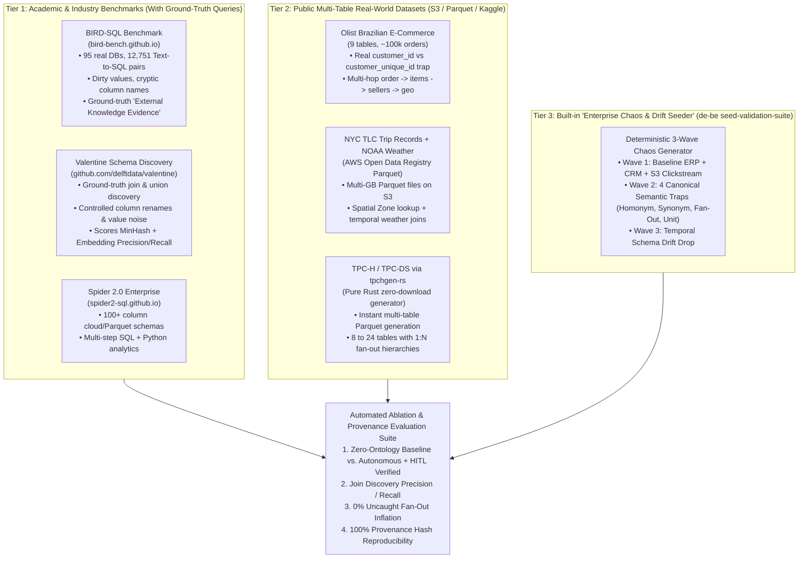

# Validation Datasets, Benchmarks & Chaos Testing Research

## 1. Executive Summary: Why Standard Toy Datasets Fail
Validating an **Autonomous Semantic Layer (`Graphrag`), Governed Steward Agents (`agent-as-data`), Sandboxed Compute & Provenance Engine (`data-engine`), and Live Shared Canvas (`Angry-agent` + `Mfe-shell`)** cannot be done with clean single-table datasets (like Iris, Titanic, or basic retail CSVs).

If a dataset already has clean, self-explanatory column names (`customer_id`, `order_revenue_usd`) and a single flat table:
- Any naive LLM can write `SELECT SUM(order_revenue_usd) FROM orders` without a semantic layer.
- You never test whether your system catches **fan-out join inflation**, **homonym false joins**, **cryptic legacy column names**, **unit mismatches (cents vs. USD)**, or **schema drift**.

To prove the value of the architecture, our validation data must contain **realistic enterprise entropy** paired with **known ground-truth answers** so we can measure **Before-Stewardship vs. After-Stewardship Accuracy**.

---

## 2. Where to Acquire Real-World & Benchmark Validation Data

---

## 3. Deep Dive: Specific Datasets & How Each Validates Our Stack

### 3.1 BIRD-SQL (`bird-bench.github.io` / HuggingFace: `birdsql/bird_mini_dev`)
- **What it is**: The industry-standard benchmark for enterprise database grounding (95 large databases across finance, healthcare, sports, retail, and education; `bird_mini_dev` provides a curated 500-question subset in SQLite/Parquet/PostgreSQL).
- **Why it is uniquely suited for us**:
  - Every BIRD question includes a **`question`**, **`SQL` ground truth**, and an explicit **`evidence`** string (e.g., *"Eligible free rate = `Free Meal Count (K-12)` / `Enrollment (K-12)`; charter schools have `Charter School (Y/N) = 1`"*).
  - In a normal company, that `evidence` is undocumented tribal knowledge!
- **Our Validation Protocol with BIRD**:
  1. **Ingest Raw DB Only**: Point `data-engine` at a BIRD database (`financial`, `california_schools`, `formula_1`, `thrombosis_prediction`) **without** loading the `evidence` hints.
  2. **Autonomous Profiling & Hypothesis**: Let `data-engine` profile the columns and `Graphrag` propose field descriptions and join edges.
  3. **Simulate the Human Steward**: Use the BIRD `evidence` strings as the "human domain expert's knowledge" during the RHS Shared Canvas review session in `Angry-agent`.
  4. **Measure Lift**: Run the benchmark questions in two modes:
     - *Mode A (Raw LLM without `Graphrag` / `data-engine`)*: Measure baseline execution accuracy.
     - *Mode B (Full Stack with Verified `Graphrag` Ontology + `data-engine` Pre-Execution Probing)*: Measure accuracy lift and provenance completeness.

### 3.2 Valentine Schema & Join Discovery Benchmark (`github.com/delftdata/valentine`)
- **What it is**: Created by TU Delft Data Management Lab specifically to evaluate automated data discovery and join-key matching algorithms (Coma, Cupid, Distribution-based, MinHash/Jaccard, EmbDI).
- **Where to get it**: Open-source on GitHub (`delftdata/valentine`) and Zenodo benchmark suites (Wikidata, Magellan, ChEMBL, TPC-DI splits).
- **How it validates `data-engine` + `Graphrag`**:
  - Valentine takes real tables and splits them horizontally/vertically while obfuscating column names (e.g., `emp_identifier` vs `wrk_id_num`) and injecting controlled value noise.
  - Provides exact ground-truth `(tableA.colX, tableB.colY)` pairs so we can unit- and integration-test `data-engine`'s **MinHash Jaccard sketcher + BGE-M3 column embedding matcher** and track Precision@K and Recall@K in CI.

### 3.3 Olist Brazilian E-Commerce Dataset (Kaggle / HuggingFace `datasets/olist`)
- **What it is**: 100,000 real anonymized orders from 2016–2018 across 9 relational tables (`olist_orders_dataset`, `olist_order_items_dataset`, `olist_order_payments_dataset`, `olist_order_reviews_dataset`, `olist_customers_dataset`, `olist_sellers_dataset`, `olist_products_dataset`, `olist_geolocation_dataset`, `product_category_name_translation`).
- **Real Semantic Traps Built Into Olist**:
  1. **The `customer_id` vs. `customer_unique_id` Trap**: In `olist_orders_dataset`, `customer_id` is actually a *per-order session key*! The true customer identifier is `customer_unique_id` inside `olist_customers_dataset`. Naive AI agents join or group by `orders.customer_id` and falsely report that 0% of customers ever place a second order.
  2. **The Multi-Installment Payment Fan-Out Trap**: A single order in `olist_orders_dataset` can have *multiple rows* in `olist_order_payments_dataset` (e.g., voucher + credit card installments) AND *multiple rows* in `olist_order_items_dataset`. Joining `orders` + `order_items` + `order_payments` directly creates an **M:N chasm trap** that multiplies GMV by $2\times$–$5\times$!
  3. **Python Sandbox Validation**: Ideal for asking the agent to dynamically write Python code in `data-engine`'s sandbox to compute **RFM (Recency, Frequency, Monetary) customer clustering**, **delivery delay regression (actual vs. estimated delivery date by seller-to-customer Haversine distance)**, and **Cohort Retention Matrices**.

### 3.4 Pure-Rust `tpchgen-rs` + NYC TLC S3 Parquet (Scale & Federated Query Validation)
- **`tpchgen-rs` (`crates.io/crates/tpchgen` / `tpchgen-arrow`)**:
  - Generates standard TPC-H tables (`customer`, `orders`, `lineitem`, `part`, `supplier`, `partsupp`, `nation`, `region`) directly as **Apache Arrow `RecordBatch`es or Parquet files in memory/disk** in milliseconds—zero external network downloads required during CI!
- **NYC TLC Yellow/Green Taxi Parquet (`https://www.nyc.gov/site/tlc/about/tlc-trip-record-data.page`)**:
  - Publicly downloadable CloudFront/S3 Parquet files with millions of rows, ideal for testing `data-engine`'s HTTP/S3 range-read predicate pushdown and schema evolution (historical TLC files changed column names and payment codes across years).

---

## 4. Designing the Built-In "Enterprise Chaos & Drift Seeder" (`de-be seed-validation-suite`)

While external datasets validate scale and real-world messiness, automated CI/CD (Robot Framework) needs a **fast, deterministic, self-contained validation suite** that intentionally plants every class of semantic failure and verifies that our 5-repo ecosystem catches and resolves them.

We specify a built-in CLI subcommand in `data-engine` (`de-be seed-validation-suite --output-dir ./test-data/chaos-lakehouse`) that materializes **3 Temporal Waves** across **PostgreSQL**, **S3/Parquet**, and **JSONL**, plus a **`ground_truth_manifest.json`**:

| Trap ID | Name | Planted Data Anomaly | Expected Ecosystem Behavior |
| :--- | :--- | :--- | :--- |
| **TRAP-01** | **The Homonym Chasm (`FORBIDDEN_JOIN`)** | `postgres.crm.accounts.account_id` (`1001..1500`, Customer IDs) vs `s3://erp/gl_entries.parquet#account_id` (`1001..1500`, General Ledger Chart-of-Accounts codes like `1001 = Cash`). | `data-engine` detects numerical overlap on `1001..1500`, proposes hypothesis; Steward rejects it in `Angry-agent` RHS Canvas $\rightarrow$ `Graphrag` records `FORBIDDEN_JOIN` $\rightarrow$ future queries are blocked from joining them. |
| **TRAP-02** | **The Cryptic Synonym Join** | `s3://erp/sales_hdr.parquet#c_pty_ref` vs `postgres.crm.customers.party_guid` (0% column name similarity, 97% MinHash Jaccard value overlap, `1:N` cardinality). | `data-engine` MinHash sketcher + `DataFusion` probe discovers the join automatically and presents an empirical evidence card (`Jaccard: 0.97, Cardinality: N:1`) for 1-click Steward approval. |
| **TRAP-03** | **The M:N Fan-Out Revenue Inflation** | `sales_hdr` (`1,000` orders, total GMV `\$250,000.00`) joined to `sales_shipments` (`2,400` partial shipments) and `sales_lines` (`3,800` line items). | When asked for "Total GMV by Carrier", a naive join inflates GMV to `\$612,400.00` ($2.45\times$ fan-out). `data-engine`'s pre-execution cardinality guard detects `output_rows > left_rows` before `SUM(order_total)` and forces pre-aggregation (`\$250,000.00`). |
| **TRAP-04** | **Wave-3 Silent Schema & Unit Drift** | In Wave 1/2, `sales_hdr.net_amt_minor` is `INT64` in **cents** (mean `25000`). In Wave 3 (`sales_hdr_2026_04.parquet`), upstream renames it to `net_amt` and changes units to **USD `FLOAT64`** (mean `250.00`, a $100\times$ shift). | `data-engine` profiler detects schema + $100\times$ Kolmogorov-Smirnov / mean shift $\rightarrow$ `Graphrag` transitions `Net Revenue` mapping to `drifted` $\rightarrow$ `agent-as-data` blocks unverified reporting until Steward approves the `CASE WHEN` / unit normalization rule on the RHS Canvas. |
| **TRAP-05** | **Dynamic Sandbox Algorithm Verification** | Customer churn & anomaly scoring across `sales_hdr` + `support_tickets.jsonl` requiring a non-SQL rolling z-score and survival curve in Python. | `data-engine` hands Arrow `RecordBatch` via `/dev/shm` to the isolated Python sandbox, computes exact ground-truth anomaly IDs (`CUST-0042`, `CUST-0189`), and emits a signed `ProvenanceRun` (`code_sha256` + `input_dataset_hashes`). |
