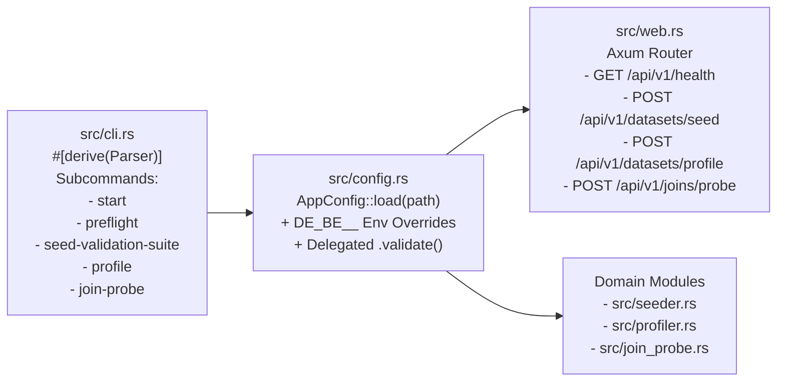

# Spec 01: Backend Scaffold, Config Loader, Typed Errors & CLI (`de-be-container`)

- **Status**: `complete`
- **Derived From**: [backend-foundations-prd.md](../prds/backend-foundations-prd.md), [developer-tooling-ci-prd.md](../prds/developer-tooling-ci-prd.md)

## 1. Objective
Establish the foundational Rust backend crate (`de-be-container`, binary `de-be`) and root `Makefile` for `data-engine` following strict workspace standards:
- `clap` derive CLI (`src/cli.rs`) supporting `start`, `preflight`, `seed-validation-suite`, `profile`, and `join-probe` subcommands.
- Centralized YAML + `DE_BE__` environment-variable configuration loader (`src/config.rs`) with modular domain config structs (`ServiceConfig`, `ProfilerConfig`, `ComputeConfig`, `SeederConfig`) and delegated `.validate()` methods.
- Modular typed error enums (`src/error.rs` and domain modules) deriving `thiserror::Error` with zero `Result<_, String>` returns.
- Axum HTTP router (`src/web.rs`) exposing `GET /api/v1/health`, `POST /api/v1/datasets/seed`, `POST /api/v1/datasets/profile`, and `POST /api/v1/joins/probe`.

## 2. Architecture & Module Flow



## 3. Configuration & Payload Contracts

### 3.1 `AppConfig` Schema (`de-be-container/config/default.yaml`)
```yaml
service:
  name: "data-engine-be"
  version: "0.1.0"
  host: "0.0.0.0"
  port: 8080
  log_level: "info"
profiler:
  max_sample_rows: 100000
  top_k_values: 10
  minhash_num_hashes: 64
  drift_relative_mean_threshold: 5.0
compute:
  query_timeout_secs: 30
  max_preview_rows: 100
  join_inclusion_threshold: 0.80
seeder:
  default_seed: 42
  default_row_count: 200
```

### 3.2 Health Endpoint (`GET /api/v1/health`)
- **Response (`200 OK`)**:
  ```json
  {
    "status": "ok",
    "service": "data-engine-be",
    "version": "0.1.0"
  }
  ```

## 4. Test Strategy (TDD)
- **Unit Tests (`src/config.rs`, `src/cli.rs`)**:
  1. `test_load_valid_config_and_env_override`: Verifies loading from YAML and overriding fields via `figment::Jail` / `DE_BE__` prefix.
  2. `test_config_validation_fails_on_invalid_fields`: Verifies fail-fast typed `ConfigError` when `service.name` is empty, `service.port == 0`, `profiler.max_sample_rows == 0`, or `compute.join_inclusion_threshold` is outside `(0.0, 1.0]`.
  3. `test_cli_parse_subcommands`: Verifies `clap::Parser::try_parse_from` for `start`, `preflight`, `seed-validation-suite`, `profile`, and `join-probe`.
- **Integration Test (`src/web.rs`)**:
  4. `test_health_endpoint_returns_ok`: Sends `GET /api/v1/health` to the Axum router and asserts HTTP `200 OK` and payload fields.
