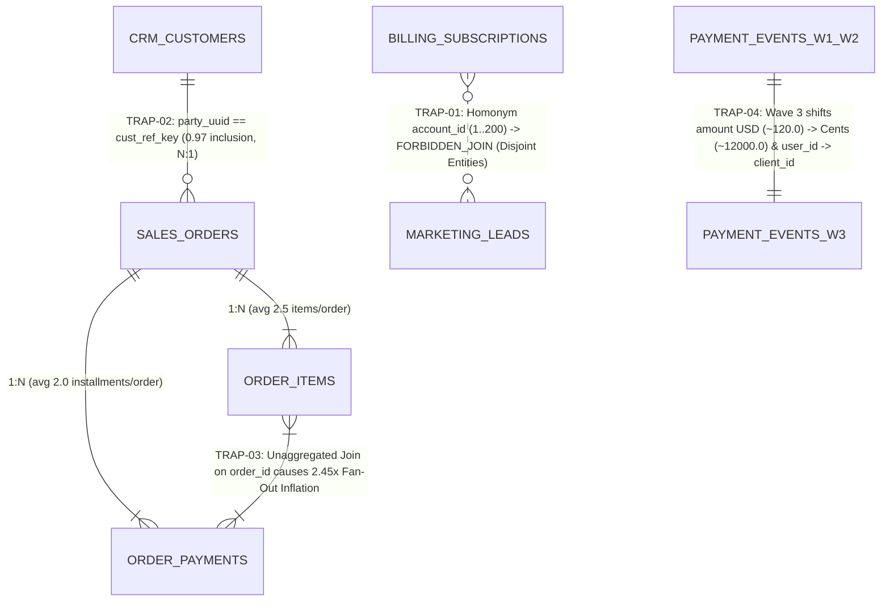

# Spec 02: Deterministic Chaos & Drift Seeder (`seed-validation-suite` & `TRAP-01..04`)

- **Status**: `complete`
- **Derived From**: [validation-datasets-and-benchmark-prd.md](../prds/validation-datasets-and-benchmark-prd.md)

## 1. Objective
Implement a zero-download, deterministic validation dataset generator (`src/seeder.rs`) invokable via CLI (`de-be seed-validation-suite --seed 42 --output-dir <DIR>`) and HTTP (`POST /api/v1/datasets/seed`). It writes multi-table Apache Parquet files across **Waves 1–3** with planted ground-truth semantic traps (`TRAP-01` through `TRAP-04`) and a machine-verifiable `ground_truth_manifest.json`.

## 2. Planted Datasets & Traps Architecture

## 3. Seeded Parquet Tables & Ground Truth Manifest Contract
When `seed_validation_suite(seed, row_count, output_dir)` executes, it creates:
1. `crm_customers.parquet`:
   - Columns: `party_uuid` (`Utf8`, PK), `customer_name` (`Utf8`), `region` (`Utf8`), `tier` (`Utf8`).
2. `sales_orders.parquet`:
   - Columns: `order_id` (`Utf8`, PK), `cust_ref_key` (`Utf8`, FK to `crm_customers.party_uuid` with `>= 0.96` inclusion ratio), `order_total_usd` (`Float64`), `status` (`Utf8`).
3. `order_items.parquet`:
   - Columns: `item_id` (`Utf8`, PK), `order_id` (`Utf8`, FK to `sales_orders.order_id`, multiple rows per order), `sku` (`Utf8`), `item_price_usd` (`Float64`).
4. `order_payments.parquet`:
   - Columns: `payment_id` (`Utf8`, PK), `order_id` (`Utf8`, FK to `sales_orders.order_id`, multiple installments per order), `installment_seq` (`Int64`), `payment_amount_usd` (`Float64`).
5. `billing_subscriptions.parquet`:
   - Columns: `account_id` (`Int64`, sequential `1..=N`), `billing_tax_id` (`Utf8`, prefix `TAX-ENT-`), `mrr_usd` (`Float64`).
6. `marketing_leads.parquet`:
   - Columns: `account_id` (`Int64`, sequential `1..=N` — homonym collision with `billing_subscriptions.account_id`), `lead_campaign_code` (`Utf8`, prefix `CMP-MKT-`), `ad_click_id` (`Utf8`).
7. `payment_events_wave1.parquet` (Baseline USD):
   - Columns: `event_id` (`Utf8`), `user_id` (`Utf8`), `amount` (`Float64`, mean `~120.0` USD).
8. `payment_events_wave3.parquet` (Drifted Cents & Renamed Column):
   - Columns: `event_id` (`Utf8`), `client_id` (`Utf8` — renamed from `user_id`), `amount` (`Float64`, mean `~12000.0` cents — $100\times$ unit shift).
9. `ground_truth_manifest.json`:
   - Contains exact `true_total_order_revenue_usd`, `naive_fanout_inflated_revenue_usd`, `expected_fanout_multiplier` (`> 2.0`), and the structured specifications for `TRAP-01`, `TRAP-02`, `TRAP-03`, and `TRAP-04`.

## 4. Test Strategy (TDD)
1. `test_seed_validation_suite_creates_all_parquet_files_and_manifest`: Runs `seed_validation_suite` in a `tempfile::tempdir()`, verifies all 8 `.parquet` files and `ground_truth_manifest.json` exist and are non-empty.
2. `test_seed_is_strictly_deterministic`: Runs `seed_validation_suite` twice with `seed = 42` and verifies identical `ground_truth_manifest.json` metrics (`true_total_order_revenue_usd`, `naive_fanout_inflated_revenue_usd`, `expected_fanout_multiplier >= 2.0`).
