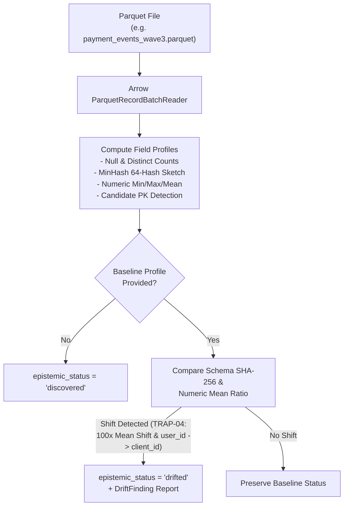

# Spec 03: Arrow Statistical Profiler & Temporal Drift Detector

- **Status**: `complete`
- **Derived From**: [connectors-and-profiling-prd.md](../prds/connectors-and-profiling-prd.md), [validation-datasets-and-benchmark-prd.md](../prds/validation-datasets-and-benchmark-prd.md)

## 1. Objective
Implement the Apache Arrow / Parquet statistical profiler and temporal schema/distribution drift detector (`src/profiler.rs`). Given any Parquet file path (and an optional baseline `DatasetProfile`), the profiler computes:
- Dataset-level `row_count`, `schema_fingerprint_sha256`, `candidate_primary_keys` (fields with `null_ratio == 0.0` and `distinct_count == row_count`), and `epistemic_status` (`"discovered"` or `"drifted"`).
- Field-level `arrow_data_type`, `null_count`, `null_ratio`, `distinct_count`, `uniqueness_ratio`, `top_k_values`, `minhash_signature` (`Vec<u64>`), `numeric_stats` (`min`, `max`, `mean`), `inferred_semantic_domain` (`identifier`, `currency_amount`, `categorical`, `text`), and `epistemic_status`.
- Drift Comparison (`compare_dataset_profiles(baseline, current)`): Detects added/removed/renamed columns (schema SHA-256 mismatch) and numeric scale shifts (e.g., Wave 1 USD mean `~120.0` vs Wave 3 Cents mean `~12000.0` $\rightarrow$ `relative_mean_ratio >= drift_relative_mean_threshold`), automatically transitioning the affected field and dataset to `epistemic_status = "drifted"`.

## 2. Profiling & Drift Detection Flow



## 3. Payload Contract (`DatasetProfile` & `DriftReport`)
```json
{
  "dataset_name": "payment_events_wave3",
  "row_count": 200,
  "schema_fingerprint_sha256": "a9c1...",
  "candidate_primary_keys": ["event_id"],
  "epistemic_status": "drifted",
  "drift_findings": [
    {
      "drift_type": "column_removed_or_renamed",
      "field_name": "user_id",
      "details": "Field 'user_id' present in baseline is missing in current snapshot (candidate replacement: 'client_id')"
    },
    {
      "drift_type": "numeric_scale_shift",
      "field_name": "amount",
      "baseline_mean": 120.5,
      "current_mean": 12050.0,
      "scale_ratio": 100.0,
      "details": "Numeric mean shifted by 100.00x (exceeds threshold 5.00x); possible unit change (e.g. USD to cents)"
    }
  ],
  "fields": [...]
}
```

## 4. Test Strategy (TDD)
1. `test_profile_seeded_crm_and_orders_tables`: Profiles `crm_customers.parquet` and `sales_orders.parquet`, verifying `row_count`, `candidate_primary_keys` (`["party_uuid"]` and `["order_id"]`), `null_ratio == 0.0`, and non-empty `minhash_signature`.
2. `test_detect_trap_04_temporal_schema_and_unit_drift`: Profiles `payment_events_wave1.parquet` as baseline and compares `payment_events_wave3.parquet` against it. Asserts that `epistemic_status == "drifted"`, `drift_findings` contains both the `user_id` $\rightarrow$ `client_id` column drift and the $100\times$ numeric scale shift on `amount`, and the `amount` field is marked `epistemic_status == "drifted"`.
