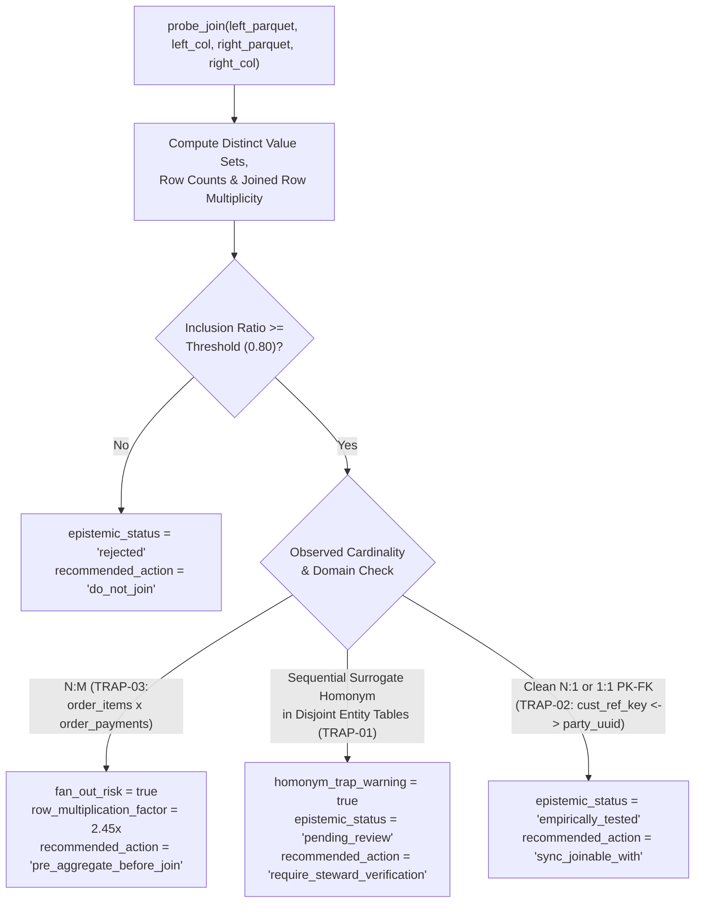

# Spec 04: Empirical Join Prober & Fan-Out Detector

- **Status**: `complete`
- **Derived From**: [connectors-and-profiling-prd.md](../prds/connectors-and-profiling-prd.md), [query-and-compute-engine-prd.md](../prds/query-and-compute-engine-prd.md), [validation-datasets-and-benchmark-prd.md](../prds/validation-datasets-and-benchmark-prd.md)

## 1. Objective
Implement the empirical join prober and multi-table fan-out analyzer (`src/join_probe.rs`). Before any join edge is trusted in the semantic layer, `probe_join` inspects the actual data across two Parquet datasets to compute:
- `inclusion_ratio_left_in_right`: $|L \cap R| / |L_{\text{distinct}}|$
- `inclusion_ratio_right_in_left`: $|L \cap R| / |R_{\text{distinct}}|$
- `jaccard_similarity`: $|L \cap R| / |L \cup R|$
- `observed_cardinality`: `"1:1"`, `"1:N"`, `"N:1"`, `"N:M"`, or `"disjoint"`
- `row_multiplication_factor`: `joined_row_count / max(left_row_count, right_row_count)`
- `fan_out_risk`: `true` when `observed_cardinality == "N:M"` or `row_multiplication_factor > 1.05`
- `homonym_trap_warning`: `true` when both columns have identical names (e.g., `account_id` in `TRAP-01`), sequential integer surrogate distributions, and contrasting non-key entity prefixes/domains across the two tables (`billing_subscriptions` vs `marketing_leads`).
- `epistemic_status` & `recommended_action`: `"empirically_tested"` (for high-confidence N:1 / 1:1 joins like `TRAP-02`), `"pending_review"` (for homonym collision `TRAP-01` or `N:M` fan-out `TRAP-03`), or `"rejected"`.

## 2. Empirical Join Probe Decision Flow

## 3. Test Strategy (TDD)
1. `test_probe_trap_02_discovers_cryptic_synonym_join`:
   - Probes `sales_orders.cust_ref_key` $\leftrightarrow$ `crm_customers.party_uuid`.
   - Asserts `inclusion_ratio_left_in_right >= 0.95`, `observed_cardinality == "N:1"`, `fan_out_risk == false`, `homonym_trap_warning == false`, and `epistemic_status == "empirically_tested"`.
2. `test_probe_trap_03_detects_nm_fanout_inflation`:
   - Probes `order_items.order_id` $\leftrightarrow$ `order_payments.order_id` and evaluates the joined sum of `payment_amount_usd` vs true order revenue.
   - Asserts `observed_cardinality == "N:M"`, `fan_out_risk == true`, `row_multiplication_factor > 1.8`, and `recommended_action == "pre_aggregate_before_join"`.
3. `test_probe_trap_01_flags_homonym_surrogate_chasm`:
   - Probes `billing_subscriptions.account_id` $\leftrightarrow$ `marketing_leads.account_id`.
   - Asserts `homonym_trap_warning == true`, `epistemic_status == "pending_review"`, and `recommended_action == "require_steward_verification"`.
4. `test_http_endpoints_end_to_end`:
   - Calls `POST /api/v1/datasets/seed`, `POST /api/v1/datasets/profile`, and `POST /api/v1/joins/probe` through the Axum router and verifies all responses.
