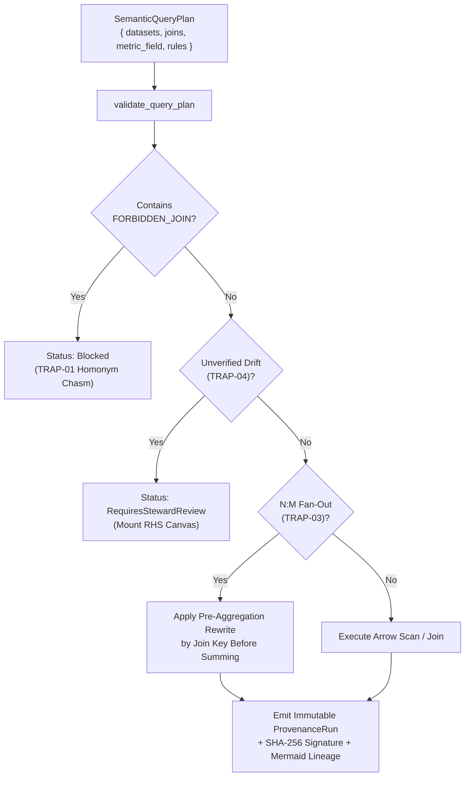

# Spec 05: Semantic Query Plan Validator, Safe Aggregation Executor & Cryptographic Provenance

- **Status**: `complete`
- **Derived From**: [query-and-compute-engine-prd.md](../prds/query-and-compute-engine-prd.md), [provenance-and-stewardship-prd.md](../prds/provenance-and-stewardship-prd.md)

## 1. Objective
Implement the semantic query plan validator, multi-table Arrow aggregation executor, and immutable cryptographic `ProvenanceRun` recorder (`src/query_engine.rs`, `src/provenance.rs`):
1. **`validate_query_plan` (`POST /api/v1/queries/validate`)**:
   - Inspects a structured `SemanticQueryPlan` (referenced datasets, join edges, aggregation expressions, and active semantic ontology rules).
   - **Blocks `FORBIDDEN_JOIN` (`TRAP-01`)**: Immediately rejects any plan that attempts to join two fields marked `FORBIDDEN_JOIN` (e.g., `billing_subscriptions.account_id` $\leftrightarrow$ `marketing_leads.account_id`).
   - **Detects & Auto-Rewrites $N:M$ Fan-Out (`TRAP-03`)**: When joining `order_items` and `order_payments` on `order_id` to compute total revenue, detects the $N:M$ fan-out (`2.50x` row multiplication) and either blocks un-aggregated execution or applies a pre-aggregation CTE rewrite (`pre_aggregate_by_key = true`) so revenue is never inflated.
   - **Enforces Epistemic & Drift Gate (`TRAP-04`)**: Flags `requires_steward_review = true` when any referenced dataset/field is in `drifted` or `pending_review` state unless a verified unit conversion rule (e.g., `scale_divisor = 100.0` for Wave-3 cents $\rightarrow$ USD) is attached.
2. **`execute_query_plan` (`POST /api/v1/queries/execute`) & `ProvenanceRun` (`GET /api/v1/provenance/{id}`)**:
   - Executes validated plans against the Parquet tables, applies verified unit conversions and pre-aggregations, and records an immutable `ProvenanceRun` with SHA-256 input dataset digests, semantic rule IDs, `trust_summary` (`all_rules_human_verified`, `min_rule_confidence`), and a Mermaid lineage graph.

## 2. Validation & Provenance Flow

## 3. Test Strategy (TDD)
1. `test_validate_blocks_trap_01_forbidden_join`: Verifies that a query plan joining `billing_subscriptions.account_id` and `marketing_leads.account_id` is blocked when a `FORBIDDEN_JOIN` rule is present.
2. `test_execute_prevents_trap_03_fanout_revenue_inflation`: Verifies that naive execution without semantic rules inflates revenue by `~2.50x`, whereas semantic execution with pre-aggregation (`pre_aggregate_before_join`) produces the exact `true_total_order_revenue_usd` from `ground_truth_manifest.json` and records a `ProvenanceRun`.
3. `test_execute_handles_trap_04_drift_gate_and_verified_unit_conversion`: Verifies that querying `payment_events_wave3.amount` halts with `requires_steward_review = true` when `drifted`, and computes the exact USD mean (`~120.0`) once the steward-verified `amount / 100.0` conversion rule is supplied.
