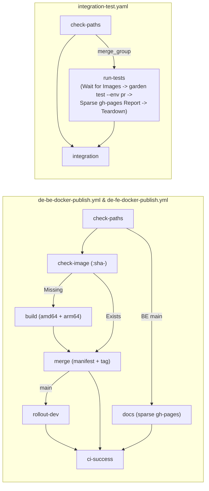

# Spec 05: Multi-Arch CI/CD Workflows, Helm Chart, Dockerfile & Garden Pipeline (`sward-warden` Pattern)

- **Status**: `complete`
- **Derived From**: [ci-cd-container-integration-prd.md](../prds/ci-cd-container-integration-prd.md)

## 1. Objective
Adopt the [`PolecatWorks/sward-warden`](https://github.com/PolecatWorks/sward-warden) CI/CD, container build, release, and ephemeral Kubernetes integration testing architecture in `data-engine`:
1. **Per-Component Multi-Arch Docker & Docs Workflows**:
   - `.github/workflows/de-be-docker-publish.yml`: Path-filtered (`de-be-container/**`, `.github/workflows/de-be-docker-publish.yml`) pipeline with `check-paths`, `check-image` (`:sha-<BACKEND_SHA>` inspection in GHCR), native multi-arch `build` (`ubuntu-24.04` for `linux/amd64` and `ubuntu-24.04-arm` for `linux/arm64` with `main`-scoped BuildKit cache read and `main`-only cache write), `merge` (manifest list creation + existing `:sha-<BACKEND_SHA>` re-tagging + PR comment), `docs` (`cargo doc --no-deps` deployed to `gh-pages` `docs/rust` via shallow blobless Git `sparse-checkout` and 5-attempt rebase retry loop), `rollout-dev` (`kubectl rollout restart deployment/data-engine-be -n data-engine-dev` on `polecatworks-runner`), and `ci-success` (`DE-BE CI Success`).
   - `.github/workflows/de-fe-docker-publish.yml`: Path-filtered (`de-fe-container/**`, `.github/workflows/de-fe-docker-publish.yml`) pipeline with `check-paths`, `check-image` (`:sha-<FE_SHA>`), multi-arch `build`, `merge`, `rollout-dev` (`deployment/data-engine-fe-nginx-view -n data-engine-dev`), and `ci-success` (`DE-FE CI Success`).
2. **Helm Chart & Helm CI Workflows**:
   - `charts/data-engine/`: Helm chart (`Chart.yaml`, `values.yaml`, `.helmignore`, `configs/config.yaml`, `templates/_helpers.tpl`, `be-configmap.yaml`, `be-deployment.yaml`, `be-service.yaml`, `be-serviceaccount.yaml`, `be-hpa.yaml`, `be-authorizationpolicy.yaml`, `be-requestauthorization.yaml`).
   - `.github/workflows/helm-ci-pr.yaml`: Path-filtered (`charts/**`, `.github/workflows/helm-ci-*.yaml`) running `helm lint charts/data-engine` and gated by `Helm CI Success`.
   - `.github/workflows/helm-ci-main.yaml`: Path-filtered on `push` to `main`, linting, stamping `Chart.yaml` version with `-main-${TIMESTAMP}-${SHA_SHORT}`, and pushing to `oci://ghcr.io/polecatworks/data-engine/helm` via `bsord/helm-push@v4`.
3. **SemVer Release Workflows**:
   - `.github/workflows/de-be-release.yml`, `.github/workflows/de-fe-release.yml`, and `.github/workflows/helm-release.yml`: Triggered on `*.*.*` tag pushes; validate strict SemVer (`^[0-9]+\.[0-9]+\.[0-9]+$`), inspect and re-tag existing `:sha-<CONTENT_SHA>` images in GHCR (or lint & push the release Helm chart to OCI) without rebuilding.
4. **Ephemeral Kubernetes Integration Testing & Garden Configuration**:
   - `.github/workflows/integration-test.yaml`: Triggered on `pull_request`, `merge_group`, and `workflow_dispatch`; runs `check-paths`, executes `run-tests` on `polecatworks-runner` during `merge_group` (resolving `:sha-<SHA>` or `:main` tags, polling GHCR in `Wait for Docker Images`, running `garden test --env pr`, publishing Robot HTML reports + `.timestamp` to `gh-pages` `pr/<PR>` via sparse checkout, commenting deduplicated report URLs on PRs, and tearing down `data-engine-pr-<PR>`), and gates via `integration`.
   - `garden.yml`, `.gardenignore`, and `integration-tests/garden.yml`: Garden v2 project configuration with `local` and `pr` environments (`data-engine-pr-${var.pr-number}`), `get-be-sha` and `get-fe-sha` exec builds, `postgres-test`, `data-engine` Helm deploy, `data-engine-fe` OCI nginx-view deploy, `virtual-service`, `telemetry`, and `robot-test-runner`.
5. **Retention, Housekeeping & Container Build**:
   - `.github/workflows/cleanup-dev-packages.yml`: Daily `snok/container-retention-policy@v2.2.1` cleanup for `data-engine-be`, `data-engine-fe`, and `data-engine/helm/data-engine` (2-week cutoff, skipping `main,latest,*.*.*`).
   - `.github/workflows/prune-gh-pages.yml`: Daily pruning of `gh-pages` `pr/<PR>` directories with `.timestamp` older than 7 days.
   - `.github/workflows/readme.md`: Workflow architecture documentation and Mermaid diagrams.
   - `de-be-container/Dockerfile`: Multi-stage `cargo-chef` Dockerfile running `cargo test -- --test-threads=1` and `cargo build --release` in the `build` stage and `/usr/local/bin/de-be --help` in the `runtime` stage.
   - `Makefile`: Standardized `de-be-docker`, `de-fe-docker`, `helm-lint`, `garden-up`, `garden-test`, `garden-down`, and `squash-gh-pages` targets.

## 2. Pipeline Architecture

## 3. Test Strategy (TDD)
1. **Automated CI & Infrastructure Contract Tests (`de-be-container/tests/ci_workflows_test.rs`)**:
   - `test_sward_warden_workflow_files_exist_and_legacy_absent`: Verifies all 10 workflow files and `.github/workflows/readme.md` exist and that `ci.yml` and `skip-merge-queue.yml` are absent.
   - `test_docker_publish_workflows_match_sward_warden_pattern`: Parses `de-be-docker-publish.yml` and `de-fe-docker-publish.yml` and verifies `check-paths`, `check-image` (`docker manifest inspect`), `build` (`ubuntu-24.04` / `ubuntu-24.04-arm`, `main` GHA cache policy), `merge` (`docker buildx imagetools create` + existing SHA re-tagging), `docs` (`sparse-checkout` for `docs/rust` in BE), `rollout-dev` (`polecatworks-runner`), and `ci-success` (`DE-BE CI Success` / `DE-FE CI Success`).
   - `test_helm_and_release_workflows_contract`: Verifies `helm-ci-pr.yaml`, `helm-ci-main.yaml`, `de-be-release.yml`, `de-fe-release.yml`, and `helm-release.yml` (SemVer regex validation, `:sha-` source image check, `bsord/helm-push@v4`, and `Helm CI Success` gate).
   - `test_integration_and_housekeeping_workflows_contract`: Verifies `integration-test.yaml` (`merge_group` gating, `Wait for Docker Images` polling loop, `garden test --env pr`, `sparse-checkout` `gh-pages` deployment with `.timestamp`, `Teardown Garden Environment` with `if: always()`, and `integration` gate job), `cleanup-dev-packages.yml`, and `prune-gh-pages.yml`.
   - `test_dockerfile_helm_chart_and_garden_configs`: Verifies `de-be-container/Dockerfile` stages (`chef`, `planner`, `buildcacherelease`, `build` with `cargo test -- --test-threads=1`, `runtime` with `/usr/local/bin/de-be --help`), `charts/data-engine/Chart.yaml` & templates, `garden.yml`, `.gardenignore`, `integration-tests/garden.yml`, and `Makefile` targets.
