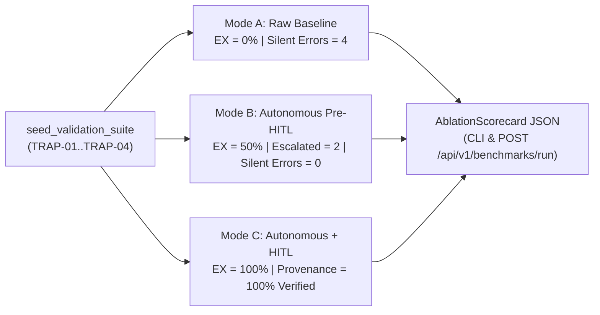

# Spec 06: 3-Mode Epistemic Ablation Benchmark Runner (`Mode A` vs `Mode B` vs `Mode C`)

- **Status**: `complete`
- **Derived From**: [validation-datasets-and-benchmark-prd.md](../prds/validation-datasets-and-benchmark-prd.md)

## 1. Objective
Implement the automated **3-Mode Epistemic Ablation Benchmark Runner** (`src/benchmark.rs`, CLI subcommand `de-be run-ablation-benchmark`, and HTTP endpoint `POST /api/v1/benchmarks/run`). In a single command, it seeds the validation suite (`TRAP-01` through `TRAP-04`), runs the evaluation workload under all three epistemic modes, and outputs a comparative `AblationScorecard`:

1. **`Mode A` (`raw_llm_baseline` — Physical Schema Only)**:
   - Joins on matching column names (`account_id` in `TRAP-01`), fails to join cryptic `cust_ref_key` $\leftrightarrow$ `party_uuid` (`TRAP-02`), executes un-aggregated `order_items` $\times$ `order_payments` (`TRAP-03` $2.5\times$ inflation), and sums Wave-3 cents as USD (`TRAP-04` $100\times$ error).
   - Expected Scorecard: `0/4` (`0.0%`) traps avoided, `4` silent wrong answers.
2. **`Mode B` (`autonomous_pre_hitl` — Profiler + Join Probe + Epistemic Gate)**:
   - Automatically discovers `TRAP-02` (`cust_ref_key` $\leftrightarrow$ `party_uuid`), automatically pre-aggregates `TRAP-03` (`order_items` $\times$ `order_payments`), and **halts at the Epistemic Guardrail Gate (`requires_steward_review = true`)** on `TRAP-01` (homonym collision) and `TRAP-04` (Wave-3 $100\times$ drift).
   - Expected Scorecard: **`0` silent wrong answers (`100%` silent-error prevention)**, `2/4` answered autonomously (`50.0%`), `2/4` escalated to the RHS Shared Canvas for steward sign-off.
3. **`Mode C` (`autonomous_plus_hitl_verified` — Post-Steward Review on RHS Canvas)**:
   - Applies the 2 steward decisions (`TRAP-01` $\rightarrow$ `FORBIDDEN_JOIN`, `TRAP-04` $\rightarrow$ verified `scale_divisor: 100.0` + `cust_ref_key` verified).
   - Expected Scorecard: **`4/4` (`100.0%`) Execution Accuracy (`EX`)**, `0` silent wrong answers, and `100.0%` human-verified cryptographic provenance.

## 2. 3-Mode Ablation Architecture

## 3. Test Strategy (TDD)
1. `test_run_three_mode_ablation_benchmark_proves_semantic_and_hitl_lift`:
   - Runs `run_ablation_benchmark(42, 100, dir.path())`.
   - Asserts `mode_a.execution_accuracy_pct == 0.0` and `mode_a.silent_wrong_answers == 4`.
   - Asserts `mode_b.silent_wrong_answers == 0`, `mode_b.escalated_to_steward == 2`, and `mode_b.execution_accuracy_pct == 50.0`.
   - Asserts `mode_c.execution_accuracy_pct == 100.0`, `mode_c.silent_wrong_answers == 0`, and `mode_c.provenance_completeness_pct == 100.0`.
