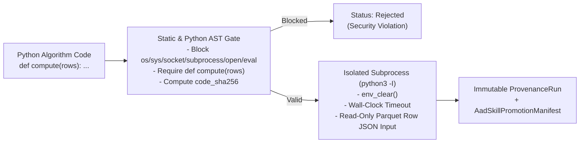

# Spec 07: Dynamic Python Algorithm Sandbox, `TRAP-05` Non-SQL Analytics & AAD Skill Promotion

- **Status**: `complete`
- **Derived From**: [python-sandbox-and-algorithm-engine-prd.md](../prds/python-sandbox-and-algorithm-engine-prd.md), [validation-datasets-and-benchmark-prd.md](../prds/validation-datasets-and-benchmark-prd.md)

## 1. Objective
Implement the isolated dynamic Python algorithm validator, sandboxed subprocess executor, and `agent-as-data` skill promotion descriptor (`src/sandbox.rs`), and extend the Chaos Seeder and 3-Mode Epistemic Ablation Benchmark (`TRAP-01` through `TRAP-05`) to include **`TRAP-05` (Non-SQL Z-Score Anomaly & Churn Risk Detection)**:
1. **`SandboxConfig` (`src/config.rs`)**:
   - Configures `python_binary` (`"python3"`), `timeout_ms` (`5000`), `max_code_bytes` (`65536`), and `allowed_modules` (`["math", "statistics", "json"]`).
2. **Static AST & Security Gate (`validate_python_algorithm`, `POST /api/v1/algorithms/validate`)**:
   - Inspects Python source code and runs Python's `ast` parser in isolated mode (`python3 -I`) to verify:
     - Syntax validity and presence of `def compute(rows):`.
     - Zero prohibited imports (`os`, `sys`, `subprocess`, `socket`, `urllib`, `http`, `pathlib`, `shutil`, `ctypes`) and zero dangerous builtins (`eval`, `exec`, `open`, `compile`, `__import__`).
     - Computes an immutable `code_sha256` digest and returns an `AadSkillPromotionManifest` ready to register in `agent-as-data`.
3. **Sandboxed Subprocess Execution (`execute_python_algorithm`, `POST /api/v1/algorithms/execute`)**:
   - Reads the verified/joined rows from Parquet, invokes `python3 -I` with cleared environment (`env_clear()`), enforces a strict wall-clock timeout (`tokio::time::timeout`), captures the structured JSON output, and records a signed `ProvenanceRun` (`code_sha256` + input datasets + semantic rules).
4. **Full 5-Trap Ablation (`TRAP-01..TRAP-05`)**:
   - Updates `benchmark.rs` so all 5 canonical traps (`TRAP-01` through `TRAP-05`) are evaluated across Mode A (`0/5 = 0.0%`), Mode B (`3/5 = 60.0%` autonomous + `2/5` safely escalated, `0` silent errors), and Mode C (`5/5 = 100.0%` accuracy and `100.0%` provenance).

## 2. Sandbox Validation & Execution Architecture

## 3. Test Strategy (TDD)
1. `test_validate_python_blocks_forbidden_imports_and_builtins`: Verifies that scripts importing `os`, `subprocess`, or `socket`, or calling `open(...)` / `eval(...)`, are rejected with `SandboxError::SecurityViolation`.
2. `test_execute_python_trap_05_anomaly_and_churn_score`: Executes the `TRAP-05` z-score anomaly detector over `sales_orders.parquet` in the isolated Python sandbox, verifies the exact anomaly count matches `ground_truth_manifest.json`, and checks that a `ProvenanceRun` and `AadSkillPromotionManifest` (`code_sha256`) are emitted.
3. `test_run_five_trap_ablation_benchmark`: Verifies that `run_ablation_benchmark` evaluates all 5 traps (`TRAP-01..TRAP-05`) with `0%` Mode A accuracy, `60%` Mode B autonomous accuracy (`0` silent errors, `2` steward escalations), and `100%` Mode C accuracy.
