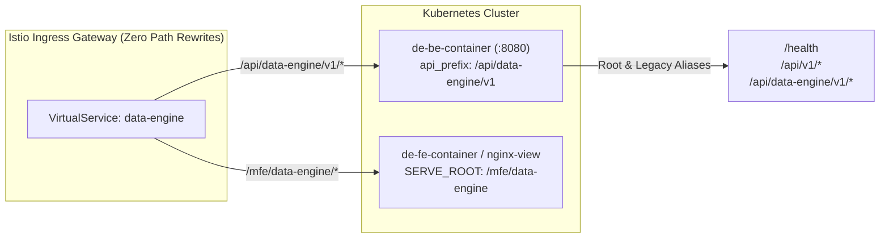

# Spec 08: Configurable API Prefix & Kubernetes VirtualService Composition

- **Status**: `complete`
- **Derived From**:
  - [backend-foundations-prd.md](../prds/backend-foundations-prd.md)
  - [data-engine-mcp-api-prd.md](../prds/data-engine-mcp-api-prd.md)
  - [ci-cd-container-integration-prd.md](../prds/ci-cd-container-integration-prd.md)

---

## 1. Objective & Architectural Context

In a multi-service Kubernetes cluster managed by Istio Ingress Gateway (or envoy reverse proxy), multiple microservices (`data-engine`, `agent-as-data`, `Angry-agent`, `Mfe-shell`) coexist within shared namespaces and routing meshes. To avoid URI collisions and eliminate complex URL rewriting rules at the gateway:

1. **Configurable Service Prefix**: `de-be-container` accepts a configurable API prefix (`service.api_prefix`), defaulting to `"/api/data-engine/v1"`.
2. **Fail-Fast Prefix Validation**: `ServiceConfig::validate()` validates that `api_prefix` starts with `'/'`, has length `> 1`, and does not end with `'/'`. Violations produce typed error `ServiceConfigError::InvalidApiPrefix`.
3. **Router Nesting & Backward Compatibility**:
   - Primary business routes (`/health`, `/datasets/seed`, `/datasets/profile`, `/joins/probe`, `/queries/validate`, `/queries/execute`, `/provenance/{id}`, `/benchmarks/run`) are nested under `api_prefix`.
   - For backward compatibility with existing tests and internal callers, if `api_prefix` is not `"/api/v1"`, the router also mounts routes under `"/api/v1"`.
   - Root `/health` is always mounted for container probes (`/health`).
4. **Zero-Rewrite Kubernetes `VirtualService`**:
   - `charts/data-engine/templates/virtualservice.yaml` and `charts/data-engine/values.yaml` provide a zero-rewrite routing rule directing traffic matching `prefix: {{ .Values.virtualService.apiPrefix }}` to the backend service.



---

## 2. Technical Specification & Implementation Plan

### 2.1 Configuration Schema & Fail-Fast Validation (`de-be-container/src/config.rs`)
- Extend `ServiceConfig`:
  ```rust
  #[derive(Debug, Clone, Serialize, Deserialize, PartialEq)]
  pub struct ServiceConfig {
      pub name: String,
      pub version: String,
      pub host: String,
      pub port: u16,
      pub log_level: String,
      #[serde(default = "default_api_prefix")]
      pub api_prefix: String,
  }

  fn default_api_prefix() -> String {
      "/api/data-engine/v1".to_string()
  }
  ```
- Add variant to `ServiceConfigError`:
  ```rust
  #[error("service.api_prefix must start with '/', have length > 1, and not end with '/'")]
  InvalidApiPrefix,
  ```
- Validation rule in `ServiceConfig::validate()`:
  - Trimmed `api_prefix` must start with `'/'`.
  - Length must be greater than 1 (e.g. `"/"` is invalid).
  - Must not end with `'/'` (e.g. `"/api/data-engine/v1/"` is invalid).
- Default configuration files updated:
  - `de-be-container/config/default.yaml`: `service.api_prefix: "/api/data-engine/v1"`
  - `charts/data-engine/configs/config.yaml`: `service.api_prefix: "/api/data-engine/v1"`

### 2.2 Axum Router Structure (`de-be-container/src/web.rs`)
- Factor core routes into a helper `v1_routes() -> Router<AppState>`:
  - `GET /health`
  - `POST /datasets/seed`
  - `POST /datasets/profile`
  - `POST /joins/probe`
  - `POST /queries/validate`
  - `POST /queries/execute`
  - `GET /provenance/{id}`
  - `POST /benchmarks/run`
- In `build_router(state: AppState) -> Router`:
  - Mount root `GET /health` -> `health_handler`.
  - Nest `v1_routes()` under `prefix = state.config.service.api_prefix.trim_end_matches('/')`.
  - If `prefix != "/api/v1"`, also nest `v1_routes()` under `"/api/v1"` as backward compatibility.

### 2.3 Helm Chart `VirtualService` (`charts/data-engine/`)
- In `charts/data-engine/values.yaml`:
  ```yaml
  virtualService:
    enabled: false
    hosts:
      - ai.k8s
    gateways:
      - istio-ingress/k8s-gateway
      - mesh
    apiPrefix: /api/data-engine/v1
    mfePrefix: /mfe/data-engine
  ```
- In `charts/data-engine/templates/virtualservice.yaml`:
  - Render Istio `VirtualService` (`networking.istio.io/v1beta1`) when `.Values.virtualService.enabled` is `true`.
  - Route `.Values.virtualService.apiPrefix` to `{{ include "data-engine.fullname" . }}-be` on port `{{ .Values.service.port }}`.

### 2.4 Robot Integration Tests (`integration-tests/tests/test_be.robot`)
- Verify both direct health checks and prefixed `/api/data-engine/v1/health` checks.

---

## 3. Test-Driven Development (TDD) Strategy

1. **Configuration Validation Unit Tests (`src/config.rs`)**:
   - `test_service_config_api_prefix_default`: Verifies deserialization without `api_prefix` defaults to `"/api/data-engine/v1"`.
   - `test_service_config_api_prefix_valid`: Verifies `"/api/data-engine/v1"` and `"/custom/api"` pass validation.
   - `test_service_config_api_prefix_invalid`: Verifies `""`, `"api/v1"`, `"/"`, `"/api/v1/"` return `ServiceConfigError::InvalidApiPrefix`.
2. **Router Web Unit Tests (`src/web.rs`)**:
   - Test default prefix: `/api/data-engine/v1/health` returns 200 OK.
   - Test backward compatibility: `/api/v1/health` returns 200 OK.
   - Test root probe: `/health` returns 200 OK.
   - Test custom prefix: When `api_prefix` is `"/api/custom/v1"`, `/api/custom/v1/health` and `/api/v1/health` both return 200 OK.
3. **Helm Lint**:
   - `helm lint charts/data-engine` with default values and `--set virtualService.enabled=true`.
