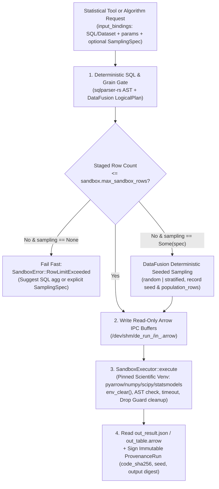

# Spec 10: Scientific Python Sandbox Runtime, Zero-Copy Arrow IPC Staging & Built-In Algorithm Registry

- **Status**: `complete`
- **Derived From**: [08. Statistical Analytics Engine PRD](../prds/statistical-analytics-engine-prd.md), [03. Federated Compute, Code Sandbox & Provenance PRD](../prds/compute-sandbox-provenance-prd.md)
- **Dependencies**: [07-python-sandbox-and-trap-05-spec.md](./07-python-sandbox-and-trap-05-spec.md), [08-configurable-api-prefix-and-virtualservice-spec.md](./08-configurable-api-prefix-and-virtualservice-spec.md)

---

## 1. Objective
Upgrade `de-be-container`'s Python execution sandbox from stdlib-only JSON stdin piping (`def compute(rows)`) to a production-grade **scientific statistical runtime** backed by:
1. A pinned, read-only multi-arch Python virtual environment (`numpy`, `scipy`, `statsmodels`, `pyarrow`) baked into `de-be-container/Dockerfile`.
2. A pluggable `SandboxExecutor` trait (`ProcessSandbox`, `NamespaceSandbox`, with future `SidecarSandbox` compatibility).
3. **Zero-copy Apache Arrow IPC staging** (`/dev/shm/de_run_<uuid>/in_<name>.arrow`) from validated DataFusion SQL queries, enforcing a **fail-fast `max_sandbox_rows` cap** unless explicit deterministic seeded sampling (`SamplingSpec`) is requested and recorded in `ProvenanceRun`.
4. A **built-in versioned statistical algorithm registry** (`builtin_stat_*`, SHA-256-pinned) hydrated automatically on startup and via `de-be hydrate-builtins`.

---

## 2. Execution & Data Staging Architecture



---

## 3. Technical Specification

### 3.1 Configuration Schema (`SandboxConfig` in `de-be-container/src/config.rs`)
Extend `SandboxConfig` (YAML prefix `DE_BE__SANDBOX__`, fail-fast `.validate()`):
```yaml
sandbox:
  backend: "process" # "process" | "namespace"
  python_binary: "/opt/de-venv/bin/python3"
  timeout_ms: 15000
  max_code_bytes: 65536
  max_sandbox_rows: 100000
  max_plot_points: 1000
  shm_dir: "/dev/shm"
  allowed_modules:
    - "math"
    - "statistics"
    - "json"
    - "numpy"
    - "scipy"
    - "statsmodels"
    - "pyarrow"
```
- **Validation Rules**:
  - `max_sandbox_rows > 0`, `max_plot_points > 0`, `timeout_ms > 0`, `shm_dir` non-empty.
  - `backend` must be a valid typed enum (`SandboxBackend::Process | SandboxBackend::Namespace`).
  - Zero hardcoded fallback defaults in runtime code.

### 3.2 Typed Error Extensions (`SandboxError` via `thiserror`)
Add variants to `SandboxError` (`src/sandbox.rs`):
- `RowLimitExceeded { actual_rows: usize, max_rows: usize, hint: String }`
- `InvalidSamplingSpec(String)`
- `ArrowIpcWrite(String)`
- `SecurityViolation(Vec<String>)`
- `BuiltinAlgorithmNotFound(String)`

### 3.3 `SandboxExecutor` Trait & Arrow IPC Harness
- Define `#[async_trait] pub trait SandboxExecutor: Send + Sync` with:
  - `fn validate_code(&self, code: &str) -> Result<PythonAlgorithmValidationResult, SandboxError>;`
  - `async fn execute_arrow(&self, job: ArrowSandboxJob) -> Result<ArrowSandboxOutput, SandboxError>;`
- **`SamplingSpec` DTO**:
  ```rust
  #[derive(Debug, Clone, Serialize, Deserialize, JsonSchema)]
  pub struct SamplingSpec {
      pub strategy: SamplingStrategy, // Random | Stratified
      pub max_rows: usize,
      pub seed: u64,
      pub stratify_by: Option<String>,
  }
  ```
- **Ephemeral `/dev/shm` Guard (`ShmRunDir`)**:
  - Creates `${shm_dir}/de_run_<uuid>/` with mode `0700`, writes `in_<binding>.arrow` (Arrow IPC File format) and `params.json`.
  - Python runner opens each input via `pyarrow.ipc.open_file(path).read_all()` (memory-mapped) and calls `run(inputs: dict[str, pa.Table], params: dict) -> dict`.
  - `impl Drop for ShmRunDir` unconditionally removes the run directory on success, error, or timeout.
- **Backward Compatibility**: Preserve existing `def compute(rows):` entrypoint support for Spec 07 `TRAP-05` tests alongside the new Arrow IPC `def run(inputs, params):` entrypoint.

### 3.4 Multi-Arch Scientific Python Venv (`de-be-container/Dockerfile`)
- Add a dedicated pinned `requirements-sandbox.txt` (with exact versions of `numpy`, `scipy`, `statsmodels`, `pyarrow`).
- Install into `/opt/de-venv` in the `runtime` stage (`python3 -m venv /opt/de-venv && /opt/de-venv/bin/pip install --no-cache-dir -r requirements-sandbox.txt`), verified on both `linux/amd64` and `linux/arm64` during Docker build (`RUN /opt/de-venv/bin/python3 -c "import numpy, scipy, statsmodels, pyarrow"`).

### 3.5 Built-In Algorithm Registry & `de-be hydrate-builtins` CLI
- Extend `src/cli.rs` (`clap` derive) with `de-be hydrate-builtins` subcommand.
- On `de-be start` and `de-be hydrate-builtins`, compute deterministic `code_sha256` digests for all bundled `builtin_stat_*` algorithms, validate each through the AST gatekeeper, and register them in the in-memory/catalog algorithm registry so `GET /api/v1/algorithms` and `algorithm_browse` expose their immutable versions and hashes.

---

## 4. Test Strategy (TDD)

### Unit Tests (`cargo test`)
1. `test_sandbox_config_validation_rejects_zero_row_limit_or_empty_shm_dir`: Verifies fail-fast `ConfigError` on invalid `SandboxConfig` fields.
2. `test_arrow_ipc_staging_and_drop_guard_cleanup`: Stages a multi-column Arrow `RecordBatch` to a temp shm dir, runs a `pyarrow` + `numpy` script via `ProcessSandbox`, verifies exact output, and asserts the run directory is deleted after drop (both on success and on simulated timeout/error).
3. `test_row_limit_fails_fast_without_explicit_sampling`: Stages `max_sandbox_rows + 1` rows with `sampling: None` and asserts `SandboxError::RowLimitExceeded`.
4. `test_explicit_seeded_sampling_is_deterministic_and_recorded_in_provenance`: Runs twice with `SamplingSpec { strategy: Random, max_rows: 100, seed: 42 }`, asserting byte-identical sampled inputs and `ProvenanceRun.sample_context` recording `sampled = true`, `population_rows`, `sample_rows = 100`, and `sampling_seed = 42`.
5. `test_stratified_sampling_preserves_group_representation`: Verifies `SamplingStrategy::Stratified` retains all strata deterministically.
6. `test_ast_gatekeeper_allows_scientific_modules_and_blocks_escapes`: Confirms `numpy`, `scipy`, `statsmodels`, `pyarrow` pass AST validation while `os`, `subprocess`, `socket`, `open()`, `eval()`, and dunder escapes remain blocked.
7. `test_hydrate_builtins_registers_pinned_sha256_algorithms`: Invokes built-in registration twice and confirms idempotent registration with deterministic `code_sha256`.

### Integration & Container Tests
- `make de-be-docker` verifies multi-stage container build with `/opt/de-venv` scientific Python smoke import and `cargo test -- --test-threads=1` passing inside the image.
- Robot Framework test verifying `GET /api/data-engine/v1/algorithms` lists `builtin_stat_*` algorithms with non-empty `code_sha256` after startup.
