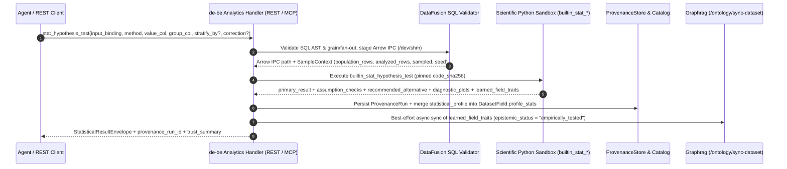

# Spec 11: Curated Phase 1 Statistical Toolbelt, `StatisticalResultEnvelope`, MCP Tools & Epistemic Trait Sync

- **Status**: `complete`
- **Derived From**: [08. Statistical Analytics Engine PRD](../prds/statistical-analytics-engine-prd.md), [04. MCP Server & REST API PRD](../prds/data-engine-mcp-api-prd.md)
- **Dependencies**: [10-scientific-python-sandbox-and-arrow-ipc-spec.md](./10-scientific-python-sandbox-and-arrow-ipc-spec.md)

---

## 1. Objective
Implement the six Phase 1 curated statistical tools inside `de-be-container` (`src/analytics/`), backed by built-in versioned Python algorithms executed over zero-copy Arrow IPC, exposed via both REST (`POST ${service.api_prefix}/analytics/*` and `/api/v1/analytics/*`) and typed `rmcp` MCP tools (`stat_*`):
1. `stat_describe_and_check` (`POST /analytics/describe`)
2. `stat_hypothesis_test` (`POST /analytics/hypothesis-test`)
3. `stat_power_analysis` (`POST /analytics/power`)
4. `stat_correlation_vif` (`POST /analytics/correlation`)
5. `stat_regression_fit` (`POST /analytics/regression`)
6. `stat_timeseries_analyze` (`POST /analytics/timeseries`)

Every tool emits the uniform `StatisticalResultEnvelope` (including automatic `assumption_checks`, `recommended_alternative`, bounded `diagnostic_plots`, `learned_field_traits`, and `provenance_run_id`) and synchronizes discovered statistical field traits into `DatasetField.profile_stats` and `Graphrag`.

---

## 2. Statistical Tool Pipeline & Envelope Flow



---

## 3. Detailed Tool Contracts & Numerical Specifications

### 3.1 Universal `StatisticalResultEnvelope` (`src/analytics/envelope.rs`)
```rust
#[derive(Debug, Clone, Serialize, Deserialize, JsonSchema)]
pub struct StatisticalResultEnvelope {
    pub tool: String,
    pub algorithm_id: String,
    pub algorithm_version: u32,
    pub code_sha256: String,
    pub sample_context: SampleContext,
    pub primary_result: serde_json::Value,
    pub assumption_checks: Vec<AssumptionCheck>, // status: "passed" | "warning" | "failed"
    pub recommended_alternative: Option<RecommendedAlternative>,
    pub diagnostic_plots: Vec<DiagnosticPlotSpec>, // bounded to sandbox.max_plot_points
    pub learned_field_traits: Vec<LearnedFieldTrait>,
    pub provenance_run_id: String,
    pub trust_summary: TrustSummary,
}
```

### 3.2 Six Phase 1 Tool Specifications
1. **`stat_describe_and_check`**:
   - Inputs: `input_binding` (`dataset_id` or `sql`), `columns: Vec<String>`, optional `sampling: SamplingSpec`.
   - Outputs per column: count, null count/ratio, mean, sample std/variance (`ddof=1`), skewness, excess kurtosis, quantiles (`p1, p5, p25, p50, p75, p95, p99`), IQR, MAD, normality test (Shapiro-Wilk for $n \le 5000$, D'Agostino-Pearson + KS for $n > 5000$), outlier counts (IQR $1.5\times$ & modified $z$-score $> 3.5$), `distribution_histogram` + `qq_plot` specs, and `learned_field_traits` (`distribution_family`, `is_heavy_tailed`, `recommended_test_family`).
2. **`stat_hypothesis_test`**:
   - Inputs: `input_binding`, `method` (`welch_t`, `student_t`, `paired_t`, `mann_whitney_u`, `wilcoxon`, `anova_oneway`, `kruskal_wallis`, `chi_square`, `fisher_exact`), `value_col`, `group_col` (or `col_a`/`col_b`), optional `alpha` (default `0.05`), `alternative` (`two-sided` | `greater` | `less`), `correction` (`none` | `fdr_bh` | `holm` | `bonferroni`), `segment_col` (multi-segment testing), `stratify_by` (confounding / Simpson's paradox check), `bootstrap_resamples` (optional, seeded).
   - Automatic checks: group $n$, Shapiro-Wilk/D'Agostino normality, Levene variance equality, expected cell count $\ge 5$. Automatically populates `recommended_alternative` (e.g., `mann_whitney_u` for failed normality in $t$-tests; `kruskal_wallis` for ANOVA; `fisher_exact` for low-count $2\times 2$ tables). When `stratify_by` is provided, computes per-stratum effects and Cochran-Mantel-Haenszel / stratified pooled effect and emits `simpsons_paradox_detected: true` if aggregate direction reverses all strata!
   - Emits `distribution_histogram`, `qq_plot`, and `ci_forest` plot specs.
3. **`stat_power_analysis`**:
   - Inputs: `test_type` (`two_sample_mean`, `two_sample_proportion`, `paired_mean`, `oneway_anova`), `solve_for` (`sample_size` | `power` | `mde`), `alpha`, and required subset of (`power`, `effect_size` / `p1`/`p2`, `n_per_group`, `ratio`, `num_groups`).
   - Emits exact required $n$, achieved power, MDE, and a `power_curve` plot spec.
4. **`stat_correlation_vif`**:
   - Inputs: `input_binding`, `columns: Vec<String>`, `methods: Vec<String>` (`pearson`, `spearman`, `kendall`), optional `control_cols: Vec<String>` (partial correlation), `correction` (`fdr_bh` default).
   - Computes correlation matrices, raw & FDR-adjusted $p$-values, partial correlations, condition number, and per-feature VIF (`statsmodels.stats.outliers_influence.variance_inflation_factor`).
   - Flags `|pearson - spearman| > 0.15` (non-linear / outlier sensitivity) and `VIF > 5` (warning) / `VIF > 10` (failed). Emits `correlation_heatmap`.
5. **`stat_regression_fit`**:
   - Inputs: `input_binding`, `model_type` (`ols`, `glm_gaussian`, `glm_binomial`, `glm_poisson`, `glm_gamma`, `huber_robust`, `ransac_robust`), `target_col`, `feature_cols: Vec<String>`, `add_intercept` (default `true`).
   - Computes coefficients, standard SEs + HC3 robust SEs, $t/z$-stats, $p$-values, 95% CIs, $R^2$/Adj-$R^2$/AIC/BIC/deviance, standardized betas.
   - Automatic checks: VIF, Breusch-Pagan heteroscedasticity, Durbin-Watson autocorrelation, residual Shapiro-Wilk normality, Cook's distance ($> 4/n$) influential row counts; populates `recommended_alternative` with HC3 robust SEs or Huber fit when heteroscedasticity/outliers fail. Emits `residual_vs_fitted`, `qq_plot`, and `ci_forest` coefficient plots.
6. **`stat_timeseries_analyze`**:
   - Inputs: `input_binding`, `time_col`, `value_col`, optional `compare_col` (cross-series correlation check), `period: Option<usize>`, `forecast_horizon: Option<usize>`, `model` (`ets` | `arima`), `anomaly_z_threshold` (default `3.0`).
   - Computes STL decomposition (`statsmodels.tsa.seasonal.STL`), ADF & KPSS stationarity tests, ACF/PACF with 95% Bartlett bands, remainder CUSUM/modified-$z$ changepoints & anomalies, optional ETS/ARIMA forecasts with 80% & 95% prediction intervals, and (when `compare_col` is given) compares level Pearson $r$ vs. first-differenced Pearson $r$ — emitting a `spurious_nonstationary_correlation` warning if series are non-stationary and differenced $|r|$ collapses.
   - Emits `stl_decomposition`, `acf_pacf`, and `forecast_interval` plot specs + `learned_field_traits` (`seasonality_period`, `is_stationary`).

---

## 4. Test Strategy (TDD)

### Golden Mathematical Unit Tests (`cargo test`, tolerance $\le 10^{-6}$)
1. `test_stat_describe_nist_norris_and_heavy_tail`: Validates mean, sample std, skewness, kurtosis, normality rejection, and `learned_field_traits` (`is_heavy_tailed = true`) on NIST `Norris` + synthetic log-normal fixture.
2. `test_stat_hypothesis_test_welch_mwu_fdr_and_simpsons_paradox`: Verifies Welch's $t$, Mann-Whitney $U$ auto-fallback on skewed data, BH-FDR correction on 20 noise segments, and `simpsons_paradox_detected = true` when aggregate vs. stratified directions reverse.
3. `test_stat_power_analysis_closed_form_matches_scipy`: Verifies sample size, power, and MDE calculations for two-sample means and proportions against closed-form reference values.
4. `test_stat_correlation_vif_nist_longley_collinearity`: Verifies Pearson/Spearman divergence flag and severe VIF ($> 10$) detection on the NIST `Longley` collinearity dataset.
5. `test_stat_regression_fit_nist_norris_and_heteroscedasticity`: Verifies OLS coefficients & SEs to $10^{-6}$ on NIST `Norris`, plus Breusch-Pagan failure triggering HC3 robust SE recommendation on heteroscedastic synthetic data.
6. `test_stat_timeseries_stl_adf_kpss_and_spurious_random_walks`: Verifies STL seasonal recovery on a known period-7 sine+trend series, ADF/KPSS detection on random walks, and `spurious_nonstationary_correlation` warning when level $r > 0.85$ drops to $|r| < 0.15$ after differencing.
7. `test_diagnostic_plots_respect_max_plot_points_bound`: Verifies plot coordinate arrays never exceed `sandbox.max_plot_points`.

### REST & MCP Integration Tests (Robot Framework)
- Verify all 6 `/api/data-engine/v1/analytics/*` endpoints and all 6 `stat_*` MCP tools via `POST /api/data-engine/v1/mcp` (`tools/list` + `tools/call`) return valid `StatisticalResultEnvelope` payloads with non-empty `provenance_run_id` and `code_sha256`.
- Verify `GET /api/data-engine/v1/fields/:id` reflects merged `statistical_profile` after running `stat_describe_and_check`.
