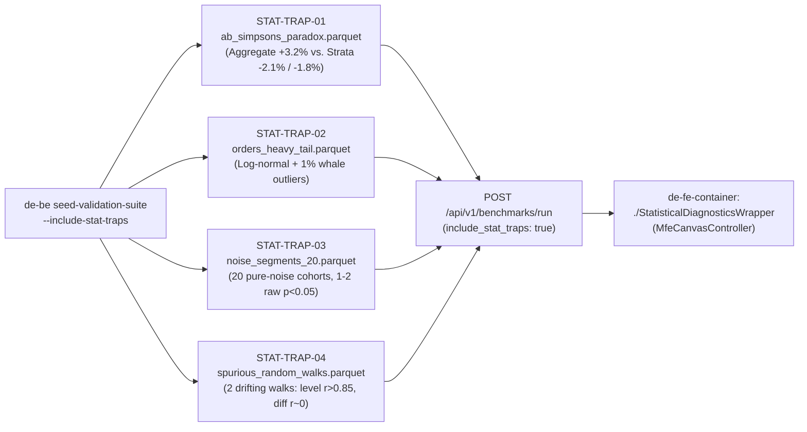

# Spec 12: Statistical Chaos Traps (`STAT-TRAP-01..04`) & `./StatisticalDiagnosticsWrapper` Canvas Remote

- **Status**: `draft`
- **Derived From**: [08. Statistical Analytics Engine PRD](../prds/statistical-analytics-engine-prd.md), [05. MFE Frontend & Shared Canvas PRD](../prds/mfe-frontend-canvas-prd.md), [07. Validation Datasets & Benchmark PRD](../prds/validation-datasets-and-benchmark-prd.md)
- **Dependencies**: [09-mfe-frontend-container-spec.md](./09-mfe-frontend-container-spec.md), [11-curated-statistical-toolbelt-and-mcp-spec.md](./11-curated-statistical-toolbelt-and-mcp-spec.md)

---

## 1. Objective
1. Extend `de-be seed-validation-suite` (`src/seeder.rs`) and the ablation benchmark harness (`src/benchmark.rs`) with four deterministic **Statistical Chaos Traps (`STAT-TRAP-01`..`STAT-TRAP-04`)** and their ground-truth verification assertions.
2. Expose **`./StatisticalDiagnosticsWrapper`** in `de-fe-container` implementing `MfeCanvasController` so `Angry-agent` and `Mfe-shell` render interactive assumption scorecards, diagnostic charts (Q-Q, residual vs. fitted, distributions, CI forest intervals, STL/ACF/forecast charts), provenance links, and 1-click **`[Verify Statistical Trait]`** stewardship actions on the RHS Shared Canvas.

---

## 2. Statistical Chaos Traps & Diagnostics Canvas Architecture

---

## 3. Technical Specification

### 3.1 Statistical Chaos Seeder Extension (`src/seeder.rs` & `src/cli.rs`)
- Add `--include-stat-traps` flag (default `false` for backward compatibility, `true` in statistical benchmark runs) to `de-be seed-validation-suite`.
- Deterministically generate four Parquet fixtures using `seeder.default_seed` (`42`):
  1. **`ab_simpsons_paradox.parquet` (`STAT-TRAP-01`)**: Columns `user_id`, `variant` (`control` | `treatment`), `segment` (`enterprise` | `smb`), `converted` (`0` | `1`). Allocation skew (80% of Treatment in high-converting `enterprise`, 80% of Control in lower-converting `smb`) yields aggregate Treatment lift `+3.2%`, while within both `enterprise` (`-2.1%`) and `smb` (`-1.8%`) Control wins.
  2. **`orders_heavy_tail.parquet` (`STAT-TRAP-02`)**: Columns `order_id`, `variant` (`control` | `treatment`), `order_total_usd`. Control has 1% planted `$50,000` whale outliers masking a genuine `+18%` median Treatment lift detectable by `mann_whitney_u` ($p < 0.01$).
  3. **`noise_segments_20.parquet` (`STAT-TRAP-03`)**: Columns `segment_id` (`SEG-01`..`SEG-20`), `variant`, `metric_value`. Generated from identical $\mathcal{N}(100, 15^2)$ null distributions with a seed chosen so at least 1 segment exhibits raw $p < 0.05$, while BH-FDR produces `0` significant segments (`adjusted_p_value > 0.25`).
  4. **`spurious_random_walks.parquet` (`STAT-TRAP-04`)**: Columns `day` (ISO date, 365 days), `series_a`, `series_b` (independent positive-drift random walks with level Pearson $r > 0.85$, ADF non-stationary $p > 0.10$, and first-differenced $|r| < 0.15$).
- Append `stat_traps` ground-truth entries into `ground_truth_manifest.json`.

### 3.2 Statistical Benchmark Harness (`src/benchmark.rs`)
- Extend `BenchmarkRunRequest` with `include_stat_traps: bool` (default `false`).
- Evaluate `STAT-TRAP-01`..`STAT-TRAP-04` across Baseline (naïve aggregate / unadjusted / level stats: `0/4`), Toolbelt-Only (diagnostics emitted: partial), and Full Statistician Protocol (stratified, non-parametric fallback, BH-FDR, ADF + differencing: `4/4 = 100%`).

### 3.3 `./StatisticalDiagnosticsWrapper` MFE Component (`de-fe-container`)
- Register `'./StatisticalDiagnosticsWrapper'` in `de-fe-container/federation.config.js` (alongside the existing 5 entry points).
- Implement `MfeCanvasController<StatisticalResultEnvelope>`:
  - `getSchema()` returns Draft-07 schema describing active plot tab, trait verification actions, and provenance inspection state.
  - `applyPatch(patches, attributions)` updates active envelope or highlights AI-flagged failed assumptions without unmounting chart DOM.
  - Renders three panels:
    1. **Assumption & Rigor Scorecard**: Status chips (`passed` green, `warning` amber, `failed` red), `SampleContext` disclosure (`sampled: true` banner with `seed` if sampled), and side-by-side Primary vs. `recommended_alternative` cards.
    2. **Diagnostic Chart Deck**: Renders `distribution_histogram`, `qq_plot`, `residual_vs_fitted`, `ci_forest`, `correlation_heatmap`, `stl_decomposition`, `acf_pacf`, and `forecast_interval` payloads cleanly (SVG/Canvas lightweight charts with tooltips).
    3. **Epistemic Trait & Provenance Drawer**: Lists `learned_field_traits` with **`[✓ Verify Statistical Trait]`** buttons invoking `PUT /api/data-engine/v1/fields/:id` (`epistemic_status = "verified"`) and links directly to `./ProvenanceLineageWrapper` via `provenance_run_id`.
- Add `./StatisticalDiagnosticsWrapper` to the standalone Studio RHS Canvas Switcher bar.

---

## 4. Test Strategy (TDD)

### Backend Unit Tests (`cargo test`)
1. `test_seeder_generates_deterministic_stat_traps_01_through_04`: Seeds with seed `42`, verifies all 4 Parquet files exist, and asserts mathematical trap invariants (aggregate vs. stratified sign reversal in `STAT-TRAP-01`, whale outliers in `STAT-TRAP-02`, raw false positive disappearing under BH-FDR in `STAT-TRAP-03`, level $r > 0.85$ vs. differenced $|r| < 0.15$ in `STAT-TRAP-04`).
2. `test_benchmark_runner_scores_stat_traps_across_modes`: Verifies `0/4` baseline vs. `4/4` full statistician protocol in `benchmark.rs`.

### Frontend Unit Tests (`make test-fe` / Vitest)
3. `StatisticalDiagnosticsComponent` renders `passed`/`warning`/`failed` assumption badges, displays the `recommended_alternative` banner when normality fails, renders sampling disclosure when `sampled: true`, implements `MfeCanvasController` (`applyPatch`/`getState`/`getSchema`), and dispatches `PUT /fields/:id` on clicking `[Verify Statistical Trait]`.

### Integration Tests (Robot Framework)
- Runs `POST /api/data-engine/v1/benchmarks/run` with `include_stat_traps: true` and verifies `4/4` statistical trap resolution and `100%` provenance completeness.
