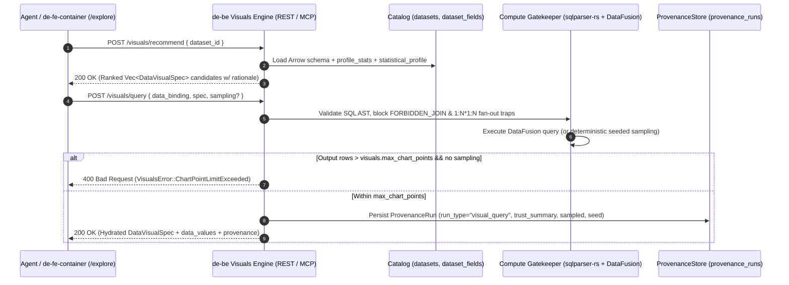

# Spec 13: Data Visuals Engine, Schema-Driven Chart Recommender, Bounded Query Materialization & MCP Tools (`src/visuals/`)

- **Status**: `draft`
- **Derived From**: [09. Data Visualizations & Semantic Relationship Topology PRD](../prds/data-visuals-and-semantic-topology-prd.md), [04. MCP Server & REST API PRD](../prds/data-engine-mcp-api-prd.md)
- **Dependencies**: [03-arrow-profiler-and-drift-detector-spec.md](./03-arrow-profiler-and-drift-detector-spec.md), [05-query-validator-and-provenance-spec.md](./05-query-validator-and-provenance-spec.md), [08-configurable-api-prefix-and-virtualservice-spec.md](./08-configurable-api-prefix-and-virtualservice-spec.md)

---

## 1. Objective
Implement `de-be-container`'s declarative data visualization backend (`src/visuals/`):
1. Modular `VisualsConfig` (`DE_BE__VISUALS__*`) with fail-fast validation and typed `VisualsError` (`thiserror::Error`).
2. Reversible PostgreSQL migration for `saved_visuals` and full REST BREAD (`GET/POST/PUT/DELETE /api/v1/visuals` & `${service.api_prefix}/visuals`).
3. Deterministic schema- and profile-driven chart recommender (`POST /api/v1/visuals/recommend` & MCP `visual_recommend`) producing ranked **Vega-Lite v5** and **Apache ECharts** `DataVisualSpec` candidates.
4. Safe, bounded chart materialization (`POST /api/v1/visuals/query` & MCP `visual_render_spec`) gated by `sqlparser-rs` + DataFusion AST/fan-out/`FORBIDDEN_JOIN` checks, fail-fast `max_chart_points` enforcement (with opt-in deterministic seeded sampling), and immutable `ProvenanceRun` (`run_type = "visual_query"`).

---

## 2. Visual Recommendation & Materialization Pipeline



---

## 3. Technical Specification

### 3.1 Modular Configuration (`src/visuals/config.rs`) & Errors (`src/visuals/error.rs`)
- **`VisualsConfig`** composed into `AppConfig` (`config/default.yaml`, `charts/data-engine/configs/config.yaml`, env override `DE_BE__VISUALS__*`):
  ```rust
  #[derive(Debug, Clone, Deserialize, Serialize)]
  pub struct VisualsConfig {
      pub max_chart_points: usize,         // default 5000 (validated 10..=100_000)
      pub max_topology_nodes: usize,       // default 250  (validated 10..=5_000)
      pub max_topology_edges: usize,       // default 500  (validated 10..=20_000)
      pub default_ego_hops: u8,            // default 2    (validated 1..=5)
      pub enable_graphrag_overlay: bool,   // default true
  }
  ```
- **`VisualsError`** (`#[derive(Debug, thiserror::Error)]`):
  - `InvalidConfig(String)`
  - `ChartPointLimitExceeded { actual_rows: usize, max_chart_points: usize }` $\rightarrow$ `400 Bad Request`
  - `InvalidVisualSpec(String)` $\rightarrow$ `400 Bad Request`
  - `UnsupportedRenderer(String)` $\rightarrow$ `400 Bad Request`
  - `VisualNotFound(Uuid)` $\rightarrow$ `404 Not Found`
  - `TopologyFocusNotFound(String)` $\rightarrow$ `404 Not Found`
  - `Compute(#[from] ComputeError)` (maps `ForbiddenJoinPath` / `FanOutTrapDetected` to `400`/`422`)
  - `Database(#[from] DatabaseError)`

### 3.2 Reversible Migration (`migrations/<version>_create_saved_visuals.{up,down}.sql`)
Creates `saved_visuals`:
- `id UUID PRIMARY KEY`
- `name VARCHAR NOT NULL`
- `description TEXT NOT NULL DEFAULT ''`
- `renderer VARCHAR NOT NULL CHECK (renderer IN ('vega_lite', 'echarts'))`
- `chart_family VARCHAR NOT NULL`
- `primary_dataset_id UUID REFERENCES datasets(id) ON DELETE SET NULL`
- `data_binding JSONB NOT NULL`
- `visual_spec JSONB NOT NULL`
- `profile_overlays JSONB NOT NULL DEFAULT '{}'::jsonb`
- `last_provenance_run_id UUID REFERENCES provenance_runs(id) ON DELETE SET NULL`
- `created_by VARCHAR NOT NULL DEFAULT 'system'`
- `created_at TIMESTAMPTZ NOT NULL DEFAULT NOW()`
- `updated_at TIMESTAMPTZ NOT NULL DEFAULT NOW()`

Paired `.down.sql` runs `DROP TABLE IF EXISTS saved_visuals;`.

### 3.3 Deterministic Chart Recommender (`src/visuals/recommender.rs`)
Inspects `DatasetField` Arrow types (`Timestamp`/`Date`, numeric `Int*`/`Float*`/`Decimal*`, string/boolean categoricals) and `profile_stats` (`distinct_count`, `null_ratio`, `quantiles`, `statistical_profile.is_heavy_tailed`, `seasonality_period`):
1. **Temporal + Numeric** $\rightarrow$ `line` (rank score `0.95`), `area` (`0.82`); attaches `seasonality_period` overlay if present.
2. **Low-Cardinality Categorical (`2..=20` distinct) + Numeric**:
   - If `is_heavy_tailed == true` or `|skewness| > 2.0`: ranks `box_plot` (`0.94`, with log-scale hint + median reference line) above `bar` (`0.78`).
   - Otherwise: ranks sorted `bar` (`0.92`) and `box_plot` (`0.80`).
3. **Two Numerics** $\rightarrow$ `scatter` (`0.88` if `row_count <= max_chart_points`, else 2D binned `heatmap` `0.88`).
4. **Two Low-Cardinality Categoricals + Numeric** $\rightarrow$ `heatmap` (`0.86`) and `pivot_table` (`0.80`).
5. **Single Numeric Column** $\rightarrow$ `histogram` (`0.85`, attaching `p25`/`p50`/`p75` reference lines) + `kpi_sparkline`.
6. **Single Categorical Column** $\rightarrow$ Top-K `bar` (`0.84`).

Each recommendation returns a complete Vega-Lite v5 `DataVisualSpec` (with optional `renderer: "echarts"` translation when requested), `score`, `rationale`, and ready-to-execute `data_binding` SQL.

### 3.4 Bounded Materialization & Provenance (`POST /api/v1/visuals/query` & MCP `visual_render_spec`)
1. Accepts `DataVisualQueryRequest { title, renderer, chart_family, data_binding, spec, profile_overlays?, sampling?, question? }`.
2. Validates `renderer` (`vega_lite` | `echarts`) and minimal structural validity of `spec` (must be JSON object with `mark`/`layer`/`vconcat`/`hconcat` for Vega-Lite or `series` for ECharts).
3. Validates `data_binding` (`dataset_id`, `sql_query`, or `algorithm_id`) through `src/compute/` (`sqlparser-rs` read-only AST + `FORBIDDEN_JOIN` + `1:N * 1:N` fan-out check).
4. Checks row count against `config.visuals.max_chart_points`:
   - If exceeded and `sampling` is `None`: returns `VisualsError::ChartPointLimitExceeded { actual_rows, max_chart_points }` with remediation hint (`"Aggregate with GROUP BY/binning or supply explicit seeded sampling"`).
   - If `sampling` is provided: applies deterministic seeded sampling (`ORDER BY hash(row, seed)` / seeded selection), recording `sampled: true`, `population_rows`, `rendered_rows`, and `sampling_seed`.
5. Records an immutable `ProvenanceRun` (`run_type = "visual_query"`) and returns `{ visual_spec, data_values, provenance: { provenance_run_id, trust_summary, sampled, population_rows, rendered_rows, sampling_seed } }`.

### 3.5 MCP Tool Parity (`src/mcp/mod.rs`)
Registers two strongly typed `rmcp` tools (`schemars::JsonSchema`):
- `visual_recommend`: wraps recommender for `dataset_id` or read-only `sql`.
- `visual_render_spec`: wraps `/visuals/query`, returning a canvas-ready `DataVisualSpec` + bounded `data_values` + `provenance_run_id` ready for `Angry-agent` to mount in `./DataVisualExplorerWrapper`.

---

## 4. Test Strategy (TDD)

### Backend Unit Tests (`make test` / `cargo test`)
1. `test_visuals_config_validation_rejects_out_of_range_bounds`: Asserts `VisualsConfig::validate()` rejects `max_chart_points < 10`, `max_topology_nodes < 10`, and `default_ego_hops == 0` or `> 5`.
2. `test_recommender_ranks_line_for_temporal_and_boxplot_for_heavy_tail`: Feeds a dataset with temporal + heavy-tailed numeric (`is_heavy_tailed = true`) + low-cardinality segment and asserts `line` and `box_plot` (with log-scale hint & median reference line) are top-ranked.
3. `test_visual_query_blocks_forbidden_join_and_fan_out_trap`: Runs `POST /api/v1/visuals/query` against seeded `TRAP-01` (`FORBIDDEN_JOIN`) and `TRAP-03` (`orders x order_items x order_payments`) SQL and asserts rejection before execution.
4. `test_visual_query_fails_fast_above_max_chart_points_and_succeeds_with_seeded_sampling`: Sets `max_chart_points = 50` on a 200-row dataset; asserts unsampled query returns `400 ChartPointLimitExceeded`, while explicit `sampling: { strategy: "random", max_rows: 50, seed: 42 }` succeeds deterministically with `sampled: true`, `population_rows: 200`, `rendered_rows: 50`, and a persisted `ProvenanceRun`.
5. `test_saved_visuals_bread_lifecycle_and_reversible_migration`: Exercises `POST` -> `GET` -> `PUT` -> `DELETE /api/v1/visuals` and verifies `404` after delete.

### Integration Tests (Robot Framework)
- Exercises `POST /api/data-engine/v1/visuals/recommend`, `POST /api/data-engine/v1/visuals/query`, saved visuals BREAD, and MCP `tools/call` for `visual_recommend` and `visual_render_spec`, asserting non-empty `provenance_run_id` and valid Vega-Lite v5 JSON specs.
