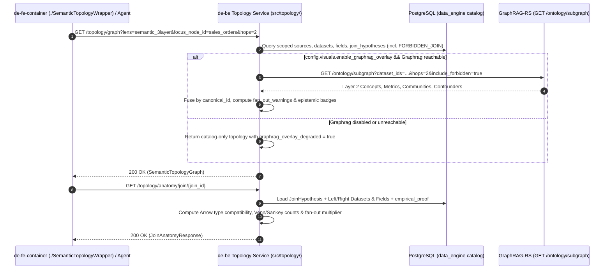

# Spec 14: Semantic & Structural Topology Graph Engine, Field Anatomy API & MCP Tools (`src/topology/`)

- **Status**: `draft`
- **Derived From**: [09. Data Visualizations & Semantic Relationship Topology PRD](../prds/data-visuals-and-semantic-topology-prd.md), [04. MCP Server & REST API PRD](../prds/data-engine-mcp-api-prd.md)
- **Dependencies**: [03-arrow-profiler-and-drift-detector-spec.md](./03-arrow-profiler-and-drift-detector-spec.md), [04-empirical-join-probe-spec.md](./04-empirical-join-probe-spec.md), [13-data-visuals-engine-recommender-and-mcp-spec.md](./13-data-visuals-engine-recommender-and-mcp-spec.md), Graphrag Spec 25 (`GET /ontology/subgraph`)

---

## 1. Objective
Implement `de-be-container`'s multi-layer semantic & structural relationship backend (`src/topology/`):
1. **Fused Multi-Layer Topology Graph (`GET /api/v1/topology/graph` & MCP `topology_graph`)**: Combines `data-engine`'s physical catalog (`data_sources`, `datasets`, `dataset_fields`, `join_hypotheses`, `provenance_lineage_edges`) with `Graphrag`'s Layer 2 ontology (`GET /ontology/subgraph`) into a single bounded `SemanticTopologyGraph` DTO, with graceful degradation if `Graphrag` is unavailable.
2. **Dataset Structural Anatomy (`GET /api/v1/topology/anatomy/dataset/{id}`)** and **Field-to-Field Join Anatomy (`GET /api/v1/topology/anatomy/join/{id}`)** (plus MCP `topology_field_anatomy`): Returns nested Arrow schema hierarchy trees, column profile mini-distributions, side-by-side schema cards, Arrow type compatibility/cast warnings, Venn/Sankey value-overlap & orphan key breakdowns, and `1:N * 1:N` / `N:M` fan-out multiplier diagnostics.
3. **Deterministic Mermaid Exporter (`GET /api/v1/topology/mermaid`)**: Renders any scoped topology view as Mermaid `erDiagram` (`er_join` lens) or `flowchart TB` (`semantic_3layer` lens).

---

## 2. Topology Fusion & Field Anatomy Flow



---

## 3. Technical Specification & Payload Contracts

### 3.1 Fused Multi-Layer Graph DTO (`GET /api/v1/topology/graph`)
Query parameters:
- `lens`: `"semantic_3layer" | "er_join" | "lineage_overlay"` (default `"semantic_3layer"`)
- `source_id`: optional `Uuid`
- `dataset_ids`: optional comma-separated `Uuid` or canonical IDs
- `epistemic_status`: optional comma-separated statuses (`verified`, `empirically_tested`, `hypothesized`, `pending_review`, `drifted`, `rejected`)
- `focus_node_id`: optional canonical ID or UUID (returns `404 TopologyFocusNotFound` if absent)
- `hops`: optional `u8` (defaults to `config.visuals.default_ego_hops`)
- `include_fields`: `bool` (default `true` when dataset count $\le 15$, `false` when $> 15$)
- `include_forbidden`: `bool` (default `true`)
- `include_semantics`: `bool` (default `true`)
- `provenance_run_id`: optional `Uuid` (activates `lineage_overlay` path highlighting)

Response (`SemanticTopologyGraph`):
```json
{
  "lens": "semantic_3layer",
  "graphrag_overlay_degraded": false,
  "truncated": false,
  "total_nodes": 18,
  "total_edges": 24,
  "applied_filter_hint": null,
  "communities": [
    { "id": "comm_revenue", "label": "Revenue & Billing", "member_node_ids": ["net_revenue", "sales_orders", "crm_customers"] }
  ],
  "nodes": [
    {
      "id": "sales_orders",
      "kind": "dataset",
      "layer": 1,
      "parent_id": "src_s3_lake",
      "label": "sales_orders",
      "subtitle": "1 row per order • 48,200 rows",
      "epistemic_status": "drifted",
      "confidence": 0.92,
      "badges": ["parquet", "drifted"],
      "field_count": 9,
      "metadata": { "format": "parquet", "row_count_estimate": 48200, "grain_description": "1 row per order" }
    }
  ],
  "edges": [
    {
      "id": "join_uuid_1",
      "source_id": "sales_orders.cust_ref_key",
      "target_id": "crm_customers.party_uuid",
      "predicate": "JOINABLE_WITH",
      "cardinality": "N:1",
      "epistemic_status": "empirically_tested",
      "confidence": 0.97,
      "inclusion_ratio": 0.97,
      "fan_out_warning": null,
      "filter_invariant": null,
      "steward_notes": null
    }
  ],
  "highlighted_path": {
    "node_ids": ["net_revenue", "sales_orders", "crm_customers"],
    "edge_ids": ["join_uuid_1"],
    "all_rules_human_verified": false,
    "fan_out_warnings": []
  }
}
```
- **Fan-Out Detection**: Inspects all `JOINABLE_WITH` edges incident to each dataset; whenever a dataset has two or more outgoing `1:N` or `N:M` joins (such as `TRAP-03` `orders -> order_items` and `orders -> order_payments`), tags the edges with `fan_out_warning: { multiplier_estimate, reason, suggested_cte_pattern }`.
- **Bounds Enforcement**: Enforces `config.visuals.max_topology_nodes` and `config.visuals.max_topology_edges` deterministically (never returning dangling edges).

### 3.2 Dataset Structural Anatomy (`GET /api/v1/topology/anatomy/dataset/{id}`)
Returns `DatasetAnatomyResponse`:
- `dataset`: core dataset metadata (`canonical_id`, `format`, `grain_description`, `row_count_estimate`, `schema_fingerprint_sha256`, `epistemic_status`).
- `schema_tree`: Hierarchical tree reconstructed from dot/bracket `field_path` descriptors (e.g., `customer` (Struct) -> `address` (Struct) -> `zip` (Utf8); `items[]` (List) -> `sku` (Utf8)), each leaf carrying `field_id`, `arrow_data_type`, `is_nullable`, `is_primary_key_candidate`, `unit`, `sensitivity_tag`, `epistemic_status`, `null_ratio`, `distinct_count`, `top_values`, `mini_histogram_bins`, and `statistical_profile`.
- `incident_joins`: Summary list of all `JOINABLE_WITH` and `FORBIDDEN_JOIN` edges connected to this dataset.
- `semantic_links`: Layer 2 `BusinessConcept` and `BusinessMetric` nodes governing or computed from this dataset (from `Graphrag` when available).

### 3.3 Field-to-Field Join Anatomy (`GET /api/v1/topology/anatomy/join/{id}`)
Returns `JoinAnatomyResponse`:
- `join`: `JoinHypothesis` metadata (`id`, `predicate`, `cardinality`, `epistemic_status`, `confidence`, `filter_invariant`, `verified_by`, `steward_notes`).
- `left_dataset` & `right_dataset`: Compact schema card field lists with the joined key field highlighted.
- `type_compatibility`: `{ compatible: bool, left_arrow_type, right_arrow_type, cast_required: Option<String>, warning: Option<String> }`.
- `overlap_strip` (for Venn/Sankey visualization): `{ jaccard_overlap, left_inclusion_ratio, right_inclusion_ratio, left_distinct_count, right_distinct_count, matched_distinct_count, left_orphan_count, right_orphan_count }`.
- `matched_samples` & `left_orphan_samples` & `right_orphan_samples`: Bounded sample arrays from `empirical_proof`.
- `fan_out_diagnostics`: `{ is_fan_out_risk: bool, row_multiplier_estimate: f64, explanation: String, safe_cte_sql_hint: Option<String> }`.
- `explore_sql_template`: Ready-to-use validated `SELECT` template enabling 1-click `[Explore Joined Data]` pivot into `./DataVisualExplorerWrapper`.

### 3.4 Deterministic Mermaid Exporter (`GET /api/v1/topology/mermaid`)
Accepts the same query filters as `/topology/graph` and returns `{ mermaid: String, diagram_kind: "erDiagram" | "flowchart", graph: SemanticTopologyGraph }`:
- `lens=er_join` emits Mermaid `erDiagram` with entities, key attributes, and crow's-foot cardinality lines (`||--o{`, `}|--|{`, plus `%% FORBIDDEN_JOIN` notes).
- `lens=semantic_3layer` emits Mermaid `flowchart TB` with `subgraph` swimlanes (`Layer 2: Semantic Ontology`, `Layer 1: Datasets`, `Layer 0: Physical Fields`).

### 3.5 MCP Tool Parity (`src/mcp/mod.rs`)
- `topology_graph`: accepts optional `lens`, `focus_node_id`, `hops`, `dataset_ids`, `epistemic_status`, `include_fields`, `include_forbidden`, `include_semantics`, `provenance_run_id`.
- `topology_field_anatomy`: accepts `target_kind: "dataset" | "join"` and `target_id: String`.

---

## 4. Test Strategy (TDD)

### Backend Unit Tests (`make test` / `cargo test`)
1. `test_topology_graph_fuses_catalog_and_mock_graphrag_layers`: Runs against a local mock `Graphrag` HTTP server returning Layer 2 `BusinessConcept`/`BusinessMetric`/`CommunitySummary` + `CONFOUNDED_BY`; asserts fused `SemanticTopologyGraph` links Layer 2 -> Layer 1 -> Layer 0 accurately by `canonical_id`.
2. `test_topology_graph_degrades_gracefully_when_graphrag_unreachable`: Points `graphrag.url` to an unreachable port and asserts `200 OK` with `graphrag_overlay_degraded == true` and complete catalog Layer 1/0 datasets, fields, and joins.
3. `test_topology_graph_annotates_trap_01_forbidden_trap_03_fanout_and_trap_04_drift`: Seeds chaos traps `TRAP-01..04`; asserts crimson `FORBIDDEN_JOIN` edge on `TRAP-01`, `fan_out_warning` on `TRAP-03`, and `drifted` badge on `TRAP-04`.
4. `test_dataset_anatomy_builds_nested_arrow_schema_tree`: Registers a dataset with dotted/list paths (`customer.address.zip`, `items[].sku`) and asserts a properly nested `schema_tree` with leaf profile stats.
5. `test_join_anatomy_computes_type_compatibility_overlap_strip_and_fanout`: Verifies `JoinAnatomyResponse` flags `Int64` vs. `Utf8` cast warnings, populates exact Venn/Sankey counts from `empirical_proof`, and returns a valid `explore_sql_template`.
6. `test_topology_mermaid_emits_valid_er_diagram_and_layered_flowchart`: Asserts deterministic `erDiagram` and `flowchart TB` outputs for both lenses.

### Integration Tests (Robot Framework)
- Exercises `GET /api/data-engine/v1/topology/graph`, `/topology/anatomy/dataset/{id}`, `/topology/anatomy/join/{id}`, `/topology/mermaid`, and MCP `topology_graph` + `topology_field_anatomy` against seeded chaos traps (`TRAP-01..04`), asserting all trap badges and anatomy fields.
