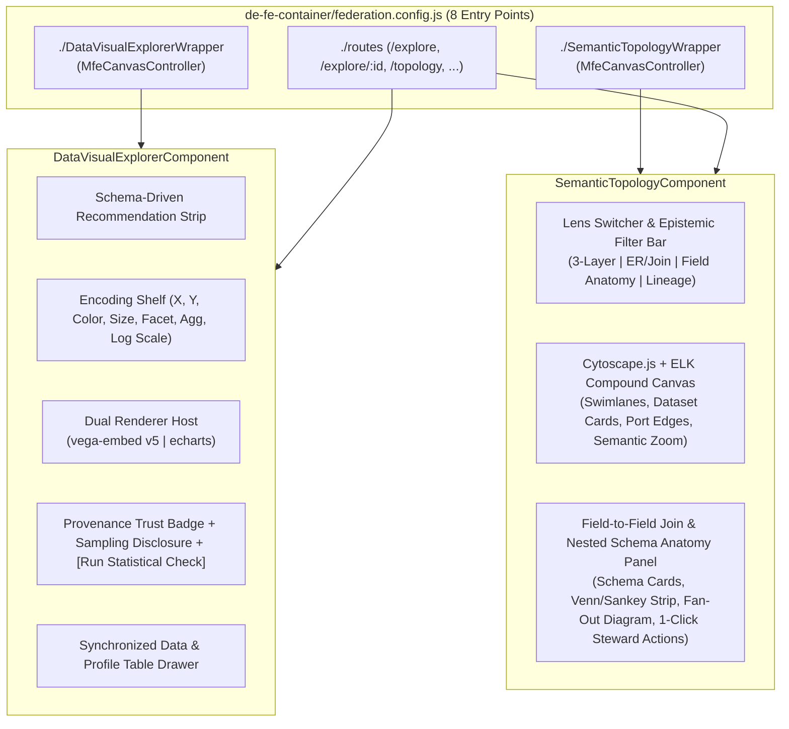

# Spec 15: `./DataVisualExplorerWrapper` & `./SemanticTopologyWrapper` Angular Native Federation Canvas Remotes (`de-fe-container`)

- **Status**: `draft`
- **Derived From**: [09. Data Visualizations & Semantic Relationship Topology PRD](../prds/data-visuals-and-semantic-topology-prd.md), [05. MFE Frontend & Shared Canvas PRD](../prds/mfe-frontend-canvas-prd.md)
- **Dependencies**: [09-mfe-frontend-container-spec.md](./09-mfe-frontend-container-spec.md), [12-statistical-chaos-traps-and-diagnostics-canvas-spec.md](./12-statistical-chaos-traps-and-diagnostics-canvas-spec.md), [13-data-visuals-engine-recommender-and-mcp-spec.md](./13-data-visuals-engine-recommender-and-mcp-spec.md), [14-semantic-topology-graph-and-field-anatomy-spec.md](./14-semantic-topology-graph-and-field-anatomy-spec.md)

---

## 1. Objective
Extend `de-fe-container` (Angular 21 + Angular Material + Tailwind CSS + `@angular-architects/native-federation`) with two rich, interactive visualization studios and bidirectional RHS Shared Canvas wrappers:
1. **`./DataVisualExplorerWrapper`** (`DataVisualExplorerComponent` + Studio routes `/explore` & `/explore/:id`): Declarative **Vega-Lite v5** (`vega-embed`) & **Apache ECharts** interactive data explorer with schema-driven recommendations, encoding shelf, cross-filtering/brushing, profile overlays, sampling/provenance trust banners, and 1-click pivot to `./StatisticalDiagnosticsWrapper`.
2. **`./SemanticTopologyWrapper`** (`SemanticTopologyComponent` + Studio route `/topology`): **Cytoscape.js + ELK (`elkjs`)** multi-layer relationship & structural anatomy visualizer supporting all four lenses (`semantic_3layer`, `er_join`, `field_anatomy`, `lineage_overlay`), semantic zoom, epistemic status styling, zoomed-in Field-to-Field Join Anatomy cards + Venn/Sankey overlap strips, and 1-click inline stewardship actions.

---

## 2. Frontend Component & Bidirectional Canvas Architecture

---

## 3. Technical Specification

### 3.1 Frontend Visualization Dependencies (`de-fe-container/package.json`)
- **Data Visuals**: `vega`, `vega-lite`, `vega-embed`, `echarts`
- **Semantic & Structural Graphs**: `cytoscape`, `cytoscape-elk`, `elkjs`
- **Existing Federation / Config Standard**: Resolves `config.json` via `new URL('config.json', import.meta.url)` so API calls target `${config.apiUrl}/visuals/*` and `${config.apiUrl}/topology/*` (`/api/data-engine/v1/...`) cleanly under `SERVE_ROOT=/mfe/data-engine`.

### 3.2 `./DataVisualExplorerWrapper` (`src/app/canvas/data-visual-explorer/`)
- **Implements `MfeCanvasController<DataVisualExplorerState>`**:
  - `getSchema()` returns Draft-07 JSON Schema describing `renderer`, `chart_family`, `spec`, `active_filters`, `profile_overlays`, and supported actions (`run_statistical_check`, `open_provenance`, `save_visual`, `drill_down_rows`, `export_spec`).
  - `applyPatch(patches, attributions)` applies RFC 6902 patches to `spec`, `active_filters`, or `profile_overlays` **in-place** (updating Vega View / ECharts instance without unmounting the container DOM) and displays an AI provenance chip when `attributions` includes `source: 'ai'`.
  - `onSelectionChange` emits clicked mark datum (`{ path: '/selection/datum', label, context }`) or brushed interval (`{ path: '/selection/brush', label, context }`) so `Angry-agent` displays a focus chip in LHS chat.
- **Core UI Capabilities**:
  1. **Recommendation Strip**: Calls `POST /visuals/recommend` on dataset selection and displays clickable ranked chart thumbnails with rationale tooltips.
  2. **Interactive Encoding Shelf**: Controls for `X`, `Y`, `Color`, `Size`, `Facet`, `Aggregation`, `Scale (linear/log)`, and `Renderer (Vega-Lite / ECharts)` emitting `onStateChange` silently.
  3. **Provenance & Sampling Header**: Shows emerald **`Verified`** or amber **`AI-Inferred`** trust pill (clicking navigates/dispatches `open_provenance`), plus an explicit disclosure banner whenever `provenance.sampled == true` (`"Sampled 5,000 of 48,200 rows (seed=42)"`).
  4. **Statistical Escalation**: Clicking **`[Run Statistical Check]`** dispatches `onAction('run_statistical_check', { data_binding, columns })` (or navigates in Studio) to open `./StatisticalDiagnosticsWrapper`.
  5. **Saved Visuals & Export**: Save/update via `POST/PUT /visuals`, load via `/explore/:id`, and export PNG/SVG/JSON spec.

### 3.3 `./SemanticTopologyWrapper` (`src/app/canvas/semantic-topology/`)
- **Implements `MfeCanvasController<SemanticTopologyState>`**:
  - `getSchema()` returns Draft-07 JSON Schema describing `lens` (`semantic_3layer | er_join | field_anatomy | lineage_overlay`), `visible_layers`, `epistemic_filters`, `focus_node_id`, `expanded_datasets`, and `highlighted_path`.
  - `applyPatch(patches, attributions)` switches lens, highlights a multi-hop `highlighted_path`, pulses `drifted`/`FORBIDDEN_JOIN` edges, or opens `active_anatomy` **in-place** without destroying Cytoscape pan/zoom state.
  - `onSelectionChange` emits the selected `BusinessConcept`, `BusinessMetric`, `Dataset`, `DatasetField`, or `JoinHypothesis` edge (`{ path, id, label, context }`) to `SharedCanvasService`.
- **Core UI Capabilities**:
  1. **Cytoscape.js + ELK Compound Layout**:
     - Renders Layer 2 `CommunitySummary` translucent hulls, `BusinessConcept`/`BusinessMetric` nodes, Layer 1 `DataSource` / `Dataset` compound cards, and expandable Layer 0 `DatasetField` child rows.
     - **Semantic Zoom & Progressive Disclosure**: Auto-collapses Layer 0 fields when `> 15` datasets are loaded; expanding a dataset card or zooming past threshold reveals field rows cleanly.
     - **Degraded Overlay Banner**: Displays a non-blocking info chip when `graphrag_overlay_degraded == true` ("Showing physical catalog topology; GraphRAG semantic overlay unavailable").
  2. **Epistemic & Structural Visual Stylesheet**:
     - `verified`: solid `#10b981`
     - `empirically_tested`: solid `#0ea5e9`
     - `hypothesized` / `pending_review`: dashed `#64748b`
     - `drifted`: pulsing amber `#f59e0b`
     - `FORBIDDEN_JOIN` (`rejected`): crimson crossed dashed `#ef4444`
     - `fan_out_warning`: orange hazard pill (`2.45x`)
     - `CONFOUNDED_BY`: amber dashed edge linking confounded field to confounder column
  3. **Zoomed-In Field Anatomy Panel (`lens === 'field_anatomy'` or side drawer on click)**:
     - **Dataset Mode**: Nested Arrow schema tree (`customer -> address -> zip`), field profile badges, and mini-histograms from `GET /topology/anatomy/dataset/{id}`.
     - **Join Mode**: Side-by-side schema cards with key connector line, Arrow type compatibility/cast alert, proportional Venn/Sankey value-overlap bar (`left_orphans | matched | right_orphans`), matched/orphan sample rows, fan-out multiplier diagram, and 1-click **`[✓ Approve & Verify]`** (`PUT /join-hypotheses/:id`), **`[✕ Reject as FORBIDDEN_JOIN]`**, **`[⚡ Re-Probe]`**, and **`[📊 Explore Joined Data]`** (pivots into `./DataVisualExplorerWrapper` with `explore_sql_template`).
  4. **Lineage & Join-Path Overlay (`lens === 'lineage_overlay'`)**: Dims unrelated nodes/edges to `opacity: 0.2`, animates `highlighted_path`, and shows `all_rules_human_verified` + `fan_out_warnings`.

### 3.4 Federation & Studio Integration
- Expose `./DataVisualExplorerWrapper` and `./SemanticTopologyWrapper` in `de-fe-container/federation.config.js` (bringing total entry points to 8).
- Add `/explore`, `/explore/:id`, and `/topology` routes to `remote.routes.ts` with deep-link query param sync (`/topology?focus=:canonical_id&lens=:lens`).
- Add both wrappers to the standalone Studio RHS Canvas Switcher bar (now switching across all 7 canvas wrappers).

---

## 4. Test Strategy (TDD)

### Frontend Unit Tests (`make test-fe` / Vitest)
1. `DataVisualExplorerComponent`:
   - Renders Vega-Lite v5 and ECharts specs from `DataVisualSpec`, displays `Verified` vs. `AI-Inferred` trust badge and `sampled: true` disclosure banner.
   - Implements `MfeCanvasController`: `getSchema()` returns valid Draft-07 schema; `applyPatch` updates Y-axis log scale and adds an AI annotation in-place without unmounting DOM; clicking a mark emits `onSelectionChange`; clicking `[Run Statistical Check]` emits `onAction('run_statistical_check', ...)`.
2. `SemanticTopologyComponent`:
   - Renders `SemanticTopologyGraph` across `semantic_3layer`, `er_join`, `field_anatomy`, and `lineage_overlay` lenses; applies crimson `FORBIDDEN_JOIN`, amber `drifted`, orange `fan_out_warning`, and `CONFOUNDED_BY` styles; shows degraded banner when `graphrag_overlay_degraded == true`.
   - Implements `MfeCanvasController`: `applyPatch` switches lens to `field_anatomy` and highlights a multi-hop path without destroying Cytoscape container; clicking an edge emits `onSelectionChange`; clicking `[Approve & Verify]` invokes `PUT /api/data-engine/v1/join-hypotheses/:id` and `[Explore Joined Data]` dispatches `explore_data_visual`.
3. `federation.config.js` & `remote.routes.ts`:
   - Verifies all 8 federated entry points resolve and Studio routes `/explore`, `/explore/:id`, and `/topology` deep-link cleanly.

### Integration & Container Build Gate
- `make test-fe` passes with zero warnings/errors.
- `make de-fe-docker` builds cleanly with `SERVE_ROOT=/mfe/data-engine` and serves `remoteEntry.json` exposing `./DataVisualExplorerWrapper` and `./SemanticTopologyWrapper`.
