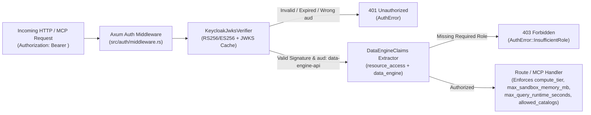

# Spec 16: Keycloak JWKS Authentication, Claims Gatekeeper & Service Auth (`src/auth/`)

- **Status**: `draft`
- **Source PRD**: [keycloak-claims-and-service-auth-prd.md](../prds/keycloak-claims-and-service-auth-prd.md)
- **Target Component**: `de-be-container` (`src/auth/`, `src/config.rs`, `src/web.rs`)

---

## 1. Objective

Implement OIDC Bearer token verification via Keycloak JWKS and domain-specific claims enforcement for all `data-engine` REST, Arrow Flight, and MCP endpoints, with **zero dev/fake auth bypasses** in any environment.

---

## 2. Architecture & Request Flow

---

## 3. Configuration & Error Handling Contract

### 3.1 `AuthConfig` (`src/auth/config.rs`, composed in `AppConfig`)
- `issuer_url: String` (e.g. `http://keycloak-keycloakx-http.auth.svc.cluster.local/auth/realms/sw-dev`) — non-empty, valid HTTP(S) URL.
- `jwks_url: String` — non-empty, valid HTTP(S) URL.
- `expected_audience: String` (default in YAML: `"data-engine-api"`) — non-empty.
- `jwks_cache_ttl_seconds: u64` — must be `> 0`.
- **Fail-fast validation**: `AuthConfig::validate()` rejects empty URLs, non-HTTP(S) schemes, empty `expected_audience`, or `jwks_cache_ttl_seconds == 0` at startup.
- **No dev/fake auth**: No `disable_auth` or `dev_bypass` flag is permitted in `AuthConfig`.

### 3.2 `AuthError` (`src/auth/error.rs`, `thiserror::Error`)
- `MissingBearerToken` $\rightarrow$ `401 Unauthorized`
- `InvalidToken(String)` $\rightarrow$ `401 Unauthorized`
- `JwksFetchFailed(String)` $\rightarrow$ `503 Service Unavailable`
- `InsufficientRole { required: String }` $\rightarrow$ `403 Forbidden`
- `CatalogAccessDenied { catalog: String }` $\rightarrow$ `403 Forbidden`
- `Config(#[from] ConfigError)`

---

## 4. Claims & Role Enforcement

### 4.1 `DataEngineClaims`
- `sub: String`
- `iss: String`
- `aud: Vec<String>` (must contain `expected_audience`)
- `resource_access["data-engine-api"].roles: Vec<String>`:
  - `profile:run` — required for profiling and join-probe endpoints.
  - `query:run` — required for DataFusion SQL validation/execution endpoints.
  - `compute:execute` — required for Python sandbox and `stat_*` analytics endpoints.
  - `dataset:admin` — required for connector registration, catalog mutations, and seeder/admin endpoints.
- `data_engine`:
  - `compute_tier: String`
  - `max_sandbox_memory_mb: u64` (caps per-request sandbox memory)
  - `max_query_runtime_seconds: u64` (caps per-request query/sandbox timeout)
  - `allowed_catalogs: Vec<String>` (enforced before DataFusion/connector access)

### 4.2 Public vs Protected Endpoints
- **Public**: HAMS health/metrics endpoints (`/health`, `/ready`, `/metrics` on `:8079` and `/api/v1/health`).
- **Protected**: All `/api/v1/...`, `/api/data-engine/v1/...`, and `/mcp/sse` routes require a valid Bearer token and the corresponding role.

---

## 5. TDD Test Strategy

### 5.1 Unit Tests (`de-be-container/src/auth/`)
1. `test_auth_config_validation_rejects_empty_or_invalid_urls`: Verifies fail-fast `AuthConfig::validate()`.
2. `test_jwks_verifier_validates_rs256_jwt_and_rejects_expired_or_wrong_audience`: Uses an ephemeral RSA keypair + mock JWKS endpoint (`wiremock` or local `axum` test server) to verify valid tokens, expired tokens (`401`), bad signatures (`401`), and wrong `aud` (`401`).
3. `test_claims_extractor_enforces_roles_and_allowed_catalogs`: Verifies `profile:run`, `query:run`, `compute:execute`, `dataset:admin` role checks (`403`) and `allowed_catalogs` enforcement.
4. `test_claims_quota_caps_sandbox_and_query_timeouts`: Verifies `max_sandbox_memory_mb` and `max_query_runtime_seconds` clamp request execution limits.

### 5.2 Integration Tests (`web::tests` & Robot Framework)
1. `test_protected_endpoints_reject_missing_or_invalid_bearer_token`: Calls `/api/v1/queries/execute`, `/api/v1/stat/describe`, and `/mcp/sse` without a token $\rightarrow$ `401`.
2. `test_protected_endpoints_enforce_role_matrix`: Calls endpoints with a valid JWT lacking the required role $\rightarrow$ `403`, and with the required role $\rightarrow$ `200`.
